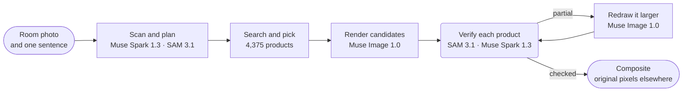

<p align="center">
  <a href="https://chanjoongx--realroom.us-east.modal.run">
    <picture>
      <source media="(prefers-color-scheme: dark)" srcset="docs/banner-dark.jpg">
      <source media="(prefers-color-scheme: light)" srcset="docs/banner-light.jpg">
      
    </picture>
  </a>
</p>

<h4 align="center">
  <a href="https://chanjoongx--realroom.us-east.modal.run">Live demo</a>
  &nbsp;·&nbsp;
  <a href="#how-a-run-works">How it works</a>
  &nbsp;·&nbsp;
  <a href="#demo-rooms">Demo rooms</a>
  &nbsp;·&nbsp;
  <a href="#run-it">Run it</a>
</h4>

<p align="center">
  <a href="https://cerebralvalley.ai/e/meta-ai-developer-hackathon"></a>
  <a href="#meta-models"></a>
  <a href="#meta-models"></a>
  <a href="#meta-models"></a>
  <a href="#meta-models"></a>
  <a href="LICENSE"></a>
</p>

> [!NOTE]
> Realroom is an entry in the [Meta Global AI Developer Hackathon](https://cerebralvalley.ai/e/meta-ai-developer-hackathon), Indie Developer track, under the problem statement "Build for Your World". The agent, the web app, the catalog index and the demo rooms were all made during the building period, October 27 to November 4, 2026.

<p align="center">
  <picture>
    <source media="(prefers-color-scheme: dark)" srcset="docs/built-on-dark.png">
    <source media="(prefers-color-scheme: light)" srcset="docs/built-on-light.png">
    
  </picture>
</p>

<p align="center">
  <a href="https://chanjoongx--realroom.us-east.modal.run"></a>
  <br>
  <sub>The living-room demo run, replayed in the app: scan, placement guide, verify, then the before and after slider.</sub>
</p>

Realroom is an agent built on Meta's models. You give it a room photo and one sentence about what you want. It reads the room, plans what to add or replace, searches 4,375 real products for pieces that fit the space, and renders them into the photo. Then it checks its own work. SAM 3.1 finds each product again in the render, Muse Spark 1.3 compares it with the product's catalog photo, and anything that came out wrong is redrawn. Only the new products, their shadows and the spots that were cleared come from the image model. Everything else is copied back from your original photo, and the page lets you verify that count in your own browser.

Try it at [chanjoongx--realroom.us-east.modal.run](https://chanjoongx--realroom.us-east.modal.run). The demo rooms replay recorded runs, and the upload box runs the whole agent on your own photo.

## Why

Room makeover generators draw a pleasant room, but the sofa in it is not one you can buy, nobody checked that it fits the wall, and the generator quietly repaints the walls, the floor and the view out of the window. If you rent, or you are shopping for one sofa, that picture answers the wrong question. Realroom keeps the room you have and changes only what you would actually buy. A furniture store can plug in its own catalog; the demo uses Amazon Berkeley Objects, a public set of real Amazon listings.

## Demo rooms


The demo rooms were generated with Muse Image 1.0, so this repository holds no private photos. Each row is one recorded run. The numbers come from that run's own `run.json` and `ledger.jsonl` in [`demo-runs/`](demo-runs).

| Room | Brief | Products | Matched | Untouched pixels | Time | Cost |
|---|---|---|---|---|---|---|
| Living room, 2005 apartment | "The old dark sofa makes the room feel gloomy. Make it brighter and cozier without painting or touching the floor." | sofa, rug, floor lamp | 3 of 3, the rug after one round of redraws | 70.1% | 206&nbsp;s | $0.25 |
| Empty room, move-in day | "Move-in day. I work from home and want a calm living room where two friends can sit: something to sit on, a rug, a small table and warm evening light." | loveseat, rug, floor lamp, coffee table, planter | 5 of 5, the coffee table after one round of redraws | 62.5% | 203&nbsp;s | $0.27 |
| Studio, first apartment | "...I still sleep on a mattress on the floor and the moving boxes are everywhere. Make it feel like a calm, grown-up bedroom without painting." | coverlet, rug, wall art | 3 of 3 | 67.9% | 150&nbsp;s | $0.18 |

"Matched" is Muse Spark 1.3's verdict on a close crop of each rendered product next to its catalog photo. Costs are estimates from Meta's published prices, logged per call.

## How a run works



| Step | Models | What happens |
|---|---|---|
| Scan and plan | Muse Spark 1.3, SAM 3.1 | One Spark request returns schema-constrained JSON: every movable object with a box and a decision (keep, remove or replace), the fixed structure, the room's size and light, and a plan of slots (kind, add or replace, target box, size range in cm, look, color family). SAM 3.1 turns the boxes into exact masks with concept prompts, and with box prompts for objects the concepts miss. |
| Search | catalog index, SigLIP 2 | For each slot: products of that kind, then only those whose real dimensions fit the slot's size range, ranked by text similarity to the Muse Spark Open description (45%) and SigLIP 2 text-to-image similarity (55%). 24 per slot. |
| Pick | Muse Spark 1.3 | Spark sees the room and a numbered sheet of candidates for every slot in a single request, so it chooses a set that works together. |
| Render | Muse Image 1.0 | One `/images/edits` call with the room, a placement guide and the real product photos returns two or three candidates. The model's web and image search tools are switched off. |
| Verify | SAM 3.1, Muse Spark 1.3 | Each candidate is aligned to the original (ECC homography) and color-matched. SAM 3.1 finds every new product again, and Spark judges each product crop against its catalog photo and the scene as a whole. The best candidate is kept. |
| Fix | Muse Image 1.0, SAM 3.1, Muse Spark 1.3 | A product judged partial is cut out with its surroundings and redrawn larger against its catalog photo, two tries per round and up to two rounds. A try replaces the current version only if Spark scores it higher, and Spark's notes steer the next round. Clutter the render left behind gets its own pass, checked with SAM 3.1. If anything changed, Spark judges the finished room again. |
| Composite | none | The result takes from the render only the product masks, a thin fringe around them, contact shadows and the footprints of removed objects. Every other pixel is the original. |

The web app replays each run from its event log: the scan with every outline, the search funnel, the pick sheets, all render candidates, each fix with its before and after, and the final layers.


Above is the verify step of the living-room run. Muse Image drew three candidates, Spark scored all three products in each, and candidate 1 was kept. Its rug scored 4 of 10, so it went on to the fix step and came back at 9.

## Meta models

| Model | Access | Used for |
|---|---|---|
| `muse-spark-1.3` | Meta Model API | reading the room and planning, picking products, judging every product and scene |
| `sam-3.1` | Meta Model API | masks of room objects and of every rendered product, checking what clutter is left |
| `muse-image-1.0` | Meta Model API | render candidates, redraws, clutter clearing, the demo rooms |
| Muse Spark Open | Baseten, Fireworks | tags and descriptions for the whole catalog |

## What you can check

- `before.png` and `after.png` are lossless. In the app, **Check it yourself** downloads both and compares them pixel by pixel in your browser, then shows the share that is identical.
- `layers.png` colors every changed pixel as product, cleared or shadow. `masks.npz` holds every object and product mask.
- `ledger.jsonl` lists every model call with its time and estimated cost.
- `drift.jpg` shows how far the raw render drifted from the original everywhere else (mean color difference dE 1.8 to 2.1 on the demo runs). Those pixels are the reason for the composite step.

## The catalog

[Amazon Berkeley Objects](https://amazon-berkeley-objects.s3.us-east-1.amazonaws.com/index.html) (ABO) is a public dataset of real Amazon product listings with photos and dimensions. `catalog/` builds the Realroom catalog from it:

1. `abo_catalog.py` sorts amazon.com listings into 25 kinds (sofa, rug, floor lamp, wall art and so on), which matches 5,931 of them. It converts sizes to centimeters and drops listings with no dimensions or implausible ones, leaving 4,612 candidates.
2. `modal_catalog.py --step score` and `abo_choose.py` pick one reference photo per product, preferring a clean cutout on white.
3. `modal_catalog.py --step fetch` downloads that photo once, in Modal's cloud, and trims it.
4. `modal_catalog.py --step tag` sends every photo with its listing to **Muse Spark Open**, Meta's open-weight model, served by Baseten (Fireworks as fallback). It returns a title, colors, materials, style, a visual description, a SAM phrase, a render-risk guess, and whether the photo really shows the listed product.
5. `modal_catalog.py --step embed` computes SigLIP 2 image embeddings.
6. `abo_finalize.py` writes `catalog.jsonl`: 4,375 products. It dropped 104 whose photo did not show the listed product and 133 that had no finished tag when the demo runs were recorded.

Muse Spark Open tagged 3,781 of the 4,375 on Baseten and 594 on Fireworks. The tags are in [`catalog/index/catalog.jsonl`](catalog/index/catalog.jsonl). Product photos are not in the repository (about 760 MB); the scripts above rebuild them.

A store with its own product feed would replace steps 1 to 3 with its own listings and photos. Search, pick, render and verify need only a kind, real dimensions and one clean photo per product, plus the tags and embeddings from steps 4 and 5.

## Run it

Python 3.12 and Node 20 or later. Put `MODEL_API_KEY=...` (Meta Model API) in a `.env` file in the repository root or any folder above it.

```bash
python -m venv .venv
.venv/bin/pip install torch==2.6.0 --index-url https://download.pytorch.org/whl/cpu
.venv/bin/pip install -r backend/requirements.txt
(cd web && npm ci && npm run build)

# one run on your own photo (needs the catalog with its photos in data/catalog)
.venv/bin/python backend/scripts/run_demo.py --room room.jpg --id my-room --brief "Warmer and less cluttered" \
    --mode refresh --slots 3 --catalog data/catalog --out demo-runs/my-room

# the web app with the recorded runs; --live also accepts uploads and calls the APIs
.venv/bin/python backend/scripts/serve_local.py --runs demo-runs --catalog data/catalog --port 8787
```

To rebuild the catalog, download the ABO listings and image metadata into `data/abo/`, then run the steps in [The catalog](#the-catalog). The Modal steps need a Modal account and, for tagging, `BASETEN_API_KEY` and `FIREWORKS_API_KEY` in a Modal secret named `realroom-keys`.

The hosted version runs on Modal (`backend/modal_app.py`): one web container, the catalog and the runs on two volumes, at most three live runs at a time, 40 live runs a day, three per visitor and 60 dollars of model calls in all. Uploaded photos are deleted within 24 hours.

## Limits

- Subtle textures are hard for the image model. A cream rug with a faint criss-cross weave came out too bold in some renders and plain in others. The fix loop catches this, and when no redraw scores higher the result says "partial" instead of hiding it.
- The plan changes between runs of the same brief, because Spark plans and picks again each time.
- Where a removed object stood, the redrawn floor can meet the original floor along a faint seam.
- The listings come from a dataset published in 2021, so there are no prices and some product links no longer open.
- Spark's room size is an estimate from things like door and bed sizes. It sets the size range for the search, but the render is not a measurement.

## Credits

- Product photos and data: Amazon Berkeley Objects by **Amazon.com**, licensed [CC BY 4.0](https://creativecommons.org/licenses/by/4.0/). Dataset by Matthieu Guillaumin, Thomas Dideriksen, Kenan Deng and Himanshu Arora (Amazon.com), Jasmine Collins and Jitendra Malik (UC Berkeley). Changes: photos were trimmed and resized, products were tagged by Muse Spark Open, and products are redrawn into room photos by Muse Image 1.0. Realroom is not affiliated with or endorsed by Amazon.
- Compute: Meta Model API credits from Meta, and credits from the hackathon's inference partners Baseten, Fireworks AI and Modal.
- [SigLIP 2](https://huggingface.co/google/siglip2-base-patch16-256) by Google, Apache 2.0.
- Fonts: Geist and Geist Mono (Vercel) and Instrument Serif, all under the SIL Open Font License.
- The demo rooms were generated with Muse Image 1.0.

Built by [Chanjoong Kim](https://github.com/chanjoongx). Code: MIT, see [LICENSE](LICENSE).
