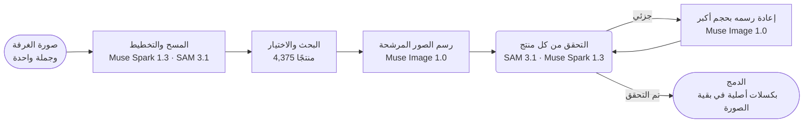

<p align="center">
  <a href="https://chanjoongx--realroom.us-east.modal.run">
    <picture>
      <source media="(prefers-color-scheme: dark)" srcset="../banner-dark.jpg">
      <source media="(prefers-color-scheme: light)" srcset="../banner-light.jpg">
      
    </picture>
  </a>
</p>

<h4 align="center">
  <a href="https://chanjoongx--realroom.us-east.modal.run">العرض الحي</a>
  &nbsp;·&nbsp;
  <a href="#how-a-run-works">كيف يعمل</a>
  &nbsp;·&nbsp;
  <a href="#demo-rooms">الغرف التجريبية</a>
  &nbsp;·&nbsp;
  <a href="#run-it">التشغيل</a>
  &nbsp;·&nbsp;
  <a href="#use-your-own-catalog">كتالوجك الخاص</a>
</h4>

<p align="center">
  <a href="https://cerebralvalley.ai/e/meta-ai-developer-hackathon"></a>
  <a href="#meta-models"></a>
  <a href="#meta-models"></a>
  <a href="#meta-models"></a>
  <a href="#meta-models"></a>
  <a href="#meta-models"></a>
  <a href="../../LICENSE"></a>
</p>

<p align="center">
  <a href="../../README.md">English</a>
  &nbsp;·&nbsp; <a href="README.ko.md">한국어</a>
  &nbsp;·&nbsp; <a href="README.ja.md">日本語</a>
  &nbsp;·&nbsp; <a href="README.es.md">Español</a>
  &nbsp;·&nbsp; <a href="README.pt-BR.md">Português</a>
  &nbsp;·&nbsp; <a href="README.fr.md">Français</a>
  &nbsp;·&nbsp; <a href="README.de.md">Deutsch</a>
  &nbsp;·&nbsp; <a href="README.hi.md">हिन्दी</a>
  &nbsp;·&nbsp; <b>العربية</b>
  &nbsp;·&nbsp; <a href="README.id.md">Indonesia</a>
</p>

<p align="center"><sub>هذه ترجمة عن <a href="../../README.md">ملف README الإنجليزي</a>. وإذا اختلف الملفان، فالملف الإنجليزي هو الصحيح.</sub></p>

> [!NOTE]
> يشارك Realroom في [Meta Global AI Developer Hackathon](https://cerebralvalley.ai/e/meta-ai-developer-hackathon) ضمن مسار Indie Developer، تحت بيان المشكلة «Build for Your World». وقد صُنع الوكيل وتطبيق الويب وفهرس الكتالوج والغرف التجريبية كلها خلال فترة البناء، من 27 أكتوبر إلى 4 نوفمبر 2026.
>
> يعيد التطبيق المستضاف عرض عمليات التشغيل الثلاث المسجّلة، ويشغّل الوكيل كاملًا مباشرةً على صورة مرفوعة، حتى 40 مرة في اليوم. وعلى جهازك، يعيد التطبيق نفسه عرض عمليات التشغيل دون مفتاح، أو يشغّل الوكيل مباشرةً بمفتاح Meta Model API الخاص بك. والطريقتان موضّحتان في قسم [التشغيل](#run-it).

<p align="center">
  <picture>
    <source media="(prefers-color-scheme: dark)" srcset="../built-on-dark.png">
    <source media="(prefers-color-scheme: light)" srcset="../built-on-light.png">
    
  </picture>
</p>

<p align="center">
  <a href="https://chanjoongx--realroom.us-east.modal.run"></a>
  <br>
  <sub>التشغيل التجريبي لغرفة المعيشة كما يُعاد عرضه في التطبيق: المسح، ودليل التموضع، والتحقق، ثم منزلق المقارنة بين قبل وبعد.</sub>
</p>

وكيل Realroom مبني على نماذج Meta. تعطيه صورة غرفة وجملة واحدة عمّا تريد، فيقرأ الغرفة، ويخطط لما سيضيفه أو يستبدله، ويبحث بين 4,375 منتجًا حقيقيًا عن قطع تناسب المساحة، ثم يرسمها داخل الصورة. بعد ذلك يراجع عمله بنفسه: يعثر SAM 3.1 على كل منتج من جديد في الصورة المولّدة، ويقارنه Muse Spark 1.3 بصورة المنتج في الكتالوج، ويُعاد رسم كل ما خرج على نحو خاطئ. لا يأتي من نموذج الصور إلا المنتجات الجديدة وظلالها والمواضع التي أُخليت. أما كل ما عدا ذلك فيُنسخ كما هو من صورتك الأصلية، وتتيح لك الصفحة أن تتحقق من هذا العدّ في متصفحك.

جرّبه على [chanjoongx--realroom.us-east.modal.run](https://chanjoongx--realroom.us-east.modal.run). تعيد الغرف التجريبية عرض عمليات تشغيل مسجّلة، أما مربع الرفع فيشغّل الوكيل كاملًا على صورتك أنت.

## لماذا

ترسم مولّدات تجديد الغرف غرفةً جميلة، لكن الأريكة فيها ليست أريكة يمكنك شراؤها، ولم يتحقق أحد من أنها تناسب الجدار، والمولّد يعيد بصمت رسم الجدران والأرضية والمنظر من النافذة. إذا كنت مستأجرًا، أو تتسوّق لشراء أريكة واحدة، فهذه الصورة تجيب عن السؤال الخطأ. يُبقي Realroom على الغرفة التي لديك، ولا يغيّر إلا ما ستشتريه فعلًا. ويمكن لمتجر أثاث أن يربط كتالوجه الخاص؛ أما العرض التجريبي فيستخدم Amazon Berkeley Objects، وهي مجموعة عامة من قوائم منتجات حقيقية على Amazon.

## <a id="demo-rooms"></a>الغرف التجريبية


وُلّدت الغرف التجريبية باستخدام Muse Image 1.0، لذا لا يحوي هذا المستودع أي صور خاصة. يمثّل كل صف تشغيلًا واحدًا مسجّلًا. وتأتي الأرقام من الملفين ‎`run.json`‎ و ‎`ledger.jsonl`‎ الخاصين بذلك التشغيل نفسه في [‎`demo-runs/`‎](../../demo-runs).

<div dir="rtl">

| الغرفة | الطلب | المنتجات | المطابقة | البكسلات غير المعدّلة | المدة | التكلفة |
|---|---|---|---|---|---|---|
| غرفة معيشة، شقة من عام 2005 | "The old dark sofa makes the room feel gloomy. Make it brighter and cozier without painting or touching the floor." | أريكة، سجادة، مصباح أرضي | تطابقت 3 من 3، والسجادة بعد جولة واحدة من إعادة الرسم | 70.3% | 216&nbsp;s | $0.24 |
| غرفة فارغة، يوم الانتقال | "Move-in day. I work from home and want a calm living room where two friends can sit: something to sit on, a rug, a small table and warm evening light." | أريكة، سجادة، مصباح أرضي، طاولة قهوة، أصيص نباتات | تطابقت 5 من 5، والسجادة بعد جولتين من إعادة الرسم، وطاولة القهوة بعد جولة واحدة | 63.3% | 288&nbsp;s | $0.37 |
| استوديو، أول شقة | "...I still sleep on a mattress on the floor and the moving boxes are everywhere. Make it feel like a calm, grown-up bedroom without painting." | هيكل سرير، مفارش سرير، سجادة | تطابقت 3 من 3، والسجادة بعد جولتين من إعادة الرسم | 70.7% | 244&nbsp;s | $0.30 |

</div>

«المطابقة» هي حكم Muse Spark 1.3 على اقتصاص مقرّب لكل منتج مرسوم، يوضع بجانب صورته في الكتالوج. أما التكاليف فتقديرات مبنية على أسعار Meta المعلنة، وتُسجَّل لكل استدعاء.

## <a id="how-a-run-works"></a>كيف يسير التشغيل



<div dir="rtl">

| الخطوة | النماذج | ما يحدث |
|---|---|---|
| المسح والتخطيط | Muse Spark 1.3, SAM 3.1 | يعيد طلب واحد إلى Spark استجابة JSON مقيّدة بمخطط: كل شيء قابل للنقل مع صندوق إحاطة وقرار بشأنه (إبقاء أو إزالة أو استبدال)، والبنية الثابتة، وحجم الغرفة وإضاءتها، وخطة من الخانات (النوع، إضافة أو استبدال، الصندوق المستهدف، نطاق الحجم بوحدة cm، المظهر، عائلة اللون). ويحوّل SAM 3.1 الصناديق إلى أقنعة دقيقة باستخدام مطالبات المفاهيم (concept prompts)، ومطالبات الصناديق (box prompts) للأشياء التي لا تلتقطها المفاهيم. |
| البحث | فهرس الكتالوج، PE-Core B16 | لكل خانة: منتجات ذلك النوع، ثم ما تقع أبعاده الحقيقية ضمن نطاق حجم الخانة فقط، مرتّبةً حسب التشابه النصي مع وصف Muse Spark Open (45%) والتشابه بين النص والصورة وفق Perception Encoder (55%). ويُختار 24 منتجًا لكل خانة. يعمل Perception Encoder داخل خادم التطبيق نفسه، فلا تُجري هذه الخطوة أي استدعاء API. |
| الاختيار | Muse Spark 1.3 | يرى Spark الغرفة ولوحة مرقّمة بالمرشحين لكل خانة في طلب واحد، فيختار مجموعة تنسجم قطعها معًا. |
| الرسم | Muse Image 1.0 | يُرسَل إلى ‎`/images/edits`‎ استدعاء واحد يضم الغرفة ودليل تموضع وصور المنتجات الحقيقية، فيعيد صورتين أو ثلاث صور مرشحة. وأدوات البحث في الويب والصور لدى النموذج معطّلة. |
| التحقق | SAM 3.1, Muse Spark 1.3 | تُحاذى كل صورة مرشحة مع الأصل (ECC homography) وتُطابَق ألوانها. يعثر SAM 3.1 مجددًا على كل منتج جديد، ويقيّم Spark اقتصاص كل منتج مقارنةً بصورته في الكتالوج، ويقيّم المشهد ككل. ويُحتفظ بأفضل صورة مرشحة. |
| الإصلاح | Muse Image 1.0, SAM 3.1, Muse Spark 1.3 | يُقتطع المنتج الذي حُكم عليه بأنه partial مع ما يحيط به، ويُعاد رسمه بحجم أكبر مقابل صورته في الكتالوج، بمحاولتين في كل جولة وحتى جولتين. ولا تحل المحاولة محل النسخة الحالية إلا إذا منحها Spark درجة أعلى، وتوجّه ملاحظات Spark الجولة التالية. أما الفوضى التي خلّفها الرسم فتُعالَج في تمريرة خاصة بها، ويُتحقق منها باستخدام SAM 3.1. وإذا تغيّر أي شيء، يعيد Spark الحكم على الغرفة المكتملة. |
| الدمج | لا شيء | لا تأخذ النتيجة من الصورة المولّدة إلا أقنعة المنتجات، وحافة رفيعة حولها، وظلال التلامس، ومواضع الأشياء المُزالة. وكل بكسل آخر هو البكسل الأصلي. |

</div>

يعيد تطبيق الويب عرض كل تشغيل من سجل أحداثه: المسح مع حدود كل شيء، وقمع البحث، ولوحات الاختيار، وكل الصور المرشحة، وكل إصلاح بحالتيه قبل وبعد، والطبقات النهائية. ويعرض عنوان كل خطوة معرّف النموذج الذي استدعته.


في الصورة أعلاه خطوة التحقق من تشغيل غرفة المعيشة. رسم Muse Image ثلاث صور مرشحة، وقيّم Spark المنتجات الثلاثة في كل منها، واحتُفظ بالصورة المرشحة رقم 2. نالت سجادتها 5 من 10، فانتقلت إلى خطوة الإصلاح وعادت بدرجة 9.

## <a id="meta-models"></a>نماذج Meta

<div dir="rtl">

| النموذج | طريقة الوصول | يُستخدم في |
|---|---|---|
| ‎`muse-spark-1.3`‎ | Meta Model API | قراءة الغرفة والتخطيط، واختيار المنتجات، والحكم على كل منتج وكل مشهد |
| ‎`sam-3.1`‎ | Meta Model API | أقنعة أشياء الغرفة وأقنعة كل منتج مرسوم، والتحقق مما بقي من فوضى |
| ‎`muse-image-1.0`‎ | Meta Model API | رسم الصور المرشحة، وإعادة الرسم، وإزالة الفوضى، والغرف التجريبية |
| Muse Spark Open | Baseten, Fireworks | الوسوم والأوصاف للكتالوج كله |
| ‎`pe-core-b16-224`‎ | أوزان مفتوحة، على خادم التطبيق (Modal، أو جهازك) | يطابق Perception Encoder مظهر كل خانة مع صور الكتالوج |

</div>

## ما يمكنك التحقق منه

- الملفان ‎`before.png`‎ و ‎`after.png`‎ محفوظان دون فقد في الجودة. في التطبيق، ينزّل زر **Check it in your browser** الملفين، ويقارنهما بكسلًا بكسلًا، ثم يعرض نسبة البكسلات المتطابقة.
- يلوّن ‎`layers.png`‎ كل بكسل متغيّر بحسب نوعه: منتج، أو موضع أُخلي، أو ظل. ويحوي ‎`masks.npz`‎ كل أقنعة الأشياء والمنتجات.
- يسرد ‎`ledger.jsonl`‎ كل استدعاء للنماذج مع وقته وتكلفته التقديرية. وبحث Perception Encoder مُدرج فيه أيضًا بلا تكلفة، لأنه يعمل على خادم التطبيق نفسه.
- يُظهر ‎`drift.jpg`‎ مدى انحراف الصورة المولّدة الخام عن الأصل في كل المواضع الأخرى (متوسط فرق اللون dE من 1.7 إلى 3.7 في عمليات التشغيل التجريبية). وهذه البكسلات هي سبب وجود خطوة الدمج.

## <a id="run-it"></a>التشغيل

تحتاج إلى Python 3.12، وكذلك Node 20 أو أحدث لبناء تطبيق الويب. ثبّت ما يلزم مرة واحدة:

```bash
python -m venv .venv
.venv/bin/pip install torch==2.6.0 torchvision==0.21.0 --index-url https://download.pytorch.org/whl/cpu
.venv/bin/pip install -r backend/requirements.txt
(cd web && npm ci && npm run build)
```

على Windows، اكتب ‎`.venv\Scripts\`‎ بدل ‎`.venv/bin/`‎ في هذه الأوامر.

### إعادة عرض عمليات التشغيل المسجّلة (بلا مفتاح)

```bash
.venv/bin/python backend/scripts/serve_local.py
```

افتح http://127.0.0.1:8787. تعيد الغرف التجريبية عرض عمليات التشغيل الموجودة في [‎`demo-runs/`‎](../../demo-runs) خطوة بخطوة، كما في التطبيق المستضاف. لا يُستدعى أي نموذج. وصور المنتجات التي تعرضها عمليات التشغيل هذه موجودة في ‎`demo-runs/_photos`‎، ويُظهر مربع الرفع أن التشغيل المباشر متوقف.

### التشغيل المباشر بمفتاح Meta Model API الخاص بك

1. انسخ ‎`.env.example`‎ إلى ‎`.env`‎ في جذر المستودع واملأ ‎`MODEL_API_KEY`‎. ويتجاهل git الملف ‎`.env`‎.
2. نزّل صور جميع المنتجات البالغ عددها 4,375 إلى ‎`data/photos`‎. وهي ملف واحد حجمه نحو 730 MB ضمن إصدار هذا المستودع على GitHub.
   ```bash
   .venv/bin/python catalog/get_photos.py
   ```
3. نزّل أوزان Perception Encoder مرة واحدة (‎`timm/PE-Core-B-16`‎ على Hugging Face، بحجم 1.8 GB تقريبًا). وإن تخطيت هذه الخطوة، فسينتظر أول بحث مباشر التنزيل نفسه.
   ```bash
   .venv/bin/python -c "import open_clip; open_clip.create_model_and_transforms('PE-Core-B-16', pretrained='meta')"
   ```
4. شغّل الخادم مع ‎`--live`‎:
   ```bash
   .venv/bin/python backend/scripts/serve_local.py --live
   ```

الخيار ‎`--live`‎ هو كل ما يفصل بين إعادة العرض والتشغيل المباشر. ومعه يشغّل مربع الرفع الوكيل كاملًا على صورتك، وتتابع الصفحة التشغيل أثناء عمله. يكلّف التشغيل الواحد بين $0.2 و $0.4 تقريبًا بأسعار Meta المعلنة، ويسرد ملف ‎`ledger.jsonl`‎ الخاص به كل استدعاء. ولا يبدأ الخادم المحلي أكثر من 10 عمليات تشغيل مباشر في اليوم؛ ويمكن تغيير ذلك بالخيار ‎`--per-day`‎.

لتشغيل الوكيل على صورة واحدة دون تطبيق الويب:

```bash
.venv/bin/python backend/scripts/run_demo.py --room room.jpg --id my-room --brief "Warmer and less cluttered" \
    --mode refresh --slots 3 --catalog catalog/index --photos data/photos --out demo-runs/my-room
```

استخدم ‎`--mode furnish`‎ للغرفة الفارغة. وما دام ‎`serve_local.py`‎ يعمل، يُعاد عرض التشغيل المكتمل على http://127.0.0.1:8787/r/my-room.

### إعادة بناء الكتالوج أو استضافة التطبيق

لإعادة بناء الكتالوج، نزّل قوائم ABO والبيانات الوصفية لصورها إلى ‎`data/abo/`‎، ثم نفّذ الخطوات الواردة في قسم [الكتالوج](#the-catalog). تحتاج خطوات Modal إلى حساب على Modal، وتحتاج خطوة الوسم أيضًا إلى ‎`BASETEN_API_KEY`‎ و ‎`FIREWORKS_API_KEY`‎ في Modal secret باسم ‎`realroom-keys`‎.

تعمل النسخة المستضافة على Modal (‎`backend/modal_app.py`‎): حاوية ويب واحدة، والكتالوج وعمليات التشغيل على وحدتي تخزين (volumes)، وثلاث عمليات تشغيل مباشر على الأكثر في الوقت نفسه، و 40 عملية تشغيل مباشر في اليوم، وثلاث لكل زائر، و 60 دولارًا من استدعاءات النماذج في المجموع. وتُحذف الصور المرفوعة خلال 24 ساعة.

## <a id="the-catalog"></a>الكتالوج

مجموعة البيانات العامة [Amazon Berkeley Objects](https://amazon-berkeley-objects.s3.us-east-1.amazonaws.com/index.html) (ABO) تضم قوائم منتجات حقيقية من Amazon مع صورها وأبعادها. ومنها يبني المجلد ‎`catalog/`‎ كتالوج Realroom:

1. يصنّف ‎`abo_catalog.py`‎ قوائم amazon.com في 25 نوعًا (أريكة، سجادة، مصباح أرضي، لوحة جدارية، وما إلى ذلك)، فيطابق منها 5,931 قائمةً. ثم يحوّل المقاسات إلى السنتيمتر ويستبعد القوائم التي لا أبعاد لها أو التي أبعادها غير معقولة، فيبقى 4,612 مرشحًا.
2. يختار ‎`modal_catalog.py --step score`‎ و ‎`abo_choose.py`‎ صورة مرجعية واحدة لكل منتج، ويفضّلان الصورة المفرّغة النظيفة على خلفية بيضاء.
3. ينزّل ‎`modal_catalog.py --step fetch`‎ تلك الصورة مرة واحدة، في سحابة Modal، ويقصّ حوافها الزائدة.
4. يرسل ‎`modal_catalog.py --step tag`‎ كل صورة مع قائمتها إلى **Muse Spark Open**، نموذج Meta مفتوح الأوزان، الذي يعمل على Baseten (مع Fireworks بديلًا احتياطيًا). فيعيد عنوانًا، وألوانًا، وخامات، وطرازًا، ووصفًا بصريًا، وعبارة SAM، وتقديرًا لمخاطر الرسم، وما إذا كانت الصورة تُظهر فعلًا المنتج المدرج في القائمة.
5. يحسب ‎`modal_catalog.py --step embed`‎ تضمين كل صورة باستخدام Perception Encoder من Meta (PE-Core B16-224) على وحدات CPU في Modal.
6. يكتب ‎`abo_finalize.py`‎ الملف ‎`catalog.jsonl`‎ الذي يضم 4,375 منتجًا. وقد استبعد 104 منتجات لا تُظهر صورها المنتج المدرج في القائمة، و 133 منتجًا لم يكتمل وسمها عند تسجيل عمليات التشغيل التجريبية.

من بين المنتجات البالغ عددها 4,375، أضاف Muse Spark Open الوسوم إلى 3,781 منتجًا على Baseten و 594 على Fireworks. والوسوم موجودة في [‎`catalog/index/catalog.jsonl`‎](../../catalog/index/catalog.jsonl). ولا يضم المستودع إلا صور المنتجات التي تظهر في عمليات التشغيل التجريبية. أما المجموعة الكاملة فهي ملف واحد ضمن إصدار المستودع على GitHub (انظر قسم [التشغيل](#run-it))، والخطوات أعلاه تعيد بناءها من ABO.

## <a id="use-your-own-catalog"></a>استخدام كتالوجك الخاص

لا يعتمد الوكيل نفسه على ABO. فهو يقرأ مجلد كتالوج (‎`--catalog`‎) يحتوي على ‎`catalog.jsonl`‎ وملفين من Perception Encoder، ومجلد صور (‎`--photos`‎) يحتوي على ‎`img/<id>.jpg`‎ و ‎`thumb/<id>.webp`‎ لكل منتج. وهذا هو السطر الأول من [‎`catalog/index/catalog.jsonl`‎](../../catalog/index/catalog.jsonl) بعد اختصاره:

```json
{
  "id": "B075QFCHM9",
  "kind": "bed",
  "name": "Rivet York Modern Extended Platform Queen Bed, 90.2\"L, Grey",
  "brand": "Rivet",
  "size_cm": {"w": 229.0, "d": 182.9, "h": 107.5},
  "url": "https://www.amazon.com/dp/B075QFCHM9",
  "cutout": true,
  "tag": {
    "title": "Light Grey Upholstered Platform Bed",
    "matches_listing": true,
    "colors": ["light grey", "white", "light brown"],
    "color_family": "grey",
    "materials": ["polyester", "fabric", "wood"],
    "style": ["modern", "minimal", "contemporary"],
    "render_risk": "low",
    "sam_phrase": "platform bed",
    "visual_description": "Low-profile light grey polyester platform bed with tall rectangular headboard, extended surround frame and tapered wood legs shown with white mattress."
  }
}
```

- الحقل ‎`kind`‎ هو أحد الأسماء الواردة في ‎`KINDS`‎ ضمن ‎`backend/realroom/catalog.py`‎. وتطلب الخطة كل خانة بنوعها.
- الحقل ‎`size_cm`‎ هو العرض والعمق والارتفاع. ولا يصل المنتج إلى القائمة المختصرة إلا إذا كانت أبعاده ضمن نطاق حجم الخانة.
- الحقل ‎`tag`‎ هو ما كتبه Muse Spark Open في الخطوة 4. يقرأ البحث النصي منه العنوان والألوان والخامات والطراز والوصف، ويعثر SAM 3.1 على المنتج المرسوم بواسطة ‎`sam_phrase`‎ الخاص به، أما المنتج الذي فيه ‎`"matches_listing": false`‎ فلا يُعرض أبدًا. وفي غياب الوسم يرجع الوكيل إلى ‎`name`‎ و ‎`kind`‎.
- الحقل ‎`cutout`‎ يميّز الصورة التي تُظهر المنتج وحده على خلفية سادة. ويرفع البحث ترتيب هذه الصور.
- الملف ‎`emb_pe_core_b16.npy`‎ يحوي تضمينًا واحدًا من Perception Encoder لكل صورة منتج، بترتيب ‎`emb_pe_core_b16_ids.json`‎. وتكتب الخطوة 5 الملفين كليهما. ومن دونهما يرتّب البحث بالنص وحده.

تبني السكربتات الموجودة في ‎`catalog/`‎ هذا المجلد من ABO. وإن كان لديك مصدر منتجات آخر، فالخطوات من 1 إلى 3 هي ما يجب إعادة كتابته، لأنها تحوّل قوائم ABO إلى صفوف وصور. ثم وجّه ‎`serve_local.py`‎ أو ‎`run_demo.py`‎ إلى المجلدات الجديدة باستخدام ‎`--catalog`‎ و ‎`--photos`‎.

## بنية المستودع

```text
backend/
  realroom/      the agent: scan.py, pick.py, render.py, verify.py, composite.py and pipeline.py,
                 catalog.py (search), meta.py (Meta Model API clients), server.py (API and site)
  scripts/       serve_local.py, run_demo.py, make_rooms.py (the demo rooms), pack_demo_photos.py
  modal_app.py   the hosted app on Modal
catalog/         the catalog build from ABO, steps 1 to 6, plus get_photos.py and pack_photos.py
  index/         catalog.jsonl (4,375 products) and the Perception Encoder embeddings
demo-runs/       the three recorded runs (run.json, ledger.jsonl, masks and images) and their product photos
web/             the React app (Vite): the home page, the run viewer and the pixel check
docs/            README images and translations
```

## القيود

- الملامس الدقيقة صعبة على نموذج الصور. فقد خرجت سجادة بلون كريمي ذات نسج متقاطع خافت بنقش أبرز مما ينبغي في بعض الصور المولّدة، وسادةً في صور أخرى. وتلتقط حلقة الإصلاح ذلك، وحين لا تنال أي إعادة رسم درجة أعلى، تُظهر النتيجة «partial» بدل أن تخفي الأمر.
- تتغيّر الخطة من تشغيل إلى آخر للطلب نفسه، لأن Spark يخطط ويختار من جديد في كل مرة.
- في الموضع الذي كان فيه شيء أُزيل، قد تلتقي الأرضية المعاد رسمها بالأرضية الأصلية عند خط التقاء باهت.
- القوائم مأخوذة من مجموعة بيانات نُشرت عام 2021، لذا لا توجد أسعار، وبعض روابط المنتجات لم تعد تعمل.
- حجم الغرفة عند Spark تقدير مستنتج من أشياء مثل مقاسات الأبواب والأسرّة. وهو يحدد نطاق الحجم في البحث، لكن الصورة المولّدة ليست قياسًا.

## شكر وإسناد

- صور المنتجات وبياناتها: Amazon Berkeley Objects من **Amazon.com**، بترخيص [CC BY 4.0](https://creativecommons.org/licenses/by/4.0/). مجموعة البيانات من إعداد Matthieu Guillaumin و Thomas Dideriksen و Kenan Deng و Himanshu Arora (Amazon.com)، و Jasmine Collins و Jitendra Malik (UC Berkeley). التعديلات: قُصّت الصور وغُيّر حجمها، وأضاف Muse Spark Open الوسوم إلى المنتجات، ويعيد Muse Image 1.0 رسم المنتجات داخل صور الغرف. ولا يتبع Realroom شركة Amazon، ولا يحظى بتأييدها.
- الحوسبة: أرصدة Meta Model API من Meta، وأرصدة من شركاء الاستدلال في الهاكاثون: Baseten و Fireworks AI و Modal.
- Built with Muse Spark Open. صدرت أوزانه بموجب [Muse Model License](https://huggingface.co/meta-models/Muse-Spark-Open-816B-A42B)، ويستدعي Realroom النموذج عبر Baseten و Fireworks AI لوسم الكتالوج.
- نموذج [Perception Encoder](https://github.com/facebookresearch/perception_models) (PE-Core B16-224) من Meta FAIR، بترخيص Apache 2.0، ويُحمَّل عبر [OpenCLIP](https://github.com/mlfoundations/open_clip) من الأوزان ‎`timm/PE-Core-B-16`‎.
- مكتبات Python: FastAPI (MIT)، و Uvicorn (BSD-3-Clause)، و NumPy و SciPy (BSD)، و OpenCV (Apache 2.0)، و Pillow (MIT-CMU)، و scikit-image (BSD-3-Clause)، و PyTorch و torchvision (BSD-3-Clause)، و OpenCLIP (MIT)، و timm (Apache 2.0)، و Requests (Apache 2.0)، و python-multipart (Apache 2.0)، وعميل Modal (Apache 2.0)، و ‎`meta-sam-parser`‎ من Meta (SAM License). أما OpenAI Python SDK (Apache 2.0) فهو العميل الذي تعرضه وثائق API لدى Meta للعمل مع Meta Model API؛ ولا يتصل هنا بأي عنوان غير api.meta.ai.
- مكتبات الويب: React و Vite و Motion (MIT)، وأيقونات Lucide (ISC)، و TypeScript (Apache 2.0).
- الخطوط: Geist و Geist Mono (Vercel) و Instrument Serif، وكلها بترخيص SIL Open Font License.
- وُلّدت الغرف التجريبية باستخدام Muse Image 1.0.

من تطوير [Chanjoong Kim](https://github.com/chanjoongx). الشيفرة: MIT، انظر [LICENSE](../../LICENSE).
