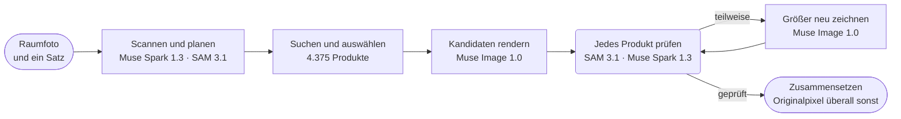

<p align="center">
  <a href="https://chanjoongx--realroom.us-east.modal.run">
    <picture>
      <source media="(prefers-color-scheme: dark)" srcset="../banner-dark.jpg">
      <source media="(prefers-color-scheme: light)" srcset="../banner-light.jpg">
      
    </picture>
  </a>
</p>

<h4 align="center">
  <a href="https://chanjoongx--realroom.us-east.modal.run">Live-Demo</a>
  &nbsp;·&nbsp;
  <a href="#how-a-run-works">Funktionsweise</a>
  &nbsp;·&nbsp;
  <a href="#demo-rooms">Demo-Räume</a>
  &nbsp;·&nbsp;
  <a href="#run-it">Ausführen</a>
  &nbsp;·&nbsp;
  <a href="#use-your-own-catalog">Eigener Katalog</a>
</h4>

<p align="center">
  <a href="https://cerebralvalley.ai/e/meta-ai-developer-hackathon"></a>
  <a href="#meta-models"></a>
  <a href="#meta-models"></a>
  <a href="#meta-models"></a>
  <a href="#meta-models"></a>
  <a href="#meta-models"></a>
  <a href="https://github.com/chanjoongx/realroom/actions/workflows/ci.yml"></a>
  <a href="../../LICENSE"></a>
</p>

<p align="center">
  <a href="../../README.md">English</a>
  &nbsp;·&nbsp; <a href="README.ko.md">한국어</a>
  &nbsp;·&nbsp; <a href="README.ja.md">日本語</a>
  &nbsp;·&nbsp; <a href="README.es.md">Español</a>
  &nbsp;·&nbsp; <a href="README.pt-BR.md">Português</a>
  &nbsp;·&nbsp; <a href="README.fr.md">Français</a>
  &nbsp;·&nbsp; <b>Deutsch</b>
  &nbsp;·&nbsp; <a href="README.hi.md">हिन्दी</a>
  &nbsp;·&nbsp; <a href="README.ar.md">العربية</a>
</p>

<p align="center"><sub>Dies ist eine Übersetzung der <a href="../../README.md">englischen README</a>. Weichen die beiden voneinander ab, gilt die englische Fassung.</sub></p>

> [!NOTE]
> Realroom ist ein Beitrag zum [Meta Global AI Developer Hackathon](https://cerebralvalley.ai/e/meta-ai-developer-hackathon) im Track Indie Developer, zur Aufgabenstellung „Build for Your World“. Der Agent, die Web-App, der Katalogindex und die Demo-Räume sind alle in der Entwicklungsphase vom 27. Oktober bis 4. November 2026 entstanden.
>
> Die gehostete App spielt die drei aufgezeichneten Läufe ab und führt den ganzen Agenten live mit einem hochgeladenen Foto aus, bis zu 40-mal am Tag. Auf deinem eigenen Rechner spielt dieselbe App die Läufe ohne Schlüssel ab oder läuft live mit deinem eigenen Schlüssel für die Meta Model API. Beide Wege stehen unter [Ausführen](#run-it).

<p align="center">
  <picture>
    <source media="(prefers-color-scheme: dark)" srcset="../built-on-dark.png">
    <source media="(prefers-color-scheme: light)" srcset="../built-on-light.png">
    
  </picture>
</p>

<p align="center">
  <a href="https://chanjoongx--realroom.us-east.modal.run"></a>
  <br>
  <sub>Der Demo-Lauf im Wohnzimmer, in der App abgespielt: Scan, Platzierungsvorlage, Prüfen, dann der Vorher-nachher-Regler.</sub>
</p>

Realroom ist ein Agent, der auf den Modellen von Meta aufbaut. Du gibst ihm ein Foto deines Zimmers und einen Satz dazu, was du dir wünschst. Er analysiert den Raum, plant, was hinzukommen oder ersetzt werden soll, sucht unter 4.375 echten Produkten nach Stücken, die in den Raum passen, und rendert sie ins Foto. Danach prüft er seine eigene Arbeit. SAM 3.1 findet jedes Produkt im Rendering wieder, Muse Spark 1.3 vergleicht es mit dem Katalogfoto des Produkts, und alles, was nicht gelungen ist, wird neu gezeichnet. Nur die neuen Produkte, ihre Schatten und die freigeräumten Stellen kommen vom Bildmodell. Alles andere wird aus deinem Originalfoto zurückkopiert, und auf der Seite kannst du das in deinem eigenen Browser nachzählen.

Probier es unter [chanjoongx--realroom.us-east.modal.run](https://chanjoongx--realroom.us-east.modal.run) aus. Die Demo-Räume spielen aufgezeichnete Läufe ab, und das Upload-Feld führt den ganzen Agenten mit deinem eigenen Foto aus.

## Warum

Generatoren für Raum-Makeovers zeichnen ein hübsches Zimmer, aber das Sofa darin kannst du nicht kaufen, niemand hat geprüft, ob es an die Wand passt, und der Generator malt stillschweigend die Wände, den Boden und den Blick aus dem Fenster neu. Wenn du zur Miete wohnst oder nur ein Sofa suchst, beantwortet so ein Bild die falsche Frage. Realroom lässt dein Zimmer, wie es ist, und ändert nur das, was du tatsächlich kaufen würdest. Ein Möbelhändler kann seinen eigenen Katalog anbinden; die Demo nutzt Amazon Berkeley Objects, einen öffentlichen Datensatz echter Amazon-Listings.

## <a id="demo-rooms"></a>Demo-Räume


Die Demo-Räume wurden mit Muse Image 1.0 erzeugt, daher enthält dieses Repository keine privaten Fotos. Jede Zeile ist ein aufgezeichneter Lauf. Die Zahlen stammen aus den eigenen Dateien `run.json` und `ledger.jsonl` des jeweiligen Laufs in [`demo-runs/`](../../demo-runs).

| Raum | Vorgabe | Produkte | Übereinstimmung | Unveränderte Pixel | Dauer | Kosten |
|---|---|---|---|---|---|---|
| Wohnzimmer, Wohnung von 2005 | "The old dark sofa makes the room feel gloomy. Make it brighter and cozier without painting or touching the floor." | Sofa, Teppich, Stehlampe | 3 von 3, die Stehlampe nach einer Runde Neuzeichnen | 68,7 % | 433&nbsp;s | $0.39 |
| Leeres Zimmer, Einzugstag | "Move-in day. I work from home and want a calm living room where two friends can sit: something to sit on, a rug, a small table and warm evening light." | Sofa, Teppich, Stehlampe, Couchtisch, Pflanzkübel | 5 von 5, der Teppich und die Stehlampe nach je einer Runde Neuzeichnen | 63,6 % | 384&nbsp;s | $0.58 |
| Einzimmerwohnung, die erste eigene | "...I still sleep on a mattress on the floor and the moving boxes are everywhere. Make it feel like a calm, grown-up bedroom without painting." | Bettwäsche, Teppich, Wandbild | 3 von 3, die Bettwäsche nach einer Runde Neuzeichnen | 67,5 % | 477&nbsp;s | $0.40 |

„Übereinstimmung“ zählt ein Produkt, wenn mindestens zwei von drei getrennten Prüfungen seiner endgültigen Pixel durch Muse Spark 1.3 „match“ ergeben. Jede Prüfung legt einen engen Ausschnitt des Produkts neben sein Katalogfoto, und die App listet alle drei Urteile auf. Die Kosten sind Schätzungen nach den veröffentlichten Preisen von Meta, pro Aufruf protokolliert.

## <a id="how-a-run-works"></a>So funktioniert ein Lauf



| Schritt | Modelle | Was passiert |
|---|---|---|
| Scannen und planen | Muse Spark 1.3, SAM 3.1 | Eine Spark-Anfrage liefert schemakonformes JSON: jedes bewegliche Objekt mit Box und Entscheidung (behalten, entfernen oder ersetzen), die festen Bauteile, Größe und Licht des Raums sowie einen Plan aus Slots (Art, hinzufügen oder ersetzen, Zielbox, Größenbereich in cm, Optik, Farbfamilie). SAM 3.1 macht aus den Boxen exakte Masken, mit Konzept-Prompts und für Objekte, die die Konzepte nicht erfassen, mit Box-Prompts. |
| Suchen | Katalogindex, PE-Core B16 | Für jeden Slot: Produkte dieser Art, davon nur die, deren echte Maße in den Größenbereich des Slots passen, sortiert nach Textähnlichkeit zur Beschreibung von Muse Spark Open (45 %) und Text-zu-Bild-Ähnlichkeit per Perception Encoder (55 %). 24 pro Slot. Der Perception Encoder läuft im eigenen Server der App, daher macht dieser Schritt keinen API-Aufruf. |
| Auswählen | Muse Spark 1.3 | Spark sieht in einer einzigen Anfrage den Raum und für jeden Slot ein nummeriertes Blatt mit Kandidaten und wählt deshalb eine Kombination, die zusammenpasst. |
| Rendern | Muse Image 1.0 | Ein Aufruf von `/images/edits` mit dem Raum, einer Platzierungsvorlage und den echten Produktfotos liefert zwei oder drei Kandidaten. Die Tools des Modells für Web- und Bildsuche sind abgeschaltet. |
| Prüfen | SAM 3.1, Muse Spark 1.3 | Jeder Kandidat wird am Original ausgerichtet (ECC-Homographie) und farblich angeglichen. SAM 3.1 findet jedes neue Produkt wieder, und Spark bewertet jeden Produktausschnitt im Vergleich zu seinem Katalogfoto und dazu die Szene als Ganzes. Der beste Kandidat wird behalten. Danach prüft Spark jedes seiner Produkte noch dreimal, jede Prüfung als eigene Anfrage mit einem engen Ausschnitt neben dem Katalogfoto. Sparks Urteil über dieselben Pixel kann sich von Anfrage zu Anfrage ändern, deshalb zählt ein Produkt nur dann als Übereinstimmung, wenn mindestens zwei der drei „match“ ergeben. |
| Korrigieren | Muse Image 1.0, SAM 3.1, Muse Spark 1.3 | Ein Produkt, das die Prüfungen als „partial“ einstufen, wird samt Umgebung ausgeschnitten und anhand seines Katalogfotos größer neu gezeichnet, mit zwei Versuchen pro Runde und bis zu zwei Runden. Ein Produkt, das die Prüfungen an seiner geplanten Stelle nicht finden, wird zuerst im ganzen Foto gesucht, weil das Rendering es manchmal woanders zeichnet; erst wenn es auch dort fehlt, wird es auf dieselbe Weise an seiner geplanten Stelle eingefügt. Ein Versuch ersetzt die aktuelle Version nur, wenn Spark ihn höher bewertet, und die Anmerkungen von Spark steuern die nächste Runde. Ein neu gezeichnetes Produkt wird, ebenso wie jedes Produkt, dessen eigene Pixel ein späterer Schritt verändert hat, auf dem fertigen Foto erneut dreimal geprüft. Kram, den das Rendering übrig gelassen hat, bekommt einen eigenen Durchgang, geprüft mit SAM 3.1. Hat sich etwas geändert, bewertet Spark den fertigen Raum noch einmal. |
| Zusammensetzen | keine | Das Ergebnis übernimmt aus dem Rendering nur die Produktmasken, einen schmalen Rand darum, Kontaktschatten und die Stellflächen entfernter Objekte. Alle übrigen Pixel stammen aus dem Original. |

Die Web-App spielt jeden Lauf aus seinem Event-Log ab: den Scan mit allen Umrissen, den Suchtrichter, die Auswahlblätter, alle Render-Kandidaten, jede Korrektur mit ihrem Vorher und Nachher und die finalen Ebenen. Die Kopfzeile jedes Schritts zeigt die ID des Modells, das er aufgerufen hat.


Oben siehst du den Prüfschritt des Wohnzimmer-Laufs. Muse Image hat drei Kandidaten gezeichnet, Spark hat in jedem alle drei Produkte bewertet, und Kandidat 1 wurde behalten. Seine Stehlampe erhielt 5 von 10, und drei getrennte Prüfungen gaben ihr jeweils 6, deshalb kam sie in den Korrekturschritt und kehrte mit 9 zurück.

## <a id="meta-models"></a>Meta-Modelle

| Modell | Zugriff | Verwendet für |
|---|---|---|
| `muse-spark-1.3` | Meta Model API | Raum analysieren und planen, Produkte auswählen, jedes Produkt und jede Szene bewerten |
| `sam-3.1` | Meta Model API | Masken der Objekte im Raum und jedes gerenderten Produkts, prüfen, welcher Kram übrig ist |
| `muse-image-1.0` | Meta Model API | Render-Kandidaten, Neuzeichnungen, Kram entfernen, die Demo-Räume |
| Muse Spark Open | Baseten, Fireworks | Tags und Beschreibungen für den ganzen Katalog |
| `pe-core-b16-224` | offene Gewichte, im Server der App (Modal oder dein Rechner) | Perception Encoder: gleicht die Optik jedes Slots mit den Katalogfotos ab |

## Was du prüfen kannst

- `before.png` und `after.png` sind verlustfrei. In der App lädt **Check it in your browser** beide herunter, vergleicht sie in deinem Browser Pixel für Pixel und zeigt dann den Anteil, der identisch ist.
- `layers.png` färbt jedes geänderte Pixel als Produkt, freigeräumte Fläche oder Schatten ein. `masks.npz` enthält jede Objekt- und Produktmaske.
- In `run.json` nennt das Urteil jedes Produkts die drei Schlussprüfungen, nach denen es gezählt wurde, und daneben das Urteil, das ihm der Prüf- oder Korrekturschritt gegeben hat.
- `ledger.jsonl` listet jeden Modellaufruf mit Zeit und geschätzten Kosten auf. Die Suche mit dem Perception Encoder steht auch darin, ohne Kosten, weil sie im eigenen Server der App läuft.
- `drift.jpg` zeigt, wie weit das rohe Rendering überall sonst vom Original abgewichen ist (mittlere Farbabweichung dE 1,8 bis 2,7 bei den Demo-Läufen). Wegen dieser Pixel gibt es den Schritt Zusammensetzen.

## <a id="run-it"></a>Ausführen

Du brauchst Python 3.12 und für den Web-Build Node 20 oder neuer. Einmalig installieren:

```bash
python -m venv .venv
.venv/bin/pip install torch==2.6.0 torchvision==0.21.0 --index-url https://download.pytorch.org/whl/cpu
.venv/bin/pip install -r backend/requirements.txt
(cd web && npm ci && npm run build)
```

Unter Windows schreibst du `.venv\Scripts\` dort, wo in diesen Befehlen `.venv/bin/` steht.

### Aufgezeichnete Läufe abspielen (ohne Schlüssel)

```bash
.venv/bin/python backend/scripts/serve_local.py
```

Öffne http://127.0.0.1:8787. Die Demo-Räume spielen die Läufe in [`demo-runs/`](../../demo-runs) Schritt für Schritt ab, wie in der gehosteten App. Es wird kein Modell aufgerufen. Die Produktfotos, die diese Läufe zeigen, liegen in `demo-runs/_photos`, und das Upload-Feld meldet, dass Live-Läufe ausgeschaltet sind.

### Live-Läufe mit deinem eigenen Schlüssel für die Meta Model API

1. Kopiere `.env.example` im Wurzelverzeichnis des Repositorys nach `.env` und trag `MODEL_API_KEY` ein. git ignoriert `.env`.
2. Lade die Fotos aller 4.375 Produkte nach `data/photos` herunter. Sie liegen als eine Datei von etwa 730 MB im GitHub-Release dieses Repositorys.
   ```bash
   .venv/bin/python catalog/get_photos.py
   ```
3. Lade einmal die Gewichte für den Perception Encoder herunter (`timm/PE-Core-B-16` auf Hugging Face, etwa 1,8 GB). Wenn du das überspringst, wartet die erste Live-Suche auf denselben Download.
   ```bash
   .venv/bin/python -c "import open_clip; open_clip.create_model_and_transforms('PE-Core-B-16', pretrained='meta')"
   ```
4. Starte den Server mit `--live`:
   ```bash
   .venv/bin/python backend/scripts/serve_local.py --live
   ```

`--live` ist der einzige Schalter zwischen Wiedergabe und Live-Betrieb. Damit führt das Upload-Feld den ganzen Agenten mit deinem Foto aus, und die Seite verfolgt den Lauf, während er arbeitet. Ein Lauf kostet zu den veröffentlichten Preisen von Meta etwa $0.2 bis $0.5, und seine `ledger.jsonl` listet jeden Aufruf auf. Der lokale Server startet höchstens 10 Live-Läufe pro Tag; `--per-day` ändert das. Ein Lauf, der 12 Minuten oder $0.60 überschreitet, lässt die restlichen Neuzeichnungen aus und endet mit dem, was er hat.

So führst du den Agenten ohne Web-App mit einem einzelnen Foto aus:

```bash
.venv/bin/python backend/scripts/run_demo.py --room room.jpg --id my-room --brief "Warmer and less cluttered" \
    --mode refresh --slots 3 --catalog catalog/index --photos data/photos --out demo-runs/my-room
```

Für ein leeres Zimmer nimmst du `--mode furnish`. Solange `serve_local.py` läuft, kannst du den fertigen Lauf unter http://127.0.0.1:8787/r/my-room abspielen.

### Katalog neu bauen oder die App hosten

Um den Katalog neu zu bauen, lädst du die ABO-Listings und die Bildmetadaten nach `data/abo/` herunter und führst dann die Schritte unter [Der Katalog](#the-catalog) aus. Die Modal-Schritte brauchen ein Modal-Konto und fürs Taggen `BASETEN_API_KEY` und `FIREWORKS_API_KEY` in einem Modal-Secret namens `realroom-keys`.

Die gehostete Version läuft auf Modal (`backend/modal_app.py`): ein Web-Container, Katalog und Läufe auf zwei Volumes, höchstens drei Live-Läufe gleichzeitig, 40 Live-Läufe pro Tag und 8 pro Stunde, drei pro Person und insgesamt 60 Dollar für Modellaufrufe. Uploads müssen JPEG, PNG oder WebP sein, höchstens 12 MB und 40 Megapixel. Standort- und Kameradaten werden entfernt, bevor ein Foto gespeichert wird, und Besucher werden über einen gesalzenen Hash gezählt, der sich jeden Tag ändert, nie über ihre Adresse. Ein Foto, das eine Person zeigt oder keinen Raum, wird abgelehnt und sofort unscharf gemacht. Live-Ergebnisse liegen unter einer nicht zu erratenden Adresse und werden nie zwischengespeichert. Ihre `after.jpg` und `after.png` tragen IPTC-Metadaten, die sie als KI-bearbeitet kennzeichnen. Hochgeladene Fotos werden innerhalb von 24 Stunden gelöscht.

## <a id="the-catalog"></a>Der Katalog

[Amazon Berkeley Objects](https://amazon-berkeley-objects.s3.us-east-1.amazonaws.com/index.html) (ABO) ist ein öffentlicher Datensatz echter Amazon-Produktlistings mit Fotos und Maßen. `catalog/` baut daraus den Realroom-Katalog:

1. `abo_catalog.py` sortiert Listings von amazon.com in 25 Produktarten (Sofa, Teppich, Stehlampe, Wandbild und so weiter), was auf 5.931 davon zutrifft. Es rechnet Größen in Zentimeter um und verwirft Listings ohne Maße oder mit unplausiblen Maßen, sodass 4.612 Kandidaten übrig bleiben.
2. `modal_catalog.py --step score` und `abo_choose.py` wählen pro Produkt ein Referenzfoto aus und bevorzugen dabei einen sauberen Freisteller auf Weiß.
3. `modal_catalog.py --step fetch` lädt dieses Foto einmal herunter, in der Cloud von Modal, und schneidet es zu.
4. `modal_catalog.py --step tag` schickt jedes Foto mit seinem Listing an **Muse Spark Open**, das Modell von Meta mit offenen Gewichten, bereitgestellt über Baseten (Fireworks als Fallback). Es liefert einen Titel, Farben, Materialien, Stil, eine visuelle Beschreibung, eine SAM-Phrase, eine Einschätzung des Render-Risikos und ob das Foto wirklich das gelistete Produkt zeigt.
5. `modal_catalog.py --step embed` berechnet für jedes Foto ein Embedding mit dem Perception Encoder von Meta (PE-Core B16-224) auf CPUs bei Modal.
6. `abo_finalize.py` schreibt `catalog.jsonl`: 4.375 Produkte. Es hat 104 verworfen, deren Foto nicht das gelistete Produkt zeigte, und 133, die bei der Aufzeichnung der Demo-Läufe noch nicht fertig getaggt waren.

Muse Spark Open hat 3.781 der 4.375 auf Baseten getaggt und 594 auf Fireworks. Die Tags stehen in [`catalog/index/catalog.jsonl`](../../catalog/index/catalog.jsonl). Das Repository enthält nur die Produktfotos, die die Demo-Läufe zeigen. Der vollständige Satz liegt als eine Datei im GitHub-Release (siehe [Ausführen](#run-it)), und die Schritte oben bauen ihn aus ABO neu.

## <a id="use-your-own-catalog"></a>Eigenen Katalog verwenden

Der Agent selbst hängt nicht von ABO ab. Er liest einen Katalogordner (`--catalog`) mit `catalog.jsonl` und zwei Dateien des Perception Encoder sowie einen Fotoordner (`--photos`) mit `img/<id>.jpg` und `thumb/<id>.webp` für jedes Produkt. Das ist die erste Zeile von [`catalog/index/catalog.jsonl`](../../catalog/index/catalog.jsonl), gekürzt:

```json
{
  "id": "B075QFCHM9",
  "kind": "bed",
  "name": "Rivet York Modern Extended Platform Queen Bed, 90.2\"L, Grey",
  "brand": "Rivet",
  "size_cm": {"w": 229.0, "d": 182.9, "h": 107.5},
  "url": "https://www.amazon.com/dp/B075QFCHM9",
  "cutout": true,
  "tag": {
    "title": "Light Grey Upholstered Platform Bed",
    "matches_listing": true,
    "colors": ["light grey", "white", "light brown"],
    "color_family": "grey",
    "materials": ["polyester", "fabric", "wood"],
    "style": ["modern", "minimal", "contemporary"],
    "render_risk": "low",
    "sam_phrase": "platform bed",
    "visual_description": "Low-profile light grey polyester platform bed with tall rectangular headboard, extended surround frame and tapered wood legs shown with white mattress."
  }
}
```

- `kind` ist einer der Namen aus `KINDS` in `backend/realroom/catalog.py`. Der Plan gibt für jeden Slot die Art an.
- `size_cm` steht für Breite, Tiefe und Höhe. Ein Produkt kommt nur in die engere Auswahl, wenn es in den Größenbereich des Slots passt.
- `tag` ist das, was Muse Spark Open in Schritt 4 geschrieben hat. Die Textsuche liest daraus Titel, Farben, Materialien, Stil und Beschreibung, SAM 3.1 findet das gerenderte Produkt über seine `sam_phrase`, und ein Produkt mit `"matches_listing": false` wird nie vorgeschlagen. Fehlt das Tag, greift der Agent auf `name` und `kind` zurück.
- `cutout` kennzeichnet ein Foto, auf dem das Produkt allein vor einfarbigem Hintergrund zu sehen ist. Die Suche stuft solche Fotos höher ein.
- `emb_pe_core_b16.npy` enthält pro Produktfoto ein Embedding des Perception Encoder, in der Reihenfolge von `emb_pe_core_b16_ids.json`. Schritt 5 schreibt beide. Ohne sie sortiert die Suche nur nach Text.

Die Skripte in `catalog/` bauen diesen Ordner aus ABO. Für einen anderen Produkt-Feed schreibst du die Schritte 1 bis 3 neu, weil sie ABO-Listings in Zeilen und Fotos umwandeln. Danach übergibst du `serve_local.py` oder `run_demo.py` mit `--catalog` und `--photos` die neuen Ordner.

## Tests

```bash
.venv/bin/pip install -r backend/requirements-test.txt
.venv/bin/python -m pytest backend/tests
```

Die Tests brauchen keinen Schlüssel und rufen kein Modell auf. Sie spielen die drei aufgezeichneten Läufe über die HTTP-API ab und gleichen ihre Zahlen mit dem jeweiligen Ledger und dieser README ab. Mit einem Fake-Launcher schicken sie Uploads durch die Schranke für Live-Läufe: Entfernen der Metadaten, Grenzen für Größe und Format, die Obergrenzen pro Besucher, pro Tag und für das Budget. Sie füttern die Pipeline mit fehlgeschlagenen und fehlerhaften Modellantworten und prüfen, dass jedes Modell, das die App aufruft, ein Meta-Modell ist, das nur über api.meta.ai erreicht wird. GitHub Actions führt sie bei jedem Push aus, zusammen mit dem Typcheck und dem Build der Web-App.

## Aufbau des Repositorys

```text
backend/
  realroom/      the agent: scan.py, pick.py, render.py, verify.py, composite.py and pipeline.py,
                 catalog.py (search), meta.py (Meta Model API clients), server.py (API and site)
  scripts/       serve_local.py, run_demo.py, make_rooms.py (the demo rooms), pack_demo_photos.py
  tests/         the test suite (no key, no network calls)
  modal_app.py   the hosted app on Modal
catalog/         the catalog build from ABO, steps 1 to 6, plus get_photos.py and pack_photos.py
  index/         catalog.jsonl (4,375 products) and the Perception Encoder embeddings
demo-runs/       the three recorded runs (run.json, ledger.jsonl, masks and images) and their product photos
web/             the React app (Vite): the home page, the run viewer and the pixel check
docs/            README images and translations
```

## Grenzen

- Feine Texturen und Farben fallen dem Bildmodell schwer. Teppiche mit feiner Webstruktur kommen oft zu kräftig heraus, und Bettwäsche fällt oft dunkler oder grauer aus als auf ihrem Katalogfoto. Die Korrekturschleife zeichnet die schwächsten Produkte neu (eines pro gehostetem Lauf, zwei pro aufgezeichnetem Lauf), und Sparks Urteile über dieselben Pixel schwanken von Anfrage zu Anfrage, deshalb zählt ein Produkt nur dann als Übereinstimmung, wenn mindestens zwei von drei getrennten Prüfungen „match“ ergeben.
- Das Rendering setzt ein Produkt manchmal abseits seiner geplanten Stelle oder lässt es weg. Finden die Prüfungen an dieser Stelle nichts, sucht Spark das Produkt zuerst im ganzen Foto, und der Korrekturschritt fügt es nur ein, wenn es dort fehlt.
- Der Plan unterscheidet sich zwischen Läufen mit derselben Vorgabe, weil Spark jedes Mal neu plant und auswählt.
- Wo ein entferntes Objekt stand, kann der neu gezeichnete Boden mit einer feinen Naht an den Originalboden stoßen.
- Die Listings stammen aus einem 2021 veröffentlichten Datensatz, daher gibt es keine Preise, und manche Produktlinks lassen sich nicht mehr öffnen.
- Die Raumgröße von Spark ist eine Schätzung anhand von Anhaltspunkten wie Tür- und Bettgrößen. Sie legt den Größenbereich für die Suche fest, aber das Rendering ist keine Messung.

## Danksagungen

- Produktfotos und -daten: Amazon Berkeley Objects von **Amazon.com**, lizenziert unter [CC BY 4.0](https://creativecommons.org/licenses/by/4.0/). Datensatz von Matthieu Guillaumin, Thomas Dideriksen, Kenan Deng und Himanshu Arora (Amazon.com), Jasmine Collins und Jitendra Malik (UC Berkeley). Änderungen: Fotos wurden zugeschnitten und skaliert, Produkte wurden von Muse Spark Open getaggt, und Produkte werden von Muse Image 1.0 in Raumfotos neu gezeichnet. Realroom steht in keiner Verbindung zu Amazon und wird nicht von Amazon unterstützt.
- Rechenleistung: Credits für die Meta Model API von Meta sowie Credits der Inferenzpartner des Hackathons: Baseten, Fireworks AI und Modal.
- Built with Muse Spark Open. Seine Gewichte sind unter der [Muse Model License](https://huggingface.co/meta-models/Muse-Spark-Open-816B-A42B) veröffentlicht, und Realroom ruft das Modell über Baseten und Fireworks AI auf, um den Katalog zu taggen.
- [Perception Encoder](https://github.com/facebookresearch/perception_models) (PE-Core B16-224) von Meta FAIR, Apache 2.0, geladen mit [OpenCLIP](https://github.com/mlfoundations/open_clip) aus den Gewichten `timm/PE-Core-B-16`.
- Python-Bibliotheken: FastAPI (MIT), Uvicorn (BSD-3-Clause), NumPy und SciPy (BSD), OpenCV (Apache 2.0), Pillow (MIT-CMU), scikit-image (BSD-3-Clause), PyTorch und torchvision (BSD-3-Clause), OpenCLIP (MIT), timm (Apache 2.0), Requests (Apache 2.0), python-multipart (Apache 2.0), der Modal-Client (Apache 2.0) und `meta-sam-parser` von Meta (SAM License). Das OpenAI Python SDK (Apache 2.0) ist der Client, den die API-Dokumentation von Meta für die Meta Model API zeigt; hier kommuniziert es ausschließlich mit api.meta.ai.
- Web-Bibliotheken: React, Vite und Motion (MIT), Lucide-Icons (ISC) und TypeScript (Apache 2.0).
- Schriften: Geist und Geist Mono (Vercel) sowie Instrument Serif, alle unter der SIL Open Font License.
- Die Demo-Räume wurden mit Muse Image 1.0 erzeugt.

Entwickelt von [Chanjoong Kim](https://github.com/chanjoongx). Code: MIT, siehe [LICENSE](../../LICENSE).
