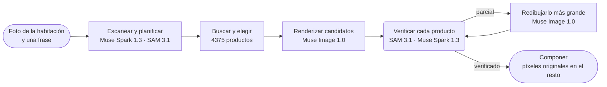

<p align="center">
  <a href="https://chanjoongx--realroom.us-east.modal.run">
    <picture>
      <source media="(prefers-color-scheme: dark)" srcset="../banner-dark.jpg">
      <source media="(prefers-color-scheme: light)" srcset="../banner-light.jpg">
      
    </picture>
  </a>
</p>

<h4 align="center">
  <a href="https://chanjoongx--realroom.us-east.modal.run">Demo en vivo</a>
  &nbsp;·&nbsp;
  <a href="#how-a-run-works">Cómo funciona</a>
  &nbsp;·&nbsp;
  <a href="#demo-rooms">Habitaciones de demostración</a>
  &nbsp;·&nbsp;
  <a href="#run-it">Cómo ejecutarlo</a>
  &nbsp;·&nbsp;
  <a href="#use-your-own-catalog">Tu propio catálogo</a>
</h4>

<p align="center">
  <a href="https://cerebralvalley.ai/e/meta-ai-developer-hackathon"></a>
  <a href="#meta-models"></a>
  <a href="#meta-models"></a>
  <a href="#meta-models"></a>
  <a href="#meta-models"></a>
  <a href="#meta-models"></a>
  <a href="https://github.com/chanjoongx/realroom/actions/workflows/ci.yml"></a>
  <a href="../../LICENSE"></a>
</p>

<p align="center">
  <a href="../../README.md">English</a>
  &nbsp;·&nbsp; <a href="README.ko.md">한국어</a>
  &nbsp;·&nbsp; <a href="README.ja.md">日本語</a>
  &nbsp;·&nbsp; <b>Español</b>
  &nbsp;·&nbsp; <a href="README.pt-BR.md">Português</a>
  &nbsp;·&nbsp; <a href="README.fr.md">Français</a>
  &nbsp;·&nbsp; <a href="README.de.md">Deutsch</a>
  &nbsp;·&nbsp; <a href="README.hi.md">हिन्दी</a>
  &nbsp;·&nbsp; <a href="README.ar.md">العربية</a>
</p>

<p align="center"><sub>Esta es una traducción del <a href="../../README.md">README en inglés</a>. Si ambas versiones difieren, la correcta es la inglesa.</sub></p>

> [!NOTE]
> Realroom participa en el [Meta Global AI Developer Hackathon](https://cerebralvalley.ai/e/meta-ai-developer-hackathon), en la categoría Indie Developer, con el reto "Build for Your World". El agente, la app web, el índice del catálogo y las habitaciones de demostración se hicieron todos durante el periodo de desarrollo, del 27 de octubre al 4 de noviembre de 2026.
>
> La app alojada reproduce las tres ejecuciones grabadas y ejecuta el agente completo en vivo sobre una foto subida, hasta 40 veces al día. En tu propia máquina, la misma app reproduce las ejecuciones sin clave, o funciona en vivo con tu propia clave de Meta Model API. Las dos formas se explican en [Cómo ejecutarlo](#run-it).

<p align="center">
  <picture>
    <source media="(prefers-color-scheme: dark)" srcset="../built-on-dark.png">
    <source media="(prefers-color-scheme: light)" srcset="../built-on-light.png">
    
  </picture>
</p>

<p align="center">
  <a href="https://chanjoongx--realroom.us-east.modal.run"></a>
  <br>
  <sub>La ejecución de demostración de la sala de estar, reproducida en la app: escaneo, guía de colocación, verificación y, por último, el control deslizante de antes y después.</sub>
</p>

Realroom es un agente construido con los modelos de Meta. Le das una foto de una habitación y una frase sobre lo que quieres. Analiza la habitación, planifica qué agregar o reemplazar, busca entre 4375 productos reales piezas que quepan en el espacio y las renderiza dentro de la foto. Después revisa su propio trabajo. SAM 3.1 vuelve a localizar cada producto en el render, Muse Spark 1.3 lo compara con la foto del producto en el catálogo y todo lo que salió mal se vuelve a dibujar. Solo los productos nuevos, sus sombras y las zonas que se despejaron salen del modelo de imagen. Todo lo demás se copia de vuelta desde tu foto original, y la página te permite comprobar ese recuento en tu propio navegador.

Pruébalo en [chanjoongx--realroom.us-east.modal.run](https://chanjoongx--realroom.us-east.modal.run). Las habitaciones de demostración reproducen ejecuciones grabadas, y el cuadro de subida ejecuta el agente completo sobre tu propia foto.

## ¿Por qué?

Los generadores de redecoración de interiores dibujan una habitación agradable, pero el sofá que aparece no es uno que puedas comprar, nadie comprobó que quepa en la pared y el generador repinta en silencio las paredes, el suelo y la vista por la ventana. Si vives de alquiler, o solo quieres comprar un sofá, esa imagen responde a la pregunta equivocada. Realroom conserva la habitación que tienes y cambia solo lo que de verdad comprarías. Una tienda de muebles puede conectar su propio catálogo; la demo usa Amazon Berkeley Objects, un conjunto público de fichas reales de Amazon.

## <a id="demo-rooms"></a>Habitaciones de demostración


Las habitaciones de demostración se generaron con Muse Image 1.0, así que este repositorio no contiene fotos privadas. Cada fila es una ejecución grabada. Las cifras salen del propio `run.json` y `ledger.jsonl` de esa ejecución, en [`demo-runs/`](../../demo-runs).

| Habitación | Petición | Productos | Coincidencia | Píxeles intactos | Tiempo | Costo |
|---|---|---|---|---|---|---|
| Sala de estar, apartamento de 2005 | "The old dark sofa makes the room feel gloomy. Make it brighter and cozier without painting or touching the floor." | sofá, alfombra, lámpara de pie | 3 de 3, la alfombra tras una ronda de redibujado | 70.3&nbsp;% | 216&nbsp;s | $0.24 |
| Habitación vacía, día de la mudanza | "Move-in day. I work from home and want a calm living room where two friends can sit: something to sit on, a rug, a small table and warm evening light." | sofá, alfombra, lámpara de pie, mesa de centro, maceta | 5 de 5, la alfombra tras dos rondas de redibujado y la mesa de centro tras una | 63.3&nbsp;% | 288&nbsp;s | $0.37 |
| Estudio, primer apartamento | "...I still sleep on a mattress on the floor and the moving boxes are everywhere. Make it feel like a calm, grown-up bedroom without painting." | estructura de cama, ropa de cama, alfombra | 2 de 3: un redibujado de la alfombra obtuvo 9, pero la comprobación final le dio 6 por un enrejado demasiado marcado | 70.7&nbsp;% | 244&nbsp;s | $0.30 |

"Coincidencia" cuenta un producto solo cuando todas las comprobaciones de Muse Spark 1.3 sobre sus píxeles finales dicen "match". Cada comprobación pone un recorte ajustado del producto renderizado junto a su foto de catálogo. Los costos son estimaciones basadas en los precios publicados por Meta, registradas por llamada.

## <a id="how-a-run-works"></a>Cómo funciona una ejecución



| Paso | Modelos | Qué ocurre |
|---|---|---|
| Escanear y planificar | Muse Spark 1.3, SAM 3.1 | Una sola petición a Spark devuelve JSON restringido por un esquema: cada objeto móvil con su caja delimitadora y una decisión (conservar, retirar o reemplazar), la estructura fija, el tamaño y la luz de la habitación, y un plan de slots (tipo, agregar o reemplazar, caja objetivo, rango de tamaño en cm, aspecto, familia de color). SAM 3.1 convierte las cajas en máscaras exactas con prompts de concepto, y con prompts de caja para los objetos que los conceptos no detectan. |
| Buscar | índice del catálogo, PE-Core B16 | Para cada slot: los productos de ese tipo, luego solo aquellos cuyas medidas reales encajan en el rango de tamaño del slot, ordenados por similitud de texto con la descripción de Muse Spark Open (45&nbsp;%) y por similitud texto-imagen de Perception Encoder (55&nbsp;%). 24 por slot. Perception Encoder se ejecuta en el propio servidor de la app, así que este paso no hace ninguna llamada a la API. |
| Elegir | Muse Spark 1.3 | Spark ve la habitación y una hoja numerada de candidatos para cada slot en una sola petición, así que elige un conjunto de piezas que combinen entre sí. |
| Renderizar | Muse Image 1.0 | Una llamada a `/images/edits` con la habitación, una guía de colocación y las fotos reales de los productos devuelve dos o tres candidatos. Las herramientas de búsqueda web y de imágenes del modelo están desactivadas. |
| Verificar | SAM 3.1, Muse Spark 1.3 | Cada candidato se alinea con el original (homografía ECC) y se ajusta su color. SAM 3.1 vuelve a localizar cada producto nuevo, y Spark evalúa el recorte de cada producto frente a su foto de catálogo, y también la escena en su conjunto. Se conserva el mejor candidato. |
| Corregir | Muse Image 1.0, SAM 3.1, Muse Spark 1.3 | Un producto con veredicto "partial" se recorta junto con su entorno y se vuelve a dibujar a mayor tamaño con su foto de catálogo como referencia, con dos intentos por ronda y hasta dos rondas. Un intento reemplaza a la versión actual solo si Spark le da una puntuación más alta, y las notas de Spark orientan la ronda siguiente. El desorden que dejó el render tiene su propia pasada, que se comprueba con SAM 3.1. Si algo cambió, Spark vuelve a evaluar la habitación terminada, y un producto solo cuenta como coincidencia si esta evaluación está de acuerdo. |
| Componer | ninguno | El resultado toma del render solo las máscaras de los productos, un borde fino a su alrededor, las sombras de contacto y el área que ocupaban los objetos retirados. Todos los demás píxeles son los del original. |

La app web reproduce cada ejecución a partir de su registro de eventos: el escaneo con todos los contornos, el embudo de búsqueda, las hojas de selección, todos los candidatos de render, cada corrección con su antes y después, y las capas finales. La cabecera de cada paso muestra el ID del modelo al que llamó.


Arriba se ve el paso de verificación de la ejecución de la sala de estar. Muse Image dibujó tres candidatos, Spark puntuó los tres productos de cada uno y se conservó el candidato 2. Su alfombra obtuvo un 5 de 10, así que pasó al paso de corrección y volvió con un 9.

## <a id="meta-models"></a>Modelos de Meta

| Modelo | Acceso | Para qué se usa |
|---|---|---|
| `muse-spark-1.3` | Meta Model API | analizar la habitación y planificar, elegir productos, evaluar cada producto y cada escena |
| `sam-3.1` | Meta Model API | máscaras de los objetos de la habitación y de cada producto renderizado, comprobar qué desorden queda |
| `muse-image-1.0` | Meta Model API | candidatos de render, redibujados, limpieza del desorden, las habitaciones de demostración |
| Muse Spark Open | Baseten, Fireworks | etiquetas y descripciones de todo el catálogo |
| `pe-core-b16-224` | pesos abiertos, en el servidor de la app (Modal o tu máquina) | Perception Encoder: compara el aspecto de cada slot con las fotos del catálogo |

## Qué puedes comprobar

- `before.png` y `after.png` se guardan sin pérdida. En la app, **Check it in your browser** descarga los dos archivos y los compara píxel a píxel en tu navegador, y luego muestra qué proporción es idéntica.
- `layers.png` colorea cada píxel modificado como producto, despejado o sombra. `masks.npz` contiene todas las máscaras de objetos y de productos.
- `ledger.jsonl` registra cada llamada a un modelo con su tiempo y su costo estimado. La búsqueda con Perception Encoder también figura, sin costo, porque se ejecuta en el propio servidor de la app.
- `drift.jpg` muestra cuánto se alejó el render en bruto del original en todo lo demás (diferencia media de color dE de 1.7 a 3.7 en las ejecuciones de demostración). Esos píxeles son el motivo del paso de composición.

## <a id="run-it"></a>Cómo ejecutarlo

Necesitas Python 3.12 y, para compilar la web, Node 20 o posterior. Instala lo necesario una sola vez:

```bash
python -m venv .venv
.venv/bin/pip install torch==2.6.0 torchvision==0.21.0 --index-url https://download.pytorch.org/whl/cpu
.venv/bin/pip install -r backend/requirements.txt
(cd web && npm ci && npm run build)
```

En Windows, escribe `.venv\Scripts\` donde estos comandos dicen `.venv/bin/`.

### Reproducir las ejecuciones grabadas (sin clave)

```bash
.venv/bin/python backend/scripts/serve_local.py
```

Abre http://127.0.0.1:8787. Las habitaciones de demostración reproducen paso a paso las ejecuciones de [`demo-runs/`](../../demo-runs), igual que en la app alojada. No se llama a ningún modelo. Las fotos de productos que muestran esas ejecuciones están en `demo-runs/_photos`, y el cuadro de subida indica que las ejecuciones en vivo están desactivadas.

### Ejecuciones en vivo con tu propia clave de Meta Model API

1. Copia `.env.example` a `.env` en la raíz del repositorio y completa `MODEL_API_KEY`. git ignora `.env`.
2. Descarga en `data/photos` las fotos de los 4375 productos. Son un solo archivo de unos 730 MB en la release de GitHub de este repositorio.
   ```bash
   .venv/bin/python catalog/get_photos.py
   ```
3. Descarga una sola vez los pesos de Perception Encoder (`timm/PE-Core-B-16` en Hugging Face, unos 1.8 GB). Si te saltas este paso, la primera búsqueda en vivo espera a que termine esa misma descarga.
   ```bash
   .venv/bin/python -c "import open_clip; open_clip.create_model_and_transforms('PE-Core-B-16', pretrained='meta')"
   ```
4. Inicia el servidor con `--live`:
   ```bash
   .venv/bin/python backend/scripts/serve_local.py --live
   ```

`--live` es lo único que separa la reproducción del modo en vivo. Con esta opción, el cuadro de subida ejecuta el agente completo sobre tu foto y la página sigue la ejecución mientras avanza. Una ejecución cuesta entre $0.2 y $0.4 aproximadamente según los precios publicados por Meta, y su `ledger.jsonl` registra cada llamada. El servidor local inicia como máximo 10 ejecuciones en vivo al día; `--per-day` cambia ese límite. Una ejecución que pasa de 12 minutos o de $0.60 se salta los redibujados que le quedan y termina con lo que tiene.

Para ejecutar el agente sobre una sola foto sin la app web:

```bash
.venv/bin/python backend/scripts/run_demo.py --room room.jpg --id my-room --brief "Warmer and less cluttered" \
    --mode refresh --slots 3 --catalog catalog/index --photos data/photos --out demo-runs/my-room
```

Usa `--mode furnish` para una habitación vacía. Mientras `serve_local.py` esté en marcha, la ejecución terminada se reproduce en http://127.0.0.1:8787/r/my-room.

### Reconstruir el catálogo o alojar la app

Para reconstruir el catálogo, descarga las fichas de ABO y los metadatos de las imágenes en `data/abo/` y luego ejecuta los pasos de [El catálogo](#the-catalog). Los pasos de Modal requieren una cuenta de Modal y, para el etiquetado, `BASETEN_API_KEY` y `FIREWORKS_API_KEY` en un secreto de Modal llamado `realroom-keys`.

La versión alojada funciona en Modal (`backend/modal_app.py`): un contenedor web, el catálogo y las ejecuciones en dos volúmenes, como máximo tres ejecuciones en vivo a la vez, 40 ejecuciones en vivo al día, tres por visitante y 60 dólares en llamadas a modelos en total. Las subidas deben ser JPEG, PNG o WebP, de 12 MB y 40 megapíxeles como máximo. Antes de guardar una foto se eliminan los datos de ubicación y de la cámara, y a los visitantes se los cuenta con un hash con sal que cambia cada día, nunca por su dirección. Una foto en la que aparece una persona o que no es una habitación se rechaza y se difumina en el acto. Los resultados en vivo están en una dirección imposible de adivinar y nunca se guardan en caché. Sus `after.jpg` y `after.png` llevan metadatos IPTC que los marcan como editados con IA. Las fotos subidas se borran en un plazo de 24 horas.

## <a id="the-catalog"></a>El catálogo

[Amazon Berkeley Objects](https://amazon-berkeley-objects.s3.us-east-1.amazonaws.com/index.html) (ABO) es un conjunto de datos público de fichas reales de productos de Amazon, con fotos y medidas. `catalog/` construye a partir de él el catálogo de Realroom:

1. `abo_catalog.py` clasifica las fichas de amazon.com en 25 tipos (sofá, alfombra, lámpara de pie, cuadros, etc.), y 5931 de ellas encajan en alguno. Convierte los tamaños a centímetros y descarta las fichas sin medidas o con medidas inverosímiles, con lo que quedan 4612 candidatos.
2. `modal_catalog.py --step score` y `abo_choose.py` eligen una foto de referencia por producto, con preferencia por un recorte limpio sobre fondo blanco.
3. `modal_catalog.py --step fetch` descarga esa foto una sola vez, en la nube de Modal, y la recorta.
4. `modal_catalog.py --step tag` envía cada foto con su ficha a **Muse Spark Open**, el modelo de pesos abiertos de Meta, servido por Baseten (con Fireworks como respaldo). Devuelve un título, colores, materiales, estilo, una descripción visual, una frase para SAM, una estimación del riesgo de render y si la foto muestra de verdad el producto de la ficha.
5. `modal_catalog.py --step embed` calcula el embedding de cada foto con Perception Encoder de Meta (PE-Core B16-224) en CPU de Modal.
6. `abo_finalize.py` escribe `catalog.jsonl`: 4375 productos. Descartó 104 cuya foto no mostraba el producto de la ficha y 133 que no tenían una etiqueta terminada cuando se grabaron las ejecuciones de demostración.

Muse Spark Open etiquetó 3781 de los 4375 en Baseten y 594 en Fireworks. Las etiquetas están en [`catalog/index/catalog.jsonl`](../../catalog/index/catalog.jsonl). El repositorio solo incluye las fotos de productos que muestran las ejecuciones de demostración. El conjunto completo es un solo archivo en la release de GitHub (consulta [Cómo ejecutarlo](#run-it)), y los pasos anteriores lo reconstruyen a partir de ABO.

## <a id="use-your-own-catalog"></a>Usa tu propio catálogo

El agente en sí no depende de ABO. Lee una carpeta de catálogo (`--catalog`) con `catalog.jsonl` y dos archivos de Perception Encoder, y una carpeta de fotos (`--photos`) con `img/<id>.jpg` y `thumb/<id>.webp` para cada producto. Esta es la primera línea de [`catalog/index/catalog.jsonl`](../../catalog/index/catalog.jsonl), abreviada:

```json
{
  "id": "B075QFCHM9",
  "kind": "bed",
  "name": "Rivet York Modern Extended Platform Queen Bed, 90.2\"L, Grey",
  "brand": "Rivet",
  "size_cm": {"w": 229.0, "d": 182.9, "h": 107.5},
  "url": "https://www.amazon.com/dp/B075QFCHM9",
  "cutout": true,
  "tag": {
    "title": "Light Grey Upholstered Platform Bed",
    "matches_listing": true,
    "colors": ["light grey", "white", "light brown"],
    "color_family": "grey",
    "materials": ["polyester", "fabric", "wood"],
    "style": ["modern", "minimal", "contemporary"],
    "render_risk": "low",
    "sam_phrase": "platform bed",
    "visual_description": "Low-profile light grey polyester platform bed with tall rectangular headboard, extended surround frame and tapered wood legs shown with white mattress."
  }
}
```

- `kind` es uno de los nombres de `KINDS` en `backend/realroom/catalog.py`. El plan pide cada slot por su tipo.
- `size_cm` es el ancho, la profundidad y la altura. Un producto solo entra en la preselección si cabe en el rango de tamaño del slot.
- `tag` es lo que escribió Muse Spark Open en el paso 4. La búsqueda de texto lee su título, colores, materiales, estilo y descripción, SAM 3.1 encuentra el producto renderizado por su `sam_phrase`, y nunca se ofrece un producto con `"matches_listing": false`. Sin etiqueta, el agente recurre a `name` y `kind`.
- `cutout` marca una foto en la que el producto aparece solo, sobre un fondo liso. La búsqueda sitúa esas fotos más arriba.
- `emb_pe_core_b16.npy` contiene un embedding de Perception Encoder por cada foto de producto, en el orden de `emb_pe_core_b16_ids.json`. El paso 5 escribe los dos. Sin ellos, la búsqueda ordena solo por texto.

Los scripts de `catalog/` construyen esta carpeta a partir de ABO. Para otro feed de productos, lo que hay que reescribir son los pasos 1 a 3, porque convierten las fichas de ABO en filas y fotos. Después, apunta `serve_local.py` o `run_demo.py` a las carpetas nuevas con `--catalog` y `--photos`.

## Pruebas

```bash
.venv/bin/pip install -r backend/requirements-test.txt
.venv/bin/python -m pytest backend/tests
```

Las pruebas no necesitan clave ni llaman a ningún modelo. Reproducen las tres ejecuciones grabadas a través de la API HTTP y comparan sus cifras con cada ledger y con este README. Hacen pasar subidas por el control de las ejecuciones en vivo con un lanzador falso: eliminación de metadatos, límites de tamaño y formato, y los topes por visitante, diarios y de presupuesto. Le dan al pipeline respuestas fallidas y salidas de modelo mal formadas, y comprueban que cada modelo que llama la app es un modelo de Meta al que solo se llega en api.meta.ai. GitHub Actions las ejecuta en cada push, junto con la comprobación de tipos y el build de la web.

## Estructura del repositorio

```text
backend/
  realroom/      the agent: scan.py, pick.py, render.py, verify.py, composite.py and pipeline.py,
                 catalog.py (search), meta.py (Meta Model API clients), server.py (API and site)
  scripts/       serve_local.py, run_demo.py, make_rooms.py (the demo rooms), pack_demo_photos.py
  tests/         the test suite (no key, no network calls)
  modal_app.py   the hosted app on Modal
catalog/         the catalog build from ABO, steps 1 to 6, plus get_photos.py and pack_photos.py
  index/         catalog.jsonl (4,375 products) and the Perception Encoder embeddings
demo-runs/       the three recorded runs (run.json, ledger.jsonl, masks and images) and their product photos
web/             the React app (Vite): the home page, the run viewer and the pixel check
docs/            README images and translations
```

## Limitaciones

- Al modelo de imagen le cuestan las texturas sutiles. Una alfombra color crema con un tenue tejido entrecruzado salió demasiado marcada en algunos renders y lisa en otros. El bucle de corrección lo detecta, pero las puntuaciones de Spark para los mismos píxeles varían: en la ejecución del estudio, un redibujado de esa alfombra obtuvo 9 y la comprobación final le dio 6. Cuando las comprobaciones no coinciden, el resultado muestra el veredicto más bajo.
- El plan cambia entre ejecuciones con la misma petición, porque Spark vuelve a planificar y a elegir cada vez.
- Donde estaba un objeto retirado, puede quedar una costura tenue entre el suelo redibujado y el suelo original.
- Las fichas proceden de un conjunto de datos publicado en 2021, así que no hay precios y algunos enlaces de productos ya no abren.
- El tamaño de la habitación que da Spark es una estimación a partir de cosas como el tamaño de puertas y camas. Fija el rango de tamaño de la búsqueda, pero el render no es una medición.

## Créditos

- Fotos y datos de productos: Amazon Berkeley Objects, de **Amazon.com**, con licencia [CC BY 4.0](https://creativecommons.org/licenses/by/4.0/). Conjunto de datos de Matthieu Guillaumin, Thomas Dideriksen, Kenan Deng y Himanshu Arora (Amazon.com), Jasmine Collins y Jitendra Malik (UC Berkeley). Cambios: las fotos se recortaron y se redimensionaron, Muse Spark Open etiquetó los productos y Muse Image 1.0 los redibuja dentro de fotos de habitaciones. Realroom no está afiliado a Amazon ni cuenta con su respaldo.
- Cómputo: créditos de Meta Model API otorgados por Meta y créditos de Baseten, Fireworks AI y Modal, los socios de inferencia del hackathon.
- Built with Muse Spark Open. Sus pesos se publican bajo la [Muse Model License](https://huggingface.co/meta-models/Muse-Spark-Open-816B-A42B), y Realroom llama al modelo a través de Baseten y Fireworks AI para etiquetar el catálogo.
- [Perception Encoder](https://github.com/facebookresearch/perception_models) (PE-Core B16-224) de Meta FAIR, Apache 2.0, cargado con [OpenCLIP](https://github.com/mlfoundations/open_clip) a partir de los pesos `timm/PE-Core-B-16`.
- Bibliotecas de Python: FastAPI (MIT), Uvicorn (BSD-3-Clause), NumPy y SciPy (BSD), OpenCV (Apache 2.0), Pillow (MIT-CMU), scikit-image (BSD-3-Clause), PyTorch y torchvision (BSD-3-Clause), OpenCLIP (MIT), timm (Apache 2.0), Requests (Apache 2.0), python-multipart (Apache 2.0), el cliente de Modal (Apache 2.0) y `meta-sam-parser` de Meta (SAM License). El SDK de OpenAI para Python (Apache 2.0) es el cliente que muestra la documentación de la API de Meta para Meta Model API; aquí solo se comunica con api.meta.ai.
- Bibliotecas web: React, Vite y Motion (MIT), los iconos de Lucide (ISC) y TypeScript (Apache 2.0).
- Fuentes: Geist y Geist Mono (Vercel) e Instrument Serif, todas bajo la SIL Open Font License.
- Las habitaciones de demostración se generaron con Muse Image 1.0.

Creado por [Chanjoong Kim](https://github.com/chanjoongx). Código: MIT, consulta [LICENSE](../../LICENSE).
