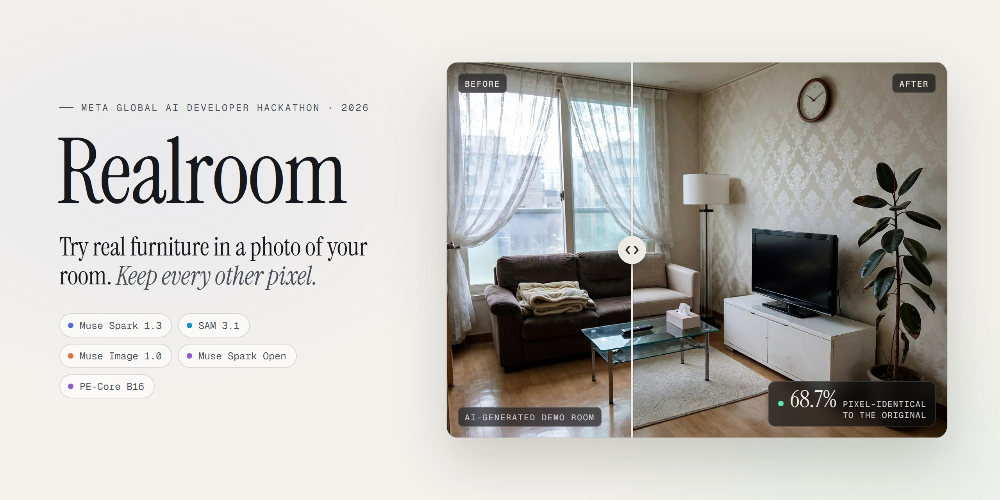
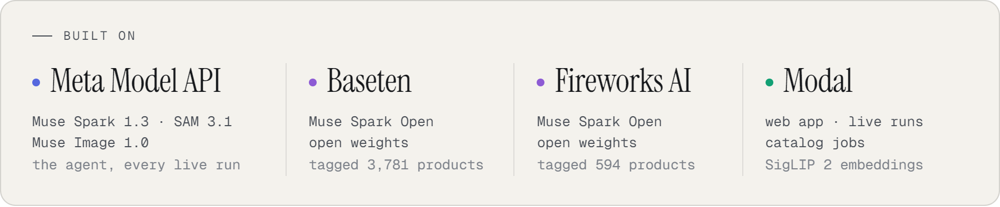
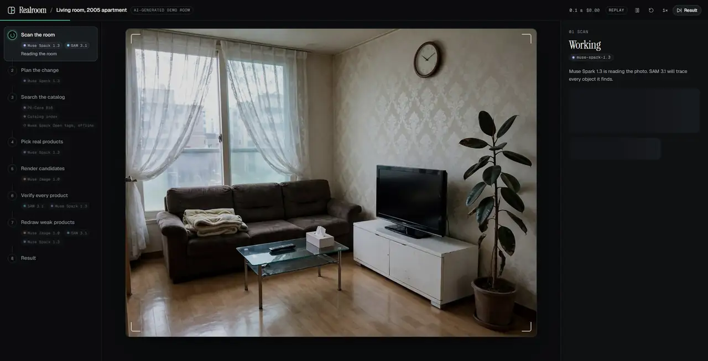
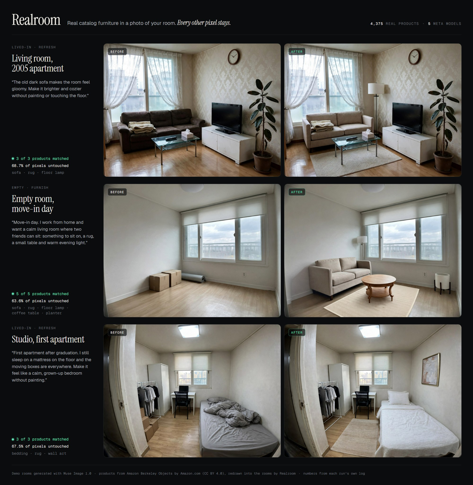
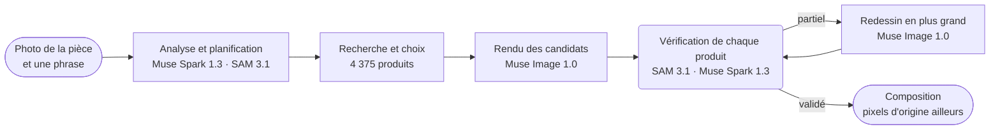
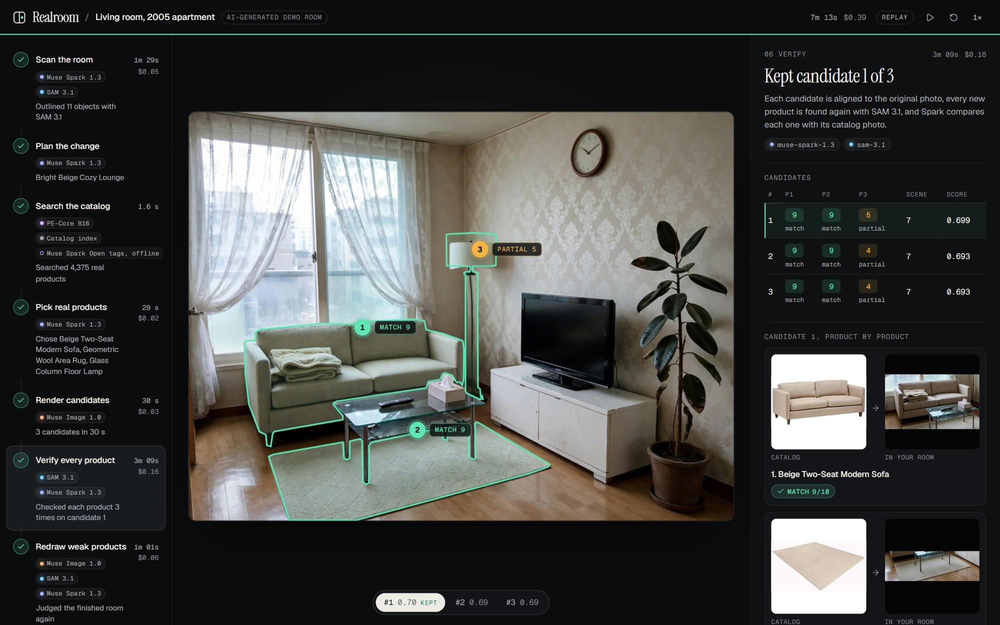

<p align="center">
  <a href="https://chanjoongx--realroom.us-east.modal.run">
    <picture>
      <source media="(prefers-color-scheme: dark)" srcset="../banner-dark.jpg">
      <source media="(prefers-color-scheme: light)" srcset="../banner-light.jpg">
      
    </picture>
  </a>
</p>

<h4 align="center">
  <a href="https://chanjoongx--realroom.us-east.modal.run">Démo en ligne</a>
  &nbsp;·&nbsp;
  <a href="#how-a-run-works">Fonctionnement</a>
  &nbsp;·&nbsp;
  <a href="#demo-rooms">Pièces de démo</a>
  &nbsp;·&nbsp;
  <a href="#run-it">Lancer Realroom</a>
  &nbsp;·&nbsp;
  <a href="#use-your-own-catalog">Votre propre catalogue</a>
</h4>

<p align="center">
  <a href="https://cerebralvalley.ai/e/meta-ai-developer-hackathon"></a>
  <a href="#meta-models"></a>
  <a href="#meta-models"></a>
  <a href="#meta-models"></a>
  <a href="#meta-models"></a>
  <a href="#meta-models"></a>
  <a href="https://github.com/chanjoongx/realroom/actions/workflows/ci.yml"></a>
  <a href="../../LICENSE"></a>
</p>

<p align="center">
  <a href="../../README.md">English</a>
  &nbsp;·&nbsp; <a href="README.ko.md">한국어</a>
  &nbsp;·&nbsp; <a href="README.ja.md">日本語</a>
  &nbsp;·&nbsp; <a href="README.es.md">Español</a>
  &nbsp;·&nbsp; <a href="README.pt-BR.md">Português</a>
  &nbsp;·&nbsp; <b>Français</b>
  &nbsp;·&nbsp; <a href="README.de.md">Deutsch</a>
  &nbsp;·&nbsp; <a href="README.hi.md">हिन्दी</a>
  &nbsp;·&nbsp; <a href="README.ar.md">العربية</a>
</p>

<p align="center"><sub>Cette page est une traduction du <a href="../../README.md">README en anglais</a>. Si les deux versions diffèrent, c'est la version anglaise qui fait foi.</sub></p>

> [!NOTE]
> Realroom participe au [Meta Global AI Developer Hackathon](https://cerebralvalley.ai/e/meta-ai-developer-hackathon), dans la catégorie Indie Developer, sur le sujet « Build for Your World ». L'agent, l'application web, l'index du catalogue et les pièces de démo ont tous été réalisés pendant la période de développement, du 27 octobre au 4 novembre 2026.
>
> L'application hébergée rejoue les trois exécutions enregistrées et fait tourner l'agent complet en direct sur une photo envoyée, jusqu'à 40 fois par jour. Une exécution en direct prend environ quatre à huit minutes, et la page la suit au fur et à mesure. Sur votre propre machine, la même application rejoue les exécutions sans clé, ou fonctionne en direct avec votre propre clé Meta Model API. Les deux méthodes sont décrites dans [Lancer Realroom](#run-it).

<p align="center">
  <picture>
    <source media="(prefers-color-scheme: dark)" srcset="../built-on-dark.png">
    <source media="(prefers-color-scheme: light)" srcset="../built-on-light.png">
    
  </picture>
</p>

<p align="center">
  <a href="https://chanjoongx--realroom.us-east.modal.run"></a>
  <br>
  <sub>L'exécution de démo sur le salon, rejouée dans l'application : analyse, guide de placement, vérification, puis le curseur avant/après.</sub>
</p>

Realroom est un agent construit sur les modèles de Meta. Vous lui donnez la photo d'une pièce et une phrase qui décrit ce que vous voulez. Muse Spark 1.3 analyse la pièce et prévoit ce qu'il faut ajouter ou remplacer, et SAM 3.1 détoure chaque objet. L'agent cherche parmi 4 375 produits réels des meubles dont les dimensions indiquées dans l'annonce conviennent à l'espace, puis les classe selon leurs descriptions écrites par Muse Spark Open et selon le Perception Encoder de Meta. Spark choisit un ensemble cohérent, et Muse Image 1.0 le dessine dans la photo. Ensuite, l'agent vérifie son propre travail : SAM 3.1 retrouve chaque produit dans le rendu, Muse Spark 1.3 le compare à sa photo de catalogue lors de trois vérifications séparées, et un produit mal rendu est redessiné. Seuls les nouveaux produits, leurs ombres et les zones dégagées viennent du rendu. Tous les autres pixels sont recopiés depuis votre photo d'origine, et la page vous permet d'en vérifier le décompte dans votre propre navigateur.

Essayez-le sur [chanjoongx--realroom.us-east.modal.run](https://chanjoongx--realroom.us-east.modal.run). Les pièces de démo rejouent des exécutions enregistrées, et la zone d'envoi fait tourner l'agent complet sur votre propre photo.

## Pourquoi

Les générateurs de relooking d'intérieur dessinent une pièce agréable, mais le canapé qu'on y voit n'est en vente nulle part, personne n'a vérifié qu'il tient contre le mur, et le générateur repeint discrètement les murs, le sol et la vue par la fenêtre. Si vous êtes locataire, ou si vous cherchez à acheter un seul canapé, cette image répond à la mauvaise question. Realroom garde votre pièce telle qu'elle est et ne change que ce que vous achèteriez vraiment. Un magasin de meubles peut y brancher son propre catalogue ; la démo utilise Amazon Berkeley Objects, un ensemble public de vraies fiches produits Amazon.

## <a id="demo-rooms"></a>Pièces de démo



Les pièces de démo ont été générées avec Muse Image 1.0 : ce dépôt ne contient donc aucune photo privée. Chaque ligne correspond à une exécution enregistrée. Les chiffres viennent des fichiers `run.json` et `ledger.jsonl` propres à chaque exécution, dans [`demo-runs/`](../../demo-runs).

| Pièce | Consigne | Produits | Conformes | Pixels intacts | Durée | Coût |
|---|---|---|---|---|---|---|
| Salon, appartement de 2005 | "The old dark sofa makes the room feel gloomy. Make it brighter and cozier without painting or touching the floor." | canapé, tapis, lampadaire | 3 sur 3, le lampadaire après un tour de redessin | 68,7 % | 433&nbsp;s | 0,39 $ |
| Pièce vide, jour d'emménagement | "Move-in day. I work from home and want a calm living room where two friends can sit: something to sit on, a rug, a small table and warm evening light." | canapé, tapis, lampadaire, table basse, jardinière | 5 sur 5, le tapis et le lampadaire après un tour de redessin chacun | 63,6 % | 384&nbsp;s | 0,58 $ |
| Studio, premier appartement | "...I still sleep on a mattress on the floor and the moving boxes are everywhere. Make it feel like a calm, grown-up bedroom without painting." | linge de lit, tapis, décoration murale | 3 sur 3, le linge de lit après un tour de redessin | 67,5 % | 477&nbsp;s | 0,40 $ |

« Conformes » compte un produit lorsqu'au moins deux vérifications sur trois, faites séparément par Muse Spark 1.3 sur ses pixels finaux, disent « match ». Chaque vérification place un recadrage serré du produit à côté de sa photo de catalogue, et l'application affiche les trois verdicts. Les coûts sont des estimations établies d'après les tarifs publiés par Meta, enregistrées appel par appel. Les exécutions enregistrées ont dessiné trois candidats et pouvaient redessiner jusqu'à deux produits. Les exécutions en direct en dessinent deux et redessinent au plus un produit, elles coûtent donc moins cher, entre 0,2 $ et 0,5 $ environ.

## <a id="how-a-run-works"></a>Déroulement d'une exécution



| Étape | Modèles | Ce qui se passe |
|---|---|---|
| Analyse et planification | Muse Spark 1.3, SAM 3.1 | Une seule requête Spark renvoie un JSON contraint par un schéma : chaque objet mobile avec une boîte englobante et une décision (garder, retirer ou remplacer), la structure fixe, la taille et la lumière de la pièce, et un plan d'emplacements (catégorie, ajout ou remplacement, boîte cible, plage de tailles en cm, aspect, famille de couleurs). SAM 3.1 transforme les boîtes en masques précis à l'aide de prompts de concept, et de prompts de boîte pour les objets que les concepts ne trouvent pas. |
| Recherche | index du catalogue, PE-Core B16 | Pour chaque emplacement : les produits de cette catégorie, puis seulement ceux dont les dimensions réelles entrent dans la plage de tailles de l'emplacement, classés selon la similarité textuelle avec la description de Muse Spark Open (45 %) et la similarité texte-image de Perception Encoder (55 %). 24 par emplacement. Perception Encoder tourne sur le serveur même de l'application, donc cette étape ne fait aucun appel d'API. |
| Choix | Muse Spark 1.3 | Spark voit la pièce et une planche numérotée de candidats pour chaque emplacement, le tout en une seule requête, ce qui lui permet de choisir un ensemble cohérent. |
| Rendu | Muse Image 1.0 | Un seul appel `/images/edits`, avec la pièce, un guide de placement et les vraies photos des produits, renvoie deux ou trois candidats. Les outils de recherche web et de recherche d'images du modèle sont désactivés. |
| Vérification | SAM 3.1, Muse Spark 1.3 | Chaque candidat est recalé sur l'original (homographie ECC) et ajusté en couleur. SAM 3.1 retrouve chaque nouveau produit, et Spark juge chaque recadrage de produit par rapport à sa photo de catalogue, ainsi que la scène dans son ensemble. Le meilleur candidat est conservé. Spark vérifie ensuite chacun de ses produits trois fois de plus, chaque vérification étant une requête distincte avec un recadrage serré à côté de la photo de catalogue. Le verdict de Spark sur les mêmes pixels peut changer d'une requête à l'autre : un produit n'est donc compté conforme que si au moins deux des trois disent « match ». |
| Correction | Muse Image 1.0, SAM 3.1, Muse Spark 1.3 | Un produit que les vérifications jugent « partial » est découpé avec ce qui l'entoure, puis redessiné en plus grand d'après sa photo de catalogue, avec deux essais par tour et deux tours au plus. Un produit que les vérifications ne trouvent pas à son emplacement prévu est d'abord recherché dans toute la photo, car le rendu le dessine parfois ailleurs ; il n'est ajouté à son emplacement prévu, de la même manière, que s'il reste introuvable. Un essai ne remplace la version en cours que si Spark lui donne une meilleure note, et les remarques de Spark orientent le tour suivant. Un produit redessiné, ainsi que tout produit dont les propres pixels ont été modifiés par une étape ultérieure, est de nouveau vérifié trois fois sur la photo finale. Le désordre laissé par le rendu a droit à sa propre passe, vérifiée avec SAM 3.1. Si quelque chose a changé, Spark juge à nouveau la pièce terminée. |
| Composition | aucun | Le résultat ne prend du rendu que les masques des produits, une fine bordure autour d'eux, les ombres de contact et l'emprise au sol des objets retirés. Tous les autres pixels sont ceux de l'original. |

L'application web rejoue chaque exécution à partir de son journal d'événements : l'analyse avec tous les contours, l'entonnoir de recherche, les planches de choix, tous les rendus candidats, chaque correction avec son avant et son après, et les calques finaux. L'en-tête de chaque étape indique l'identifiant du modèle qu'elle a appelé.



Ci-dessus, l'étape de vérification de l'exécution sur le salon. Muse Image a dessiné trois candidats, Spark a noté les trois produits de chacun, et le candidat 1 a été conservé. Son lampadaire a obtenu 5 sur 10, et trois vérifications distinctes lui ont donné 6 chacune : il est donc passé par l'étape de correction, et en est ressorti avec 9.

## <a id="meta-models"></a>Modèles Meta

| Modèle | Accès | Utilisé pour |
|---|---|---|
| `muse-spark-1.3` | Meta Model API | analyse de la pièce et planification, choix des produits, évaluation de chaque produit et de chaque scène |
| `sam-3.1` | Meta Model API | masques des objets de la pièce et de chaque produit rendu, vérification du désordre restant |
| `muse-image-1.0` | Meta Model API | rendus candidats, redessins, effacement du désordre, pièces de démo |
| Muse Spark Open | Baseten, Fireworks | étiquettes et descriptions de tout le catalogue |
| `pe-core-b16-224` | poids ouverts, sur le serveur de l'application (Modal, ou votre machine) | Perception Encoder : compare l'aspect de chaque emplacement aux photos du catalogue |

Pendant une exécution, Realroom n'appelle que les trois premiers modèles, tous sur api.meta.ai, et fait tourner le Perception Encoder sur son propre serveur. Muse Spark Open a étiqueté le catalogue avant toute exécution. [`backend/tests/test_meta_only.py`](../../backend/tests/test_meta_only.py) vérifie le code de l'agent dans `backend/realroom/` : le test échoue si les identifiants de modèle qui s'y trouvent ne sont pas les quatre de ce tableau, si l'adresse de l'API n'est pas api.meta.ai, ou si une chaîne de ce code contient une autre URL ou nomme un modèle courant qui n'est pas de Meta, comme GPT, Claude, Gemini, Flux ou SigLIP.

## Comment les éléments s'assemblent

1. La page envoie la photo, la phrase et le mode à `POST /api/runs` sur le serveur FastAPI ([`backend/realroom/server.py`](../../backend/realroom/server.py)). Le serveur vérifie les limites, enregistre la photo sans ses métadonnées dans un nouveau dossier d'exécution et lance l'agent ([`pipeline.py`](../../backend/realroom/pipeline.py)) dans un thread en arrière-plan.
2. L'agent appelle Muse Spark 1.3, SAM 3.1 et Muse Image 1.0 sur api.meta.ai via [`meta.py`](../../backend/realroom/meta.py). La recherche dans le catalogue, dans [`catalog.py`](../../backend/realroom/catalog.py), fait tourner le Perception Encoder dans le même processus.
3. Chaque fois qu'une étape commence ou se termine, l'agent ajoute un événement à `run.json` et enregistre les images de l'étape dans le dossier d'exécution. Chaque appel de modèle est consigné dans `ledger.jsonl` avec son heure et son coût estimé.
4. Tant que l'exécution est en cours, la page lit `GET /api/runs/<id>` toutes les 1,5 seconde et dessine chaque étape dès que son événement arrive, avec les images de `/runs/<id>/`. Une pièce de démo est un dossier d'exécution terminé, et la page en rejoue les événements.

La clé de Meta Model API reste sur le serveur. Sur votre machine, elle se trouve dans `.env`, que git ignore. Sur Modal, elle se trouve dans le secret `realroom-model`, qui ne contient que `MODEL_API_KEY`. Le navigateur ne reçoit jamais la clé, et le dépôt n'en contient aucune.

## Ce que vous pouvez vérifier

- `before.png` et `after.png` sont enregistrés sans perte. Dans l'application, **Check it in your browser** télécharge les deux fichiers et les compare pixel par pixel dans votre navigateur, puis affiche la part de pixels identiques.
- `layers.png` colore chaque pixel modifié selon qu'il appartient à un produit, à une zone dégagée ou à une ombre. `masks.npz` contient tous les masques d'objets et de produits.
- Dans `run.json`, le verdict de chaque produit liste les trois vérifications finales à partir desquelles il a été compté, à côté du verdict que lui a donné l'étape de vérification ou de correction.
- `ledger.jsonl` liste chaque appel de modèle avec sa durée et son coût estimé. La recherche Perception Encoder y figure aussi, à coût nul, puisqu'elle tourne sur le serveur même de l'application.
- `drift.jpg` montre à quel point le rendu brut s'est écarté de l'original partout ailleurs (écart colorimétrique moyen dE de 1,8 à 2,7 sur les exécutions de démo). Ces pixels sont la raison d'être de l'étape de composition.

## <a id="run-it"></a>Lancer Realroom

Il vous faut Python 3.12 (PyTorch 2.6.0 n'a pas de wheels pour Python 3.14), ainsi que Node 22.12 ou plus récent (20.19 fonctionne aussi) pour compiler l'interface web. Installez une fois pour toutes :

```bash
python3.12 -m venv .venv
.venv/bin/pip install torch==2.6.0 torchvision==0.21.0 --index-url https://download.pytorch.org/whl/cpu
.venv/bin/pip install -r backend/requirements.txt
(cd web && npm ci && npm run build)
```

Sous Windows, créez l'environnement avec `py -3.12 -m venv .venv` et remplacez `.venv/bin/` par `.venv\Scripts\` dans ces commandes.

### Rejouer les exécutions enregistrées (sans clé)

```bash
.venv/bin/python backend/scripts/serve_local.py
```

Ouvrez http://127.0.0.1:8787. Les pièces de démo rejouent pas à pas les exécutions de [`demo-runs/`](../../demo-runs), comme sur l'application hébergée. Aucun modèle n'est appelé. Les photos de produits que montrent ces exécutions se trouvent dans `demo-runs/_photos`, et la zone d'envoi indique que les exécutions en direct sont désactivées.

Le rejeu n'a pas besoin de PyTorch. Si vous voulez seulement rejouer, lancez `.venv/bin/pip install -r backend/requirements-test.txt` à la place des deux lignes `pip` ci-dessus : cela installe tous les paquets Python qu'utilisent le serveur de rejeu et les tests. La compilation de l'interface web reste nécessaire.

### Exécutions en direct avec votre propre clé Meta Model API

1. Copiez `.env.example` en `.env` à la racine du dépôt et renseignez `MODEL_API_KEY`. `.env` est ignoré par git.
2. Téléchargez les photos des 4 375 produits dans `data/photos`. Elles tiennent en un seul fichier d'environ 730 MB, sur la release GitHub de ce dépôt.
   ```bash
   .venv/bin/python catalog/get_photos.py
   ```
3. Téléchargez une fois pour toutes les poids de Perception Encoder (`timm/PE-Core-B-16` sur Hugging Face, environ 1,8 GB). Si vous sautez cette étape, la première recherche en direct attendra ce même téléchargement.
   ```bash
   .venv/bin/python -c "import open_clip; open_clip.create_model_and_transforms('PE-Core-B-16', pretrained='meta')"
   ```
4. Lancez le serveur avec `--live` :
   ```bash
   .venv/bin/python backend/scripts/serve_local.py --live
   ```

Seule l'option `--live` fait passer du rejeu au direct. Avec elle, la zone d'envoi fait tourner l'agent complet sur votre photo, et la page suit l'exécution au fur et à mesure. Une exécution coûte entre 0,2 $ et 0,5 $ environ aux tarifs publiés par Meta, et son `ledger.jsonl` liste chaque appel. Le serveur local lance au plus 10 exécutions en direct par jour ; `--per-day` change cette limite. Une exécution qui dépasse 12 minutes ou 0,60 $ saute les redessins qui lui restent et se termine avec ce qu'elle a.

Pour exécuter l'agent sur une seule photo, sans l'application web :

```bash
.venv/bin/python backend/scripts/run_demo.py --room room.jpg --id my-room --brief "Warmer and less cluttered" \
    --mode refresh --slots 3 --catalog catalog/index --photos data/photos --out demo-runs/my-room
```

Utilisez `--mode furnish` pour une pièce vide. Tant que `serve_local.py` tourne, l'exécution terminée se rejoue à l'adresse http://127.0.0.1:8787/r/my-room.

### Reconstruire le catalogue ou héberger l'application

Pour reconstruire le catalogue, téléchargez les fiches ABO et les métadonnées des images dans `data/abo/`, puis suivez les étapes de la section [Le catalogue](#the-catalog). Les étapes Modal nécessitent un compte Modal et, pour l'étiquetage, `BASETEN_API_KEY` et `FIREWORKS_API_KEY` dans un secret Modal nommé `realroom-keys`.

La version hébergée tourne sur Modal (`backend/modal_app.py`) : un conteneur web, le catalogue et les exécutions sur deux volumes, au plus trois exécutions en direct à la fois, 40 exécutions en direct par jour et 8 par heure, trois par visiteur et 60 dollars d'appels de modèles au total. Les envois doivent être en JPEG, PNG ou WebP, de 12 Mo et 40 mégapixels au plus. Les données de localisation et d'appareil photo sont retirées avant l'enregistrement de la photo, et les visiteurs sont comptés par un hachage salé qui change chaque jour, jamais par leur adresse. Une photo qui montre une personne ou qui n'est pas une pièce est refusée et floutée aussitôt. Les résultats en direct sont à une adresse impossible à deviner et ne sont jamais mis en cache. Leurs `after.jpg` et `after.png` portent des métadonnées IPTC qui les signalent comme retouchés par IA. Les photos envoyées sont supprimées sous 24 heures.

## <a id="the-catalog"></a>Le catalogue

[Amazon Berkeley Objects](https://amazon-berkeley-objects.s3.us-east-1.amazonaws.com/index.html) (ABO) est un jeu de données public de vraies fiches produits Amazon, avec photos et dimensions. `catalog/` en tire le catalogue de Realroom :

1. `abo_catalog.py` répartit les fiches amazon.com en 25 catégories (canapé, tapis, lampadaire, décoration murale, etc.), auxquelles correspondent 5 931 fiches. Il convertit les tailles en centimètres et écarte les fiches sans dimensions ou aux dimensions invraisemblables, ce qui laisse 4 612 candidats.
2. `modal_catalog.py --step score` et `abo_choose.py` choisissent une photo de référence par produit, de préférence un détourage propre sur fond blanc.
3. `modal_catalog.py --step fetch` télécharge cette photo une seule fois, dans le cloud de Modal, et la rogne.
4. `modal_catalog.py --step tag` envoie chaque photo avec sa fiche à **Muse Spark Open**, le modèle à poids ouverts de Meta, servi par Baseten (avec Fireworks en secours). Il renvoie un titre, des couleurs, des matériaux, un style, une description visuelle, une expression pour SAM, une estimation du risque de rendu, et indique si la photo montre vraiment le produit de la fiche.
5. `modal_catalog.py --step embed` calcule l'embedding de chaque photo avec le Perception Encoder de Meta (PE-Core B16-224), sur des CPU Modal.
6. `abo_finalize.py` écrit `catalog.jsonl` : 4 375 produits. Il en a écarté 104 dont la photo ne montrait pas le produit de la fiche, et 133 dont l'étiquetage n'était pas terminé au moment où les exécutions de démo ont été enregistrées.

Muse Spark Open a étiqueté 3 781 des 4 375 produits sur Baseten, et 594 sur Fireworks. Les étiquettes se trouvent dans [`catalog/index/catalog.jsonl`](../../catalog/index/catalog.jsonl). Le dépôt ne contient que les photos de produits que montrent les exécutions de démo. L'ensemble complet tient en un seul fichier sur la release GitHub (voir [Lancer Realroom](#run-it)), et les étapes ci-dessus permettent de le reconstruire à partir d'ABO.

## <a id="use-your-own-catalog"></a>Utiliser votre propre catalogue

L'agent lui-même ne dépend pas d'ABO. Il lit un dossier de catalogue (`--catalog`) contenant `catalog.jsonl` et deux fichiers Perception Encoder, ainsi qu'un dossier de photos (`--photos`) contenant `img/<id>.jpg` et `thumb/<id>.webp` pour chaque produit. Voici la première ligne de [`catalog/index/catalog.jsonl`](../../catalog/index/catalog.jsonl), raccourcie :

```json
{
  "id": "B075QFCHM9",
  "kind": "bed",
  "name": "Rivet York Modern Extended Platform Queen Bed, 90.2\"L, Grey",
  "brand": "Rivet",
  "size_cm": {"w": 229.0, "d": 182.9, "h": 107.5},
  "url": "https://www.amazon.com/dp/B075QFCHM9",
  "cutout": true,
  "tag": {
    "title": "Light Grey Upholstered Platform Bed",
    "matches_listing": true,
    "colors": ["light grey", "white", "light brown"],
    "color_family": "grey",
    "materials": ["polyester", "fabric", "wood"],
    "style": ["modern", "minimal", "contemporary"],
    "render_risk": "low",
    "sam_phrase": "platform bed",
    "visual_description": "Low-profile light grey polyester platform bed with tall rectangular headboard, extended surround frame and tapered wood legs shown with white mattress."
  }
}
```

- `kind` est l'un des noms de `KINDS`, dans `backend/realroom/catalog.py`. Pour chaque emplacement, le plan demande une catégorie.
- `size_cm` donne la largeur, la profondeur et la hauteur. Un produit n'entre dans la présélection que s'il tient dans la plage de tailles de l'emplacement.
- `tag` contient ce que Muse Spark Open a écrit à l'étape 4. La recherche textuelle en lit le titre, les couleurs, les matériaux, le style et la description, SAM 3.1 retrouve le produit rendu grâce à son `sam_phrase`, et un produit avec `"matches_listing": false` n'est jamais proposé. Sans étiquette, l'agent se rabat sur `name` et `kind`.
- `cutout` signale une photo du produit seul sur fond uni. La recherche classe ces photos plus haut.
- `emb_pe_core_b16.npy` contient un embedding Perception Encoder par photo de produit, dans l'ordre de `emb_pe_core_b16_ids.json`. L'étape 5 écrit ces deux fichiers. Sans eux, la recherche classe sur le seul texte.

Les scripts de `catalog/` construisent ce dossier à partir d'ABO. Pour un autre flux de produits, ce sont les étapes 1 à 3 qu'il faut réécrire, car ce sont elles qui transforment les fiches ABO en lignes et en photos. Pointez ensuite `serve_local.py` ou `run_demo.py` vers les nouveaux dossiers avec `--catalog` et `--photos`.

## Tests

```bash
.venv/bin/pip install -r backend/requirements-test.txt
.venv/bin/python -m pytest backend/tests
```

Les tests ne demandent aucune clé et n'appellent aucun modèle. Ils rejouent les trois exécutions enregistrées via l'API HTTP et comparent leurs chiffres à chaque ledger et à ce README. Ils font passer des envois par le contrôle d'entrée des exécutions en direct avec un lanceur factice : suppression des métadonnées, limites de taille et de format, plafonds par visiteur, par jour et de budget. Ils soumettent au pipeline des réponses en échec et des sorties de modèle mal formées, et vérifient que chaque modèle appelé par l'application est un modèle Meta joint uniquement sur api.meta.ai. GitHub Actions les lance à chaque push, avec la vérification des types et le build du web.

## Structure du dépôt

```text
backend/
  realroom/      the agent: scan.py, pick.py, render.py, verify.py, composite.py and pipeline.py,
                 catalog.py (search), meta.py (Meta Model API clients), server.py (API and site)
  scripts/       serve_local.py, run_demo.py, make_rooms.py (the demo rooms), pack_demo_photos.py
  tests/         the test suite (no key, no network calls)
  modal_app.py   the hosted app on Modal
catalog/         the catalog build from ABO, steps 1 to 6, plus get_photos.py and pack_photos.py
  index/         catalog.jsonl (4,375 products) and the Perception Encoder embeddings
demo-runs/       the three recorded runs (run.json, ledger.jsonl, masks and images) and their product photos
web/             the React app (Vite): the home page, the run viewer and the pixel check
docs/            README images and translations
```

## Limites

- Les textures et les couleurs subtiles sont difficiles pour le modèle d'image. Les tapis au tissage fin ressortent souvent trop marqués, et le linge de lit souvent plus foncé ou plus gris que sur sa photo de catalogue. La boucle de correction redessine les produits les plus faibles (un par exécution hébergée, deux par exécution enregistrée), et les verdicts de Spark sur les mêmes pixels varient d'une requête à l'autre : un produit n'est donc compté conforme que si au moins deux vérifications distinctes sur trois disent « match ».
- Le rendu place parfois un produit ailleurs qu'à son emplacement prévu, ou l'omet. Quand les vérifications ne trouvent rien à cet emplacement, Spark cherche d'abord le produit dans toute la photo, et l'étape de correction ne l'ajoute que s'il n'y est pas.
- Le plan change d'une exécution à l'autre pour une même consigne, car Spark refait la planification et le choix à chaque fois.
- Là où se trouvait un objet retiré, le sol redessiné peut rejoindre le sol d'origine avec un léger raccord visible.
- Les fiches viennent d'un jeu de données publié en 2021 : il n'y a donc pas de prix, et certains liens vers les produits ne s'ouvrent plus.
- La taille de la pièce que donne Spark est une estimation fondée sur des repères comme la taille des portes et des lits. Elle fixe la plage de tailles de la recherche, mais le rendu n'est pas une mesure.

## Crédits

- Photos et données des produits : Amazon Berkeley Objects, par **Amazon.com**, sous licence [CC BY 4.0](https://creativecommons.org/licenses/by/4.0/). Jeu de données créé par Matthieu Guillaumin, Thomas Dideriksen, Kenan Deng et Himanshu Arora (Amazon.com), Jasmine Collins et Jitendra Malik (UC Berkeley). Modifications : les photos ont été rognées et redimensionnées, les produits ont été étiquetés par Muse Spark Open, et les produits sont redessinés dans des photos de pièces par Muse Image 1.0. Realroom n'est ni affilié à Amazon, ni approuvé par Amazon.
- Ressources de calcul : crédits Meta Model API fournis par Meta, et crédits des partenaires d'inférence du hackathon, Baseten, Fireworks AI et Modal.
- Built with Muse Spark Open. Ses poids sont publiés sous la [Muse Model License](https://huggingface.co/meta-models/Muse-Spark-Open-816B-A42B), et Realroom appelle le modèle via Baseten et Fireworks AI pour étiqueter le catalogue.
- [Perception Encoder](https://github.com/facebookresearch/perception_models) (PE-Core B16-224) de Meta FAIR, Apache 2.0, chargé avec [OpenCLIP](https://github.com/mlfoundations/open_clip) à partir des poids `timm/PE-Core-B-16`.
- Bibliothèques Python : FastAPI (MIT), Uvicorn (BSD-3-Clause), NumPy et SciPy (BSD), OpenCV (Apache 2.0), Pillow (MIT-CMU), scikit-image (BSD-3-Clause), PyTorch et torchvision (BSD-3-Clause), OpenCLIP (MIT), timm (Apache 2.0), Requests (Apache 2.0), python-multipart (Apache 2.0), le client Modal (Apache 2.0) et `meta-sam-parser` de Meta (SAM License). Le SDK Python d'OpenAI (Apache 2.0) est le client que la documentation de l'API de Meta présente pour la Meta Model API ; ici, il ne communique qu'avec api.meta.ai.
- Bibliothèques web : React, Vite et Motion (MIT), les icônes Lucide (ISC) et TypeScript (Apache 2.0).
- Polices : Geist et Geist Mono (Vercel), ainsi qu'Instrument Serif, toutes sous la SIL Open Font License.
- Les pièces de démo ont été générées avec Muse Image 1.0.

Réalisé par [Chanjoong Kim](https://github.com/chanjoongx), étudiant en IA à l'université Kookmin, à Séoul. Code : MIT, voir [LICENSE](../../LICENSE).
