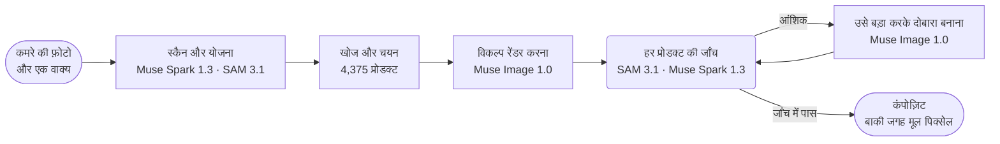

<p align="center">
  <a href="https://chanjoongx--realroom.us-east.modal.run">
    <picture>
      <source media="(prefers-color-scheme: dark)" srcset="../banner-dark.jpg">
      <source media="(prefers-color-scheme: light)" srcset="../banner-light.jpg">
      
    </picture>
  </a>
</p>

<h4 align="center">
  <a href="https://chanjoongx--realroom.us-east.modal.run">लाइव डेमो</a>
  &nbsp;·&nbsp;
  <a href="#how-a-run-works">यह कैसे काम करता है</a>
  &nbsp;·&nbsp;
  <a href="#demo-rooms">डेमो कमरे</a>
  &nbsp;·&nbsp;
  <a href="#run-it">इसे चलाएँ</a>
  &nbsp;·&nbsp;
  <a href="#use-your-own-catalog">अपना कैटलॉग</a>
</h4>

<p align="center">
  <a href="https://cerebralvalley.ai/e/meta-ai-developer-hackathon"></a>
  <a href="#meta-models"></a>
  <a href="#meta-models"></a>
  <a href="#meta-models"></a>
  <a href="#meta-models"></a>
  <a href="#meta-models"></a>
  <a href="https://github.com/chanjoongx/realroom/actions/workflows/ci.yml"></a>
  <a href="../../LICENSE"></a>
</p>

<p align="center">
  <a href="../../README.md">English</a>
  &nbsp;·&nbsp; <a href="README.ko.md">한국어</a>
  &nbsp;·&nbsp; <a href="README.ja.md">日本語</a>
  &nbsp;·&nbsp; <a href="README.es.md">Español</a>
  &nbsp;·&nbsp; <a href="README.pt-BR.md">Português</a>
  &nbsp;·&nbsp; <a href="README.fr.md">Français</a>
  &nbsp;·&nbsp; <a href="README.de.md">Deutsch</a>
  &nbsp;·&nbsp; <b>हिन्दी</b>
  &nbsp;·&nbsp; <a href="README.ar.md">العربية</a>
</p>

<p align="center"><sub>यह <a href="../../README.md">अंग्रेज़ी README</a> का अनुवाद है। दोनों में अंतर हो, तो अंग्रेज़ी वाला ही सही है।</sub></p>

> [!NOTE]
> Realroom, [Meta Global AI Developer Hackathon](https://cerebralvalley.ai/e/meta-ai-developer-hackathon) के Indie Developer ट्रैक में "Build for Your World" समस्या विवरण के तहत भेजी गई एक प्रविष्टि है। एजेंट, वेब ऐप, कैटलॉग इंडेक्स और डेमो कमरे, ये सभी 27 अक्टूबर से 4 नवंबर 2026 तक चली निर्माण अवधि में बनाए गए।
>
> होस्ट किया गया ऐप रिकॉर्ड किए गए तीनों रन रीप्ले करता है, और अपलोड की गई फ़ोटो पर पूरा एजेंट लाइव चलाता है, दिन में ज़्यादा से ज़्यादा 40 बार। एक लाइव रन में लगभग चार से आठ मिनट लगते हैं, और रन जब तक काम करता है, पेज उसके साथ-साथ आगे बढ़ता है। अपनी मशीन पर यही ऐप बिना key के रन रीप्ले करता है, या आपकी अपनी Meta Model API key से लाइव चलता है। दोनों तरीके [इसे चलाएँ](#run-it) खंड में दिए गए हैं।

<p align="center">
  <picture>
    <source media="(prefers-color-scheme: dark)" srcset="../built-on-dark.png">
    <source media="(prefers-color-scheme: light)" srcset="../built-on-light.png">
    
  </picture>
</p>

<p align="center">
  <a href="https://chanjoongx--realroom.us-east.modal.run"></a>
  <br>
  <sub>लिविंग रूम का डेमो रन, ऐप में रीप्ले होते हुए: स्कैन, प्लेसमेंट गाइड, जाँच, फिर पहले और बाद वाला स्लाइडर।</sub>
</p>

Realroom एक एजेंट है, जो Meta के मॉडलों पर बना है। आप इसे कमरे की एक फ़ोटो देते हैं और एक वाक्य में बताते हैं कि आपको क्या चाहिए। Muse Spark 1.3 कमरे को समझता है और योजना बनाता है कि क्या जोड़ना है या क्या बदलना है, और SAM 3.1 हर चीज़ की रूपरेखा बनाता है। एजेंट 4,375 असली प्रोडक्टों में से वे चीज़ें खोजता है जिनके लिस्टिंग वाले नाप उस जगह में फ़िट बैठें, और उन्हें Muse Spark Open के लिखे विवरणों और Meta के Perception Encoder के आधार पर रैंक करता है। Spark एक ऐसा सेट चुनता है जो साथ में अच्छा लगे, और Muse Image 1.0 उसे फ़ोटो में बनाता है। फिर एजेंट अपने काम की खुद जाँच करता है: SAM 3.1 रेंडर में हर प्रोडक्ट को दोबारा ढूँढता है, Muse Spark 1.3 तीन अलग-अलग जाँचों में उसकी तुलना उसकी कैटलॉग फ़ोटो से करता है, और जो प्रोडक्ट गलत बना हो, उसे दोबारा बनाया जाता है। रेंडर से सिर्फ़ नए प्रोडक्ट, उनकी परछाइयाँ और खाली की गई जगहें आती हैं। बाकी हर पिक्सेल आपकी मूल फ़ोटो से वापस कॉपी किया जाता है, और पेज आपको यह गिनती अपने ही ब्राउज़र में जाँचने देता है।

इसे [chanjoongx--realroom.us-east.modal.run](https://chanjoongx--realroom.us-east.modal.run) पर आज़माएँ। डेमो कमरे रिकॉर्ड किए गए रन रीप्ले करते हैं, और अपलोड बॉक्स आपकी अपनी फ़ोटो पर पूरा एजेंट चलाता है।

## क्यों

कमरे का मेकओवर करने वाले जनरेटर एक अच्छा-सा कमरा बना देते हैं, लेकिन उसमें रखा सोफ़ा ऐसा नहीं होता जिसे आप खरीद सकें, किसी ने यह जाँचा नहीं होता कि वह दीवार के साथ फ़िट बैठेगा या नहीं, और जनरेटर चुपचाप दीवारें, फ़र्श और खिड़की के बाहर का नज़ारा भी दोबारा पेंट कर देता है। अगर आप किराए पर रहते हैं, या बस एक सोफ़ा ढूँढ रहे हैं, तो वह तस्वीर गलत सवाल का जवाब देती है। Realroom आपका कमरा जैसा है वैसा ही रखता है, और सिर्फ़ वही बदलता है जो आप सच में खरीदेंगे। कोई फ़र्नीचर स्टोर इसमें अपना कैटलॉग जोड़ सकता है; डेमो में Amazon Berkeley Objects इस्तेमाल हुआ है, जो Amazon की असली लिस्टिंग का एक सार्वजनिक सेट है।

## <a id="demo-rooms"></a>डेमो कमरे


डेमो कमरे Muse Image 1.0 से जनरेट किए गए हैं, इसलिए इस रिपॉज़िटरी में कोई निजी फ़ोटो नहीं है। हर पंक्ति एक रिकॉर्ड किया गया रन है। आँकड़े उसी रन की अपनी `run.json` और `ledger.jsonl` से लिए गए हैं, जो [`demo-runs/`](../../demo-runs) में हैं।

| कमरा | अनुरोध | प्रोडक्ट | मेल खाए | अनछुए पिक्सेल | समय | लागत |
|---|---|---|---|---|---|---|
| लिविंग रूम, 2005 का अपार्टमेंट | "The old dark sofa makes the room feel gloomy. Make it brighter and cozier without painting or touching the floor." | सोफ़ा, कालीन, फ़्लोर लैंप | 3 में से 3, फ़्लोर लैंप दोबारा बनाने के एक दौर के बाद | 68.7% | 433&nbsp;s | $0.39 |
| खाली कमरा, शिफ़्ट होने का दिन | "Move-in day. I work from home and want a calm living room where two friends can sit: something to sit on, a rug, a small table and warm evening light." | सोफ़ा, कालीन, फ़्लोर लैंप, कॉफ़ी टेबल, गमला | 5 में से 5, कालीन और फ़्लोर लैंप दोबारा बनाने के एक-एक दौर के बाद | 63.6% | 384&nbsp;s | $0.58 |
| स्टूडियो, पहला अपार्टमेंट | "...I still sleep on a mattress on the floor and the moving boxes are everywhere. Make it feel like a calm, grown-up bedroom without painting." | बेडिंग, कालीन, वॉल आर्ट | 3 में से 3, बेडिंग दोबारा बनाने के एक दौर के बाद | 67.5% | 477&nbsp;s | $0.40 |

"मेल खाए" कॉलम किसी प्रोडक्ट को तब गिनता है जब उसके अंतिम पिक्सल की Muse Spark 1.3 वाली तीन अलग-अलग जाँचों में से कम से कम दो "match" कहें। हर जाँच में प्रोडक्ट का पास से लिया गया क्रॉप उसकी कैटलॉग फ़ोटो के बगल में रखा जाता है, और ऐप तीनों फ़ैसले दिखाता है। लागत के आँकड़े Meta की प्रकाशित कीमतों से लगाए गए अनुमान हैं, और हर कॉल के लिए लॉग किए गए हैं। रिकॉर्ड किए गए रनों ने तीन-तीन विकल्प बनाए, और वे ज़्यादा से ज़्यादा दो प्रोडक्ट दोबारा बना सकते थे। लाइव रन दो विकल्प बनाते हैं और ज़्यादा से ज़्यादा एक प्रोडक्ट दोबारा बनाते हैं, इसलिए उनकी लागत कम आती है: लगभग $0.2 से $0.5।

## <a id="how-a-run-works"></a>एक रन कैसे चलता है



| चरण | मॉडल | क्या होता है |
|---|---|---|
| स्कैन और योजना | Muse Spark 1.3, SAM 3.1 | Spark की एक ही रिक्वेस्ट स्कीमा से बँधा JSON लौटाती है: खिसकाई जा सकने वाली हर चीज़ अपने बॉक्स और फ़ैसले (रखना, हटाना या बदलना) के साथ, कमरे का स्थायी ढाँचा, कमरे का आकार और रोशनी, और स्लॉट की योजना (किस्म, जोड़ना या बदलना, टारगेट बॉक्स, cm में आकार का दायरा, लुक, रंग परिवार)। SAM 3.1 कॉन्सेप्ट प्रॉम्प्ट से इन बॉक्सों को सटीक मास्क में बदलता है, और जिन चीज़ों को कॉन्सेप्ट नहीं पकड़ पाते, उनके लिए बॉक्स प्रॉम्प्ट का इस्तेमाल करता है। |
| खोज | कैटलॉग इंडेक्स, PE-Core B16 | हर स्लॉट के लिए: पहले उस किस्म के प्रोडक्ट, फिर उनमें से सिर्फ़ वे जिनके असली नाप स्लॉट के आकार के दायरे में आते हैं। इन्हें Muse Spark Open के लिखे विवरण से टेक्स्ट की समानता (45%) और Perception Encoder की टेक्स्ट-से-इमेज समानता (55%) के आधार पर रैंक किया जाता है। हर स्लॉट के लिए 24 प्रोडक्ट। Perception Encoder ऐप के अपने सर्वर में चलता है, इसलिए इस चरण में कोई API कॉल नहीं होती। |
| चयन | Muse Spark 1.3 | Spark एक ही रिक्वेस्ट में कमरा और हर स्लॉट के विकल्पों की नंबर लगी शीट देखता है, इसलिए वह ऐसा सेट चुनता है जिसकी चीज़ें आपस में जँचें। |
| रेंडर | Muse Image 1.0 | कमरे, एक प्लेसमेंट गाइड और प्रोडक्टों की असली फ़ोटो के साथ एक `/images/edits` कॉल दो या तीन विकल्प लौटाती है। मॉडल के वेब सर्च और इमेज सर्च टूल बंद रखे जाते हैं। |
| जाँच | SAM 3.1, Muse Spark 1.3 | हर विकल्प को मूल फ़ोटो के साथ अलाइन किया जाता है (ECC होमोग्राफ़ी) और उसके रंग मूल से मिलाए जाते हैं। SAM 3.1 हर नए प्रोडक्ट को दोबारा ढूँढता है, और Spark हर प्रोडक्ट के क्रॉप को उसकी कैटलॉग फ़ोटो से मिलाकर परखता है, साथ ही पूरे दृश्य को भी। सबसे अच्छा विकल्प रखा जाता है। इसके बाद Spark उस विकल्प के हर प्रोडक्ट को तीन बार और जाँचता है, और हर जाँच एक अलग रिक्वेस्ट होती है जिसमें पास से लिया गया क्रॉप कैटलॉग फ़ोटो के बगल में रखा जाता है। एक ही पिक्सेल पर Spark का फ़ैसला एक रिक्वेस्ट से दूसरी रिक्वेस्ट में बदल सकता है, इसलिए कोई प्रोडक्ट तभी मेल खाया गिना जाता है जब तीनों में से कम से कम दो "match" कहें। |
| सुधार | Muse Image 1.0, SAM 3.1, Muse Spark 1.3 | जिस प्रोडक्ट को जाँचें partial बताएँ, उसे आसपास के हिस्से समेत काटा जाता है और उसकी कैटलॉग फ़ोटो को सामने रखकर बड़ा करके दोबारा बनाया जाता है। हर दौर में दो कोशिशें होती हैं, और ज़्यादा से ज़्यादा दो दौर चलते हैं। जो प्रोडक्ट जाँचों को उसकी तय जगह पर नहीं मिलता, उसे पहले पूरी फ़ोटो में ढूँढा जाता है, क्योंकि रेंडर कभी-कभी उसे कहीं और बना देता है; अगर वह वहाँ न हो, तभी उसे उसी तरह उसकी तय जगह पर जोड़ा जाता है। कोई कोशिश मौजूदा वर्शन की जगह तभी लेती है, जब Spark उसे ज़्यादा अंक दे, और Spark की टिप्पणियाँ अगले दौर को दिशा देती हैं। दोबारा बनाया गया प्रोडक्ट, और हर वह प्रोडक्ट जिसके अपने पिक्सेल किसी बाद वाले चरण ने बदल दिए हों, तैयार फ़ोटो पर फिर से तीन बार जाँचा जाता है। रेंडर ने जो बिखरा सामान छोड़ दिया, उसके लिए अलग से एक पास चलता है, जिसे SAM 3.1 से जाँचा जाता है। अगर कुछ भी बदला हो, तो Spark तैयार कमरे को फिर से परखता है। |
| कंपोज़िट | कोई नहीं | नतीजा रेंडर से सिर्फ़ प्रोडक्ट मास्क, उनके चारों ओर की एक पतली पट्टी, कॉन्टैक्ट शैडो और हटाई गई चीज़ों की जगहें लेता है। बाकी हर पिक्सेल मूल फ़ोटो का है। |

वेब ऐप हर रन को उसके इवेंट लॉग से रीप्ले करता है: हर आउटलाइन के साथ स्कैन, खोज का फ़नल, चयन की शीटें, सभी रेंडर विकल्प, हर सुधार उसके पहले और बाद के रूप के साथ, और अंतिम लेयर। हर चरण के हेडर में उस मॉडल की ID दिखती है जिसे उस चरण ने कॉल किया।


ऊपर लिविंग रूम रन का जाँच वाला चरण है। Muse Image ने तीन विकल्प बनाए, Spark ने हर विकल्प में तीनों प्रोडक्टों को अंक दिए, और विकल्प 1 रखा गया। उसके फ़्लोर लैंप को 10 में से 5 अंक मिले, और तीन अलग-अलग जाँचों में से हर एक ने उसे 6 अंक दिए, इसलिए वह सुधार वाले चरण में गया और 9 अंक के साथ लौटा।

## <a id="meta-models"></a>Meta के मॉडल

| मॉडल | एक्सेस | किस काम में |
|---|---|---|
| `muse-spark-1.3` | Meta Model API | कमरे को समझना और योजना बनाना, प्रोडक्ट चुनना, हर प्रोडक्ट और दृश्य को परखना |
| `sam-3.1` | Meta Model API | कमरे की चीज़ों और हर रेंडर हुए प्रोडक्ट के मास्क, यह जाँचना कि कौन-सा बिखरा सामान बचा रह गया |
| `muse-image-1.0` | Meta Model API | रेंडर के विकल्प, दोबारा बनाना, बिखरा सामान हटाना, डेमो कमरे |
| Muse Spark Open | Baseten, Fireworks | पूरे कैटलॉग के टैग और विवरण |
| `pe-core-b16-224` | ओपन वेट्स, ऐप के सर्वर में (Modal या आपकी मशीन) | Perception Encoder: हर स्लॉट के लुक को कैटलॉग की फ़ोटो से मिलाता है |

चलते समय Realroom सिर्फ़ इस टेबल के पहले तीन मॉडलों को कॉल करता है, और तीनों api.meta.ai पर हैं। Perception Encoder वह अपने ही सर्वर में चलाता है। Muse Spark Open ने कैटलॉग के टैग किसी भी रन से पहले ही बना दिए थे। [`backend/tests/test_meta_only.py`](../../backend/tests/test_meta_only.py) `backend/realroom/` में एजेंट के कोड की जाँच करता है: अगर वहाँ के मॉडल ID इस टेबल वाले चार ID नहीं हैं, अगर API का पता api.meta.ai नहीं है, या अगर उस कोड की किसी स्ट्रिंग में कोई दूसरा URL है या GPT, Claude, Gemini, Flux या SigLIP जैसे किसी जाने-माने गैर-Meta मॉडल का नाम है, तो टेस्ट फ़ेल हो जाता है।

## हिस्से आपस में कैसे जुड़ते हैं

1. पेज फ़ोटो, वाक्य और मोड को FastAPI सर्वर ([`backend/realroom/server.py`](../../backend/realroom/server.py)) के `POST /api/runs` पर भेजता है। सर्वर सीमाएँ जाँचता है, फ़ोटो को उसके मेटाडेटा के बिना एक नए रन फ़ोल्डर में सेव करता है और एजेंट ([`pipeline.py`](../../backend/realroom/pipeline.py)) को एक बैकग्राउंड थ्रेड में शुरू करता है।
2. एजेंट [`meta.py`](../../backend/realroom/meta.py) के ज़रिए api.meta.ai पर Muse Spark 1.3, SAM 3.1 और Muse Image 1.0 को कॉल करता है। [`catalog.py`](../../backend/realroom/catalog.py) में कैटलॉग खोज उसी प्रोसेस के अंदर Perception Encoder चलाती है।
3. हर चरण के शुरू और ख़त्म होने पर एजेंट `run.json` में एक इवेंट जोड़ता है और उस चरण की इमेज रन फ़ोल्डर में सेव करता है। हर मॉडल कॉल अपने समय और अनुमानित लागत के साथ `ledger.jsonl` में दर्ज होती है।
4. रन चलते समय पेज हर 1.5 सेकंड में `GET /api/runs/<id>` पढ़ता है और किसी चरण का इवेंट आते ही उस चरण को `/runs/<id>/` की इमेज के साथ दिखाता है। डेमो कमरा एक पूरा हो चुका रन फ़ोल्डर है, और पेज उसके इवेंट दोबारा चलाता है।

Meta Model API की key सर्वर पर ही रहती है। आपकी मशीन पर वह `.env` में होती है, जिसे git अनदेखा करता है। Modal पर वह `realroom-model` नाम के secret में होती है, जिसमें सिर्फ़ `MODEL_API_KEY` है। ब्राउज़र को key कभी नहीं मिलती, और रिपॉज़िटरी में कोई key नहीं है।

## आप क्या जाँच सकते हैं

- `before.png` और `after.png` लॉसलेस हैं। ऐप में **Check it in your browser** दोनों को डाउनलोड करके आपके ब्राउज़र में उनकी पिक्सेल-दर-पिक्सेल तुलना करता है, फिर दिखाता है कि कितना हिस्सा बिल्कुल एक जैसा है।
- `layers.png` हर बदले हुए पिक्सेल को प्रोडक्ट, खाली की गई जगह या परछाईं के हिसाब से रंगता है। `masks.npz` में हर चीज़ और हर प्रोडक्ट का मास्क है।
- `run.json` में हर प्रोडक्ट के फ़ैसले में वे तीन अंतिम जाँचें दर्ज हैं जिनके आधार पर उसे गिना गया, और उनके बगल में वह फ़ैसला भी है जो जाँच या सुधार वाले चरण ने उसे दिया था।
- `ledger.jsonl` में हर मॉडल कॉल अपने समय और अनुमानित लागत के साथ दर्ज है। Perception Encoder वाली खोज भी इसमें है, बिना किसी लागत के, क्योंकि वह ऐप के अपने सर्वर में चलती है।
- `drift.jpg` दिखाता है कि बाकी हर जगह कच्चा रेंडर मूल फ़ोटो से कितना भटक गया (डेमो रन में औसत रंग अंतर dE 1.8 से 2.7)। कंपोज़िट वाला चरण इन्हीं पिक्सेलों की वजह से है।

## <a id="run-it"></a>इसे चलाएँ

आपको Python 3.12 चाहिए (PyTorch 2.6.0 के Python 3.14 के लिए wheel नहीं हैं), और वेब बिल्ड के लिए Node 22.12 या उससे नया वर्शन (20.19 भी चलता है)। एक बार इंस्टॉल करें:

```bash
python3.12 -m venv .venv
.venv/bin/pip install torch==2.6.0 torchvision==0.21.0 --index-url https://download.pytorch.org/whl/cpu
.venv/bin/pip install -r backend/requirements.txt
(cd web && npm ci && npm run build)
```

Windows पर, `py -3.12 -m venv .venv` से एनवायरनमेंट बनाएँ, और इन कमांड में जहाँ `.venv/bin/` लिखा है, वहाँ `.venv\Scripts\` लिखें।

### रिकॉर्ड किए गए रन रीप्ले करें (बिना key के)

```bash
.venv/bin/python backend/scripts/serve_local.py
```

http://127.0.0.1:8787 खोलें। डेमो कमरे [`demo-runs/`](../../demo-runs) के रन को चरण-दर-चरण रीप्ले करते हैं, ठीक होस्ट किए गए ऐप की तरह। किसी मॉडल को कॉल नहीं किया जाता। उन रन में दिखने वाली प्रोडक्ट फ़ोटो `demo-runs/_photos` में हैं, और अपलोड बॉक्स बताता है कि लाइव रन बंद हैं।

रीप्ले के लिए PyTorch की ज़रूरत नहीं है। अगर आपको सिर्फ़ रीप्ले चाहिए, तो ऊपर की दो `pip` लाइनों की जगह `.venv/bin/pip install -r backend/requirements-test.txt` चलाएँ: इससे वे सारे Python पैकेज इंस्टॉल हो जाते हैं जो रीप्ले सर्वर और टेस्ट इस्तेमाल करते हैं। वेब बिल्ड फिर भी चाहिए।

### अपनी Meta Model API key से लाइव रन

1. रिपॉज़िटरी के रूट में `.env.example` को `.env` नाम से कॉपी करें और `MODEL_API_KEY` भरें। `.env` को git अनदेखा करता है।
2. सभी 4,375 प्रोडक्टों की फ़ोटो `data/photos` में डाउनलोड करें। ये इस रिपॉज़िटरी की GitHub रिलीज़ में लगभग 730 MB की एक फ़ाइल के रूप में हैं।
   ```bash
   .venv/bin/python catalog/get_photos.py
   ```
3. Perception Encoder के वेट्स एक बार डाउनलोड कर लें (Hugging Face पर `timm/PE-Core-B-16`, लगभग 1.8 GB)। अगर आप यह छोड़ देते हैं, तो पहली लाइव खोज इसी डाउनलोड के पूरा होने का इंतज़ार करेगी।
   ```bash
   .venv/bin/python -c "import open_clip; open_clip.create_model_and_transforms('PE-Core-B-16', pretrained='meta')"
   ```
4. सर्वर को `--live` के साथ शुरू करें:
   ```bash
   .venv/bin/python backend/scripts/serve_local.py --live
   ```

`--live` रीप्ले और लाइव के बीच का एकमात्र स्विच है। इसके साथ अपलोड बॉक्स आपकी फ़ोटो पर पूरा एजेंट चलाता है, और रन जब तक काम करता है, पेज उसके साथ-साथ आगे बढ़ता है। Meta की प्रकाशित कीमतों पर एक रन की लागत लगभग $0.2 से $0.5 आती है, और उसकी `ledger.jsonl` में हर कॉल दर्ज होती है। लोकल सर्वर दिन में ज़्यादा से ज़्यादा 10 लाइव रन शुरू करता है; इसे `--per-day` से बदला जा सकता है। जो रन 12 मिनट या $0.60 पार कर जाए, वह दोबारा बनाने के बचे हुए दौर छोड़ देता है और जो उसके पास है उसी के साथ पूरा होता है।

वेब ऐप के बिना किसी एक फ़ोटो पर एजेंट चलाने के लिए:

```bash
.venv/bin/python backend/scripts/run_demo.py --room room.jpg --id my-room --brief "Warmer and less cluttered" \
    --mode refresh --slots 3 --catalog catalog/index --photos data/photos --out demo-runs/my-room
```

खाली कमरे के लिए `--mode furnish` इस्तेमाल करें। जब तक `serve_local.py` चल रहा हो, पूरा हुआ रन http://127.0.0.1:8787/r/my-room पर रीप्ले होता है।

### कैटलॉग दोबारा बनाएँ या ऐप होस्ट करें

कैटलॉग दोबारा बनाने के लिए ABO की लिस्टिंग और इमेज मेटाडेटा `data/abo/` में डाउनलोड करें, फिर [कैटलॉग](#the-catalog) खंड के चरण चलाएँ। Modal वाले चरणों के लिए एक Modal अकाउंट चाहिए, और टैगिंग के लिए `realroom-keys` नाम के Modal सीक्रेट में `BASETEN_API_KEY` और `FIREWORKS_API_KEY` होने चाहिए।

होस्ट किया गया वर्शन Modal पर चलता है (`backend/modal_app.py`): एक वेब कंटेनर, दो वॉल्यूम पर कैटलॉग और रन, एक समय में ज़्यादा से ज़्यादा तीन लाइव रन, दिन में 40 और घंटे में 8 लाइव रन, हर विज़िटर के लिए तीन, और कुल मिलाकर 60 डॉलर तक की मॉडल कॉल। अपलोड JPEG, PNG या WebP होने चाहिए, ज़्यादा से ज़्यादा 12 MB और 40 मेगापिक्सल। फ़ोटो सहेजने से पहले उसकी लोकेशन और कैमरे की जानकारी हटा दी जाती है, और विज़िटर को हर दिन बदलने वाले salt वाले hash से गिना जाता है, उनके पते से कभी नहीं। जिस फ़ोटो में कोई व्यक्ति दिखे या जो कमरे की न हो, वह लौटा दी जाती है और तुरंत धुंधली कर दी जाती है। लाइव नतीजे ऐसे पते पर रहते हैं जिसका अंदाज़ा नहीं लगाया जा सकता, और वे कभी कैश नहीं होते। उनकी `after.jpg` और `after.png` में IPTC मेटाडेटा होता है जो उन्हें AI से संपादित बताता है। अपलोड की गई फ़ोटो 24 घंटे के अंदर मिटा दी जाती हैं।

## <a id="the-catalog"></a>कैटलॉग

[Amazon Berkeley Objects](https://amazon-berkeley-objects.s3.us-east-1.amazonaws.com/index.html) (ABO) Amazon की असली प्रोडक्ट लिस्टिंग का एक सार्वजनिक डेटासेट है, जिसमें फ़ोटो और नाप भी हैं। `catalog/` इसी से Realroom का कैटलॉग बनाता है:

1. `abo_catalog.py` amazon.com की लिस्टिंग को 25 किस्मों (सोफ़ा, कालीन, फ़्लोर लैंप, वॉल आर्ट वगैरह) में बाँटता है, और इनमें से 5,931 लिस्टिंग किसी न किसी किस्म में आती हैं। यह आकार को सेंटीमीटर में बदलता है और जिन लिस्टिंग में नाप नहीं हैं या जिनके नाप सही नहीं लगते, उन्हें हटा देता है। इसके बाद 4,612 संभावित प्रोडक्ट बचते हैं।
2. `modal_catalog.py --step score` और `abo_choose.py` हर प्रोडक्ट के लिए एक संदर्भ फ़ोटो चुनते हैं, और सफ़ेद पृष्ठभूमि पर साफ़ कटआउट को तरजीह देते हैं।
3. `modal_catalog.py --step fetch` वह फ़ोटो Modal के क्लाउड में एक बार डाउनलोड करता है और उसे ट्रिम करता है।
4. `modal_catalog.py --step tag` हर फ़ोटो को उसकी लिस्टिंग के साथ **Muse Spark Open** को भेजता है, जो Meta का ओपन-वेट मॉडल है और जिसे Baseten सर्व करता है (Fireworks बैकअप के तौर पर)। यह एक शीर्षक, रंग, सामग्री, शैली, दिखावट का विवरण, SAM के लिए एक वाक्यांश और रेंडर-जोखिम का अनुमान लौटाता है, और यह भी कि फ़ोटो में सच में लिस्टिंग वाला प्रोडक्ट है या नहीं।
5. `modal_catalog.py --step embed` Modal के CPU पर Meta के Perception Encoder (PE-Core B16-224) से हर फ़ोटो की एम्बेडिंग बनाता है।
6. `abo_finalize.py` `catalog.jsonl` लिखता है, जिसमें 4,375 प्रोडक्ट हैं। इसने वे 104 प्रोडक्ट हटा दिए जिनकी फ़ोटो में लिस्टिंग वाला प्रोडक्ट नहीं दिखता था, और वे 133 भी जिनका टैग डेमो रन रिकॉर्ड होते समय तक पूरा नहीं हुआ था।

Muse Spark Open ने 4,375 में से 3,781 प्रोडक्ट Baseten पर और 594 Fireworks पर टैग किए। टैग [`catalog/index/catalog.jsonl`](../../catalog/index/catalog.jsonl) में हैं। रिपॉज़िटरी में सिर्फ़ वही प्रोडक्ट फ़ोटो हैं जो डेमो रन में दिखती हैं। पूरा सेट GitHub रिलीज़ में एक फ़ाइल के रूप में है ([इसे चलाएँ](#run-it) देखें), और ऊपर दिए चरण इसे ABO से दोबारा बना देते हैं।

## <a id="use-your-own-catalog"></a>अपना कैटलॉग इस्तेमाल करें

एजेंट खुद ABO पर निर्भर नहीं है। यह एक कैटलॉग फ़ोल्डर (`--catalog`) पढ़ता है, जिसमें `catalog.jsonl` और Perception Encoder की दो फ़ाइलें होती हैं, और एक फ़ोटो फ़ोल्डर (`--photos`) भी, जिसमें हर प्रोडक्ट के लिए `img/<id>.jpg` और `thumb/<id>.webp` होते हैं। यह [`catalog/index/catalog.jsonl`](../../catalog/index/catalog.jsonl) की पहली पंक्ति है, छोटी करके:

```json
{
  "id": "B075QFCHM9",
  "kind": "bed",
  "name": "Rivet York Modern Extended Platform Queen Bed, 90.2\"L, Grey",
  "brand": "Rivet",
  "size_cm": {"w": 229.0, "d": 182.9, "h": 107.5},
  "url": "https://www.amazon.com/dp/B075QFCHM9",
  "cutout": true,
  "tag": {
    "title": "Light Grey Upholstered Platform Bed",
    "matches_listing": true,
    "colors": ["light grey", "white", "light brown"],
    "color_family": "grey",
    "materials": ["polyester", "fabric", "wood"],
    "style": ["modern", "minimal", "contemporary"],
    "render_risk": "low",
    "sam_phrase": "platform bed",
    "visual_description": "Low-profile light grey polyester platform bed with tall rectangular headboard, extended surround frame and tapered wood legs shown with white mattress."
  }
}
```

- `kind` का मान `backend/realroom/catalog.py` के `KINDS` में दिए गए नामों में से एक होता है। योजना हर स्लॉट को किस्म के हिसाब से माँगती है।
- `size_cm` का मतलब चौड़ाई, गहराई और ऊँचाई है। कोई प्रोडक्ट शॉर्टलिस्ट में तभी पहुँचता है, जब वह स्लॉट के आकार के दायरे में फ़िट हो।
- `tag` वह है जो Muse Spark Open ने चरण 4 में लिखा। टेक्स्ट खोज इसका शीर्षक, रंग, सामग्री, शैली और विवरण पढ़ती है, SAM 3.1 रेंडर हुए प्रोडक्ट को उसके `sam_phrase` से ढूँढता है, और `"matches_listing": false` वाला प्रोडक्ट कभी सुझाया नहीं जाता। टैग न हो, तो एजेंट `name` और `kind` से काम चलाता है।
- `cutout` बताता है कि फ़ोटो में प्रोडक्ट सादी पृष्ठभूमि पर अकेला है। खोज ऐसी फ़ोटो को ऊपर रैंक करती है।
- `emb_pe_core_b16.npy` में हर प्रोडक्ट फ़ोटो की एक Perception Encoder एम्बेडिंग है, `emb_pe_core_b16_ids.json` के क्रम में। चरण 5 ये दोनों फ़ाइलें लिखता है। इनके बिना खोज सिर्फ़ टेक्स्ट के आधार पर रैंक करती है।

`catalog/` की स्क्रिप्टें यह फ़ोल्डर ABO से बनाती हैं। किसी दूसरे प्रोडक्ट फ़ीड के लिए चरण 1 से 3 ही दोबारा लिखने होंगे, क्योंकि यही चरण ABO लिस्टिंग को पंक्तियों और फ़ोटो में बदलते हैं। फिर `--catalog` और `--photos` देकर `serve_local.py` या `run_demo.py` को नए फ़ोल्डरों का पता दें।

## टेस्ट

```bash
.venv/bin/pip install -r backend/requirements-test.txt
.venv/bin/python -m pytest backend/tests
```

टेस्ट के लिए किसी key की ज़रूरत नहीं है और वे कोई मॉडल नहीं बुलाते। वे तीनों रिकॉर्ड किए गए रन HTTP API से दोबारा चलाते हैं और उनके आँकड़ों को हर ledger और इस README से मिलाते हैं। एक नकली launcher के साथ वे अपलोड को लाइव रन के गेट से गुज़ारते हैं: मेटाडेटा हटाना, साइज़ और फ़ॉर्मैट की सीमाएँ, और हर विज़िटर, हर दिन और बजट की सीमाएँ। वे पाइपलाइन को नाकाम जवाब और बिगड़े हुए मॉडल आउटपुट देते हैं, और जाँचते हैं कि ऐप जो भी मॉडल बुलाता है वह Meta का मॉडल है, जिस तक सिर्फ़ api.meta.ai से पहुँचा जाता है। GitHub Actions हर push पर इन्हें वेब के टाइपचेक और बिल्ड के साथ चलाता है।

## रिपॉज़िटरी की संरचना

```text
backend/
  realroom/      the agent: scan.py, pick.py, render.py, verify.py, composite.py and pipeline.py,
                 catalog.py (search), meta.py (Meta Model API clients), server.py (API and site)
  scripts/       serve_local.py, run_demo.py, make_rooms.py (the demo rooms), pack_demo_photos.py
  tests/         the test suite (no key, no network calls)
  modal_app.py   the hosted app on Modal
catalog/         the catalog build from ABO, steps 1 to 6, plus get_photos.py and pack_photos.py
  index/         catalog.jsonl (4,375 products) and the Perception Encoder embeddings
demo-runs/       the three recorded runs (run.json, ledger.jsonl, masks and images) and their product photos
web/             the React app (Vite): the home page, the run viewer and the pixel check
docs/            README images and translations
```

## सीमाएँ

- बारीक टेक्सचर और रंगों के हल्के फ़र्क़ इमेज मॉडल के लिए मुश्किल होते हैं। महीन बुनाई वाले कालीन अक्सर बहुत उभरे हुए बनते हैं, और बेडिंग अक्सर अपनी कैटलॉग फ़ोटो से ज़्यादा गहरी या ज़्यादा धूसर बनती है। सुधार वाला लूप सबसे कमज़ोर प्रोडक्टों को दोबारा बनाता है (होस्ट किए गए ऐप के हर रन में एक, हर रिकॉर्ड किए गए रन में दो), और एक ही पिक्सल पर Spark के फ़ैसले एक रिक्वेस्ट से दूसरी रिक्वेस्ट में बदलते रहते हैं, इसलिए कोई प्रोडक्ट तभी मेल खाया गिना जाता है जब तीन अलग-अलग जाँचों में से कम से कम दो "match" कहें।
- रेंडर कभी-कभी किसी प्रोडक्ट को उसकी तय जगह से हटकर बना देता है, या उसे बनाता ही नहीं। जब जाँचों को उस जगह पर कुछ नहीं मिलता, तो Spark पहले पूरी फ़ोटो में उस प्रोडक्ट को ढूँढता है, और सुधार वाला चरण उसे तभी जोड़ता है जब वह वहाँ न हो।
- एक ही अनुरोध के अलग-अलग रन में योजना बदल जाती है, क्योंकि Spark हर बार नए सिरे से योजना बनाता है और चयन करता है।
- जहाँ से कोई चीज़ हटाई गई थी, वहाँ दोबारा बनाया गया फ़र्श मूल फ़र्श से एक हल्की-सी जोड़ की रेखा पर मिल सकता है।
- लिस्टिंग 2021 में प्रकाशित एक डेटासेट से ली गई हैं, इसलिए इनमें कीमतें नहीं हैं और कुछ प्रोडक्ट लिंक अब नहीं खुलते।
- Spark कमरे का जो आकार बताता है, वह दरवाज़े और बेड जैसी चीज़ों के आकार से लगाया गया अनुमान है। इससे खोज के लिए आकार का दायरा तय होता है, लेकिन रेंडर कोई माप नहीं है।

## श्रेय

- प्रोडक्ट फ़ोटो और डेटा: **Amazon.com** का Amazon Berkeley Objects, [CC BY 4.0](https://creativecommons.org/licenses/by/4.0/) लाइसेंस के तहत। डेटासेट Matthieu Guillaumin, Thomas Dideriksen, Kenan Deng और Himanshu Arora (Amazon.com), Jasmine Collins और Jitendra Malik (UC Berkeley) ने तैयार किया है। बदलाव: फ़ोटो ट्रिम और रीसाइज़ की गईं, प्रोडक्टों को Muse Spark Open ने टैग किया, और Muse Image 1.0 प्रोडक्टों को कमरे की फ़ोटो में दोबारा बनाता है। Realroom न तो Amazon से जुड़ा है और न ही Amazon ने इसका समर्थन किया है।
- कंप्यूट: Meta से मिले Meta Model API क्रेडिट, और हैकाथॉन के इन्फ़रेंस पार्टनर Baseten, Fireworks AI और Modal से मिले क्रेडिट।
- Built with Muse Spark Open. इसके वेट्स [Muse Model License](https://huggingface.co/meta-models/Muse-Spark-Open-816B-A42B) के तहत जारी किए गए हैं, और Realroom कैटलॉग को टैग करने के लिए इस मॉडल को Baseten और Fireworks AI के ज़रिए कॉल करता है।
- Meta FAIR का [Perception Encoder](https://github.com/facebookresearch/perception_models) (PE-Core B16-224), Apache 2.0, जिसे [OpenCLIP](https://github.com/mlfoundations/open_clip) के ज़रिए `timm/PE-Core-B-16` वेट्स से लोड किया जाता है।
- Python लाइब्रेरी: FastAPI (MIT), Uvicorn (BSD-3-Clause), NumPy और SciPy (BSD), OpenCV (Apache 2.0), Pillow (MIT-CMU), scikit-image (BSD-3-Clause), PyTorch और torchvision (BSD-3-Clause), OpenCLIP (MIT), timm (Apache 2.0), Requests (Apache 2.0), python-multipart (Apache 2.0), Modal क्लाइंट (Apache 2.0) और Meta का `meta-sam-parser` (SAM License)। OpenAI Python SDK (Apache 2.0) वही क्लाइंट है जो Meta के API दस्तावेज़ों में Meta Model API के लिए दिखाया गया है; यहाँ यह सिर्फ़ api.meta.ai से बात करता है।
- वेब लाइब्रेरी: React, Vite और Motion (MIT), Lucide आइकन (ISC) और TypeScript (Apache 2.0)।
- फ़ॉन्ट: Geist और Geist Mono (Vercel) और Instrument Serif, सभी SIL Open Font License के तहत।
- डेमो कमरे Muse Image 1.0 से जनरेट किए गए हैं।

सियोल की कुकमिन यूनिवर्सिटी में AI के छात्र [Chanjoong Kim](https://github.com/chanjoongx) ने बनाया। कोड: MIT, [LICENSE](../../LICENSE) देखें।
