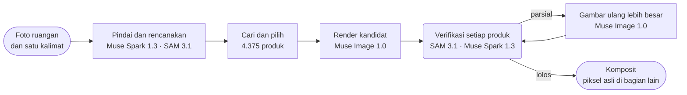

<p align="center">
  <a href="https://chanjoongx--realroom.us-east.modal.run">
    <picture>
      <source media="(prefers-color-scheme: dark)" srcset="../banner-dark.jpg">
      <source media="(prefers-color-scheme: light)" srcset="../banner-light.jpg">
      
    </picture>
  </a>
</p>

<h4 align="center">
  <a href="https://chanjoongx--realroom.us-east.modal.run">Demo langsung</a>
  &nbsp;·&nbsp;
  <a href="#how-a-run-works">Cara kerja</a>
  &nbsp;·&nbsp;
  <a href="#demo-rooms">Ruangan demo</a>
  &nbsp;·&nbsp;
  <a href="#run-it">Cara menjalankan</a>
  &nbsp;·&nbsp;
  <a href="#use-your-own-catalog">Katalog Anda sendiri</a>
</h4>

<p align="center">
  <a href="https://cerebralvalley.ai/e/meta-ai-developer-hackathon"></a>
  <a href="#meta-models"></a>
  <a href="#meta-models"></a>
  <a href="#meta-models"></a>
  <a href="#meta-models"></a>
  <a href="#meta-models"></a>
  <a href="../../LICENSE"></a>
</p>

<p align="center">
  <a href="../../README.md">English</a>
  &nbsp;·&nbsp; <a href="README.ko.md">한국어</a>
  &nbsp;·&nbsp; <a href="README.zh-CN.md">简体中文</a>
  &nbsp;·&nbsp; <a href="README.ja.md">日本語</a>
  &nbsp;·&nbsp; <a href="README.es.md">Español</a>
  &nbsp;·&nbsp; <a href="README.pt-BR.md">Português</a>
  &nbsp;·&nbsp; <a href="README.fr.md">Français</a>
  &nbsp;·&nbsp; <a href="README.de.md">Deutsch</a>
  &nbsp;·&nbsp; <a href="README.ru.md">Русский</a>
  &nbsp;·&nbsp; <a href="README.hi.md">हिन्दी</a>
  &nbsp;·&nbsp; <a href="README.ar.md">العربية</a>
  &nbsp;·&nbsp; <b>Bahasa Indonesia</b>
</p>

<p align="center"><sub>Ini adalah terjemahan dari <a href="../../README.md">README berbahasa Inggris</a>. Jika keduanya berbeda, yang benar adalah versi bahasa Inggris.</sub></p>

> [!NOTE]
> Realroom adalah karya peserta [Meta Global AI Developer Hackathon](https://cerebralvalley.ai/e/meta-ai-developer-hackathon), jalur Indie Developer, dengan pernyataan masalah "Build for Your World". Agen, aplikasi web, indeks katalog, dan ruangan demo semuanya dibuat selama masa pengembangan, 27 Oktober hingga 4 November 2026.
>
> Aplikasi yang dihosting memutar ulang tiga eksekusi yang direkam dan menjalankan seluruh agen secara langsung pada foto yang diunggah, hingga 40 kali sehari. Di komputer Anda sendiri, aplikasi yang sama memutar ulang eksekusi tersebut tanpa kunci API, atau menjalankan eksekusi langsung dengan kunci Meta Model API milik Anda. Keduanya dijelaskan di bagian [Cara menjalankan](#run-it).

<p align="center">
  <picture>
    <source media="(prefers-color-scheme: dark)" srcset="../built-on-dark.png">
    <source media="(prefers-color-scheme: light)" srcset="../built-on-light.png">
    
  </picture>
</p>

<p align="center">
  <a href="https://chanjoongx--realroom.us-east.modal.run"></a>
  <br>
  <sub>Eksekusi demo ruang keluarga, diputar ulang di aplikasi: pemindaian, panduan penempatan, verifikasi, lalu slider sebelum dan sesudah.</sub>
</p>

Realroom adalah agen yang dibangun di atas model-model Meta. Anda memberinya foto ruangan dan satu kalimat tentang apa yang Anda inginkan. Agen ini membaca ruangan, merencanakan apa yang akan ditambahkan atau diganti, mencari perabot yang pas untuk ruang tersebut di antara 4.375 produk nyata, lalu merendernya ke dalam foto. Setelah itu, agen memeriksa hasil kerjanya sendiri. SAM 3.1 menemukan kembali setiap produk di hasil render, Muse Spark 1.3 membandingkannya dengan foto katalog produk itu, dan apa pun yang hasilnya keliru akan digambar ulang. Hanya produk baru, bayangannya, dan area yang dikosongkan yang berasal dari model gambar. Semua bagian lain disalin kembali dari foto asli Anda, dan halaman aplikasinya memungkinkan Anda memverifikasi hitungan itu di browser Anda sendiri.

Coba di [chanjoongx--realroom.us-east.modal.run](https://chanjoongx--realroom.us-east.modal.run). Ruangan demo memutar ulang eksekusi yang direkam, dan kotak unggah menjalankan seluruh agen pada foto Anda sendiri.

## Mengapa

Generator makeover ruangan menggambar ruangan yang enak dilihat, tetapi sofa di dalamnya bukan sofa yang dapat Anda beli, tidak ada yang memeriksa apakah sofa itu muat di dindingnya, dan generator itu diam-diam melukis ulang dinding, lantai, serta pemandangan di luar jendela. Jika Anda tinggal di tempat sewaan, atau sedang mencari satu sofa untuk dibeli, gambar seperti itu menjawab pertanyaan yang salah. Realroom mempertahankan ruangan yang Anda miliki dan hanya mengubah barang yang memang akan Anda beli. Toko furnitur dapat memasang katalognya sendiri; demo ini memakai Amazon Berkeley Objects, kumpulan data publik berisi listing Amazon yang nyata.

## <a id="demo-rooms"></a>Ruangan demo


Ruangan demo dihasilkan dengan Muse Image 1.0, sehingga repositori ini tidak menyimpan foto pribadi apa pun. Setiap baris adalah satu eksekusi yang direkam. Angka-angkanya berasal dari `run.json` dan `ledger.jsonl` milik eksekusi itu sendiri di [`demo-runs/`](../../demo-runs).

| Ruangan | Permintaan | Produk | Cocok | Piksel tak tersentuh | Waktu | Biaya |
|---|---|---|---|---|---|---|
| Ruang keluarga, apartemen tahun 2005 | "The old dark sofa makes the room feel gloomy. Make it brighter and cozier without painting or touching the floor." | sofa, karpet, lampu lantai | 3 dari 3, karpet setelah satu putaran penggambaran ulang | 70,3% | 216&nbsp;s | $0,24 |
| Ruangan kosong, hari pindahan | "Move-in day. I work from home and want a calm living room where two friends can sit: something to sit on, a rug, a small table and warm evening light." | sofa, karpet, lampu lantai, meja kopi, pot tanaman | 5 dari 5, karpet setelah dua putaran penggambaran ulang dan meja kopi setelah satu putaran | 63,3% | 288&nbsp;s | $0,37 |
| Studio, apartemen pertama | "...I still sleep on a mattress on the floor and the moving boxes are everywhere. Make it feel like a calm, grown-up bedroom without painting." | rangka tempat tidur, perlengkapan tempat tidur, karpet | 3 dari 3, karpet setelah dua putaran penggambaran ulang | 70,7% | 244&nbsp;s | $0,30 |

"Cocok" adalah penilaian Muse Spark 1.3 atas potongan jarak dekat setiap produk hasil render yang disandingkan dengan foto katalognya. Biaya adalah perkiraan berdasarkan harga yang dipublikasikan Meta, dan dicatat per panggilan.

## <a id="how-a-run-works"></a>Cara kerja sebuah eksekusi



| Langkah | Model | Apa yang terjadi |
|---|---|---|
| Pindai dan rencanakan | Muse Spark 1.3, SAM 3.1 | Satu panggilan ke Spark mengembalikan JSON yang dibatasi skema: setiap objek yang dapat dipindahkan beserta kotak pembatas dan keputusannya (pertahankan, hapus, atau ganti), struktur tetap, ukuran dan pencahayaan ruangan, serta rencana slot (jenis, tambah atau ganti, kotak target, rentang ukuran dalam cm, tampilan, kelompok warna). SAM 3.1 mengubah kotak-kotak itu menjadi mask yang presisi dengan prompt konsep, dan dengan prompt kotak untuk objek yang terlewat oleh konsep. |
| Cari | indeks katalog, PE-Core B16 | Untuk setiap slot: produk dengan jenis tersebut, lalu hanya produk yang dimensi sebenarnya masuk dalam rentang ukuran slot, diurutkan berdasarkan kemiripan teks dengan deskripsi Muse Spark Open (45%) dan kemiripan teks-ke-gambar Perception Encoder (55%). 24 per slot. Perception Encoder berjalan di server aplikasi itu sendiri, sehingga langkah ini tidak memanggil API apa pun. |
| Pilih | Muse Spark 1.3 | Spark melihat ruangan dan lembar kandidat bernomor untuk setiap slot dalam satu panggilan, sehingga Spark memilih satu set yang saling serasi. |
| Render | Muse Image 1.0 | Satu panggilan `/images/edits` dengan foto ruangan, panduan penempatan, dan foto produk asli menghasilkan dua atau tiga kandidat. Alat pencarian web dan pencarian gambar milik model dimatikan. |
| Verifikasi | SAM 3.1, Muse Spark 1.3 | Setiap kandidat diselaraskan dengan gambar asli (homografi ECC) dan disesuaikan warnanya. SAM 3.1 menemukan kembali setiap produk baru, lalu Spark menilai potongan gambar setiap produk terhadap foto katalognya dan terhadap ruangan secara keseluruhan. Kandidat terbaik dipertahankan. |
| Perbaiki | Muse Image 1.0, SAM 3.1, Muse Spark 1.3 | Produk yang dinilai "partial" dipotong bersama area di sekitarnya, lalu digambar ulang dalam ukuran lebih besar dengan foto katalognya sebagai acuan, dua percobaan per putaran dan paling banyak dua putaran. Sebuah percobaan hanya menggantikan versi saat ini jika Spark memberinya skor lebih tinggi, dan catatan Spark mengarahkan putaran berikutnya. Barang berserakan yang tertinggal di hasil render ditangani dalam tahap tersendiri, yang diperiksa dengan SAM 3.1. Jika ada yang berubah, Spark menilai lagi ruangan yang sudah jadi. |
| Komposit | tidak ada | Dari hasil render, hasil akhir hanya mengambil mask produk, pinggiran tipis di sekelilingnya, bayangan kontak, dan area bekas objek yang dihapus. Semua piksel lainnya adalah piksel asli. |

Aplikasi web memutar ulang setiap eksekusi dari log peristiwanya: pemindaian beserta setiap garis tepi, corong pencarian, lembar pemilihan, semua kandidat render, setiap perbaikan beserta kondisi sebelum dan sesudahnya, serta lapisan akhir. Header setiap langkah menampilkan ID model yang dipanggil langkah tersebut.


Gambar di atas menunjukkan langkah verifikasi pada eksekusi ruang keluarga. Muse Image menggambar tiga kandidat, Spark memberi skor pada ketiga produk di setiap kandidat, dan kandidat 2 yang dipertahankan. Karpetnya mendapat skor 5 dari 10, sehingga karpet itu masuk ke langkah perbaikan dan kembali dengan skor 9.

## <a id="meta-models"></a>Model Meta

| Model | Akses | Digunakan untuk |
|---|---|---|
| `muse-spark-1.3` | Meta Model API | membaca ruangan dan membuat rencana, memilih produk, menilai setiap produk dan keseluruhan ruangan |
| `sam-3.1` | Meta Model API | mask objek di ruangan dan setiap produk hasil render, memeriksa barang berserakan yang masih tersisa |
| `muse-image-1.0` | Meta Model API | kandidat render, penggambaran ulang, pembersihan barang berserakan, ruangan demo |
| Muse Spark Open | Baseten, Fireworks | tag dan deskripsi untuk seluruh katalog |
| `pe-core-b16-224` | bobot terbuka, di server aplikasi (Modal, atau komputer Anda) | Perception Encoder: mencocokkan tampilan setiap slot dengan foto-foto katalog |

## Yang dapat Anda periksa

- `before.png` dan `after.png` bersifat lossless. Di aplikasi, tombol **Check it in your browser** mengunduh keduanya dan membandingkannya piksel demi piksel di browser Anda, lalu menampilkan proporsi piksel yang identik.
- `layers.png` mewarnai setiap piksel yang berubah sebagai produk, area yang dikosongkan, atau bayangan. `masks.npz` menyimpan semua mask objek dan produk.
- `ledger.jsonl` mencatat setiap panggilan model beserta waktu dan perkiraan biayanya. Pencarian Perception Encoder juga tercatat di sana, tanpa biaya, karena berjalan di server aplikasi itu sendiri.
- `drift.jpg` menunjukkan seberapa jauh render mentah bergeser dari gambar asli di semua bagian lainnya (rata-rata selisih warna dE 1,7 hingga 3,7 pada eksekusi demo). Piksel-piksel itulah alasan adanya langkah komposit.

## <a id="run-it"></a>Cara menjalankan

Anda memerlukan Python 3.12, serta Node 20 atau versi yang lebih baru untuk build web. Instal sekali saja:

```bash
python -m venv .venv
.venv/bin/pip install torch==2.6.0 torchvision==0.21.0 --index-url https://download.pytorch.org/whl/cpu
.venv/bin/pip install -r backend/requirements.txt
(cd web && npm ci && npm run build)
```

Di Windows, ganti `.venv/bin/` pada perintah-perintah ini dengan `.venv\Scripts\`.

### Memutar ulang eksekusi yang direkam (tanpa kunci API)

```bash
.venv/bin/python backend/scripts/serve_local.py
```

Buka http://127.0.0.1:8787. Ruangan demo memutar ulang eksekusi di [`demo-runs/`](../../demo-runs) langkah demi langkah, sama seperti di aplikasi yang dihosting. Tidak ada model yang dipanggil. Foto produk yang ditampilkan dalam eksekusi tersebut ada di `demo-runs/_photos`, dan kotak unggah memberi tahu bahwa eksekusi langsung sedang nonaktif.

### Eksekusi langsung dengan kunci Meta Model API Anda sendiri

1. Salin `.env.example` menjadi `.env` di root repositori, lalu isi `MODEL_API_KEY`. `.env` diabaikan oleh git.
2. Unduh foto seluruh 4.375 produk ke `data/photos`. Foto-foto itu tersedia sebagai satu file berukuran sekitar 730 MB di rilis GitHub repositori ini.
   ```bash
   .venv/bin/python catalog/get_photos.py
   ```
3. Unduh bobot Perception Encoder sekali saja (`timm/PE-Core-B-16` di Hugging Face, sekitar 1,8 GB). Jika langkah ini Anda lewati, pencarian pertama dalam eksekusi langsung akan menunggu unduhan yang sama.
   ```bash
   .venv/bin/python -c "import open_clip; open_clip.create_model_and_transforms('PE-Core-B-16', pretrained='meta')"
   ```
4. Jalankan server dengan `--live`:
   ```bash
   .venv/bin/python backend/scripts/serve_local.py --live
   ```

`--live` adalah satu-satunya opsi yang membedakan mode putar ulang dari mode langsung. Dengan opsi ini, kotak unggah menjalankan seluruh agen pada foto Anda, dan halaman mengikuti jalannya eksekusi selama agen bekerja. Satu eksekusi memakan biaya sekitar $0,2 hingga $0,4 menurut harga yang dipublikasikan Meta, dan `ledger.jsonl` dari eksekusi itu mencatat setiap panggilan. Server lokal memulai paling banyak 10 eksekusi langsung per hari; `--per-day` mengubah batas itu.

Untuk menjalankan agen pada satu foto tanpa aplikasi web:

```bash
.venv/bin/python backend/scripts/run_demo.py --room room.jpg --id my-room --brief "Warmer and less cluttered" \
    --mode refresh --slots 3 --catalog catalog/index --photos data/photos --out demo-runs/my-room
```

Gunakan `--mode furnish` untuk ruangan kosong. Selama `serve_local.py` berjalan, eksekusi yang sudah selesai dapat diputar ulang di http://127.0.0.1:8787/r/my-room.

### Membangun ulang katalog atau menghosting aplikasinya

Untuk membangun ulang katalog, unduh listing ABO dan metadata gambarnya ke `data/abo/`, lalu jalankan langkah-langkah di [Katalog](#the-catalog). Langkah-langkah Modal memerlukan akun Modal dan, untuk pemberian tag, `BASETEN_API_KEY` serta `FIREWORKS_API_KEY` di dalam secret Modal bernama `realroom-keys`.

Versi yang dihosting berjalan di Modal (`backend/modal_app.py`): satu kontainer web, katalog dan data eksekusi di dua volume, paling banyak tiga eksekusi langsung sekaligus, 40 eksekusi langsung per hari, tiga per pengunjung, dan total 60 dolar untuk panggilan model. Foto yang diunggah dihapus dalam waktu 24 jam.

## <a id="the-catalog"></a>Katalog

[Amazon Berkeley Objects](https://amazon-berkeley-objects.s3.us-east-1.amazonaws.com/index.html) (ABO) adalah dataset publik berisi listing produk Amazon asli, lengkap dengan foto dan dimensinya. `catalog/` membangun katalog Realroom dari dataset ini:

1. `abo_catalog.py` mengelompokkan listing amazon.com ke dalam 25 jenis (sofa, karpet, lampu lantai, hiasan dinding, dan sebagainya), dan 5.931 listing cocok dengan salah satunya. Skrip ini mengonversi ukuran ke sentimeter dan membuang listing yang tidak memiliki dimensi atau yang dimensinya tidak masuk akal, sehingga tersisa 4.612 kandidat.
2. `modal_catalog.py --step score` dan `abo_choose.py` memilih satu foto acuan per produk, dengan mengutamakan foto cutout yang bersih berlatar putih.
3. `modal_catalog.py --step fetch` mengunduh foto itu satu kali, di cloud Modal, lalu memangkasnya.
4. `modal_catalog.py --step tag` mengirim setiap foto beserta listingnya ke **Muse Spark Open**, model berbobot terbuka milik Meta, yang dijalankan di Baseten (dengan Fireworks sebagai cadangan). Model ini mengembalikan judul, warna, bahan, gaya, deskripsi visual, frasa SAM, perkiraan risiko render, dan apakah foto itu benar-benar menampilkan produk yang ada di listing.
5. `modal_catalog.py --step embed` membuat embedding untuk setiap foto dengan Perception Encoder milik Meta (PE-Core B16-224) di CPU Modal.
6. `abo_finalize.py` menulis `catalog.jsonl`: 4.375 produk. Skrip ini membuang 104 produk yang fotonya tidak menampilkan produk sesuai listing dan 133 produk yang tag-nya belum selesai saat eksekusi demo direkam.

Muse Spark Open memberi tag pada 3.781 dari 4.375 produk di Baseten dan 594 di Fireworks. Tag tersebut ada di [`catalog/index/catalog.jsonl`](../../catalog/index/catalog.jsonl). Repositori ini hanya menyimpan foto produk yang ditampilkan dalam eksekusi demo. Set lengkapnya berupa satu file di rilis GitHub (lihat [Cara menjalankan](#run-it)), dan langkah-langkah di atas membangunnya ulang dari ABO.

## <a id="use-your-own-catalog"></a>Menggunakan katalog Anda sendiri

Agen itu sendiri tidak bergantung pada ABO. Agen membaca folder katalog (`--catalog`) berisi `catalog.jsonl` dan dua file Perception Encoder, serta folder foto (`--photos`) berisi `img/<id>.jpg` dan `thumb/<id>.webp` untuk setiap produk. Berikut baris pertama [`catalog/index/catalog.jsonl`](../../catalog/index/catalog.jsonl) dalam bentuk yang dipersingkat:

```json
{
  "id": "B075QFCHM9",
  "kind": "bed",
  "name": "Rivet York Modern Extended Platform Queen Bed, 90.2\"L, Grey",
  "brand": "Rivet",
  "size_cm": {"w": 229.0, "d": 182.9, "h": 107.5},
  "url": "https://www.amazon.com/dp/B075QFCHM9",
  "cutout": true,
  "tag": {
    "title": "Light Grey Upholstered Platform Bed",
    "matches_listing": true,
    "colors": ["light grey", "white", "light brown"],
    "color_family": "grey",
    "materials": ["polyester", "fabric", "wood"],
    "style": ["modern", "minimal", "contemporary"],
    "render_risk": "low",
    "sam_phrase": "platform bed",
    "visual_description": "Low-profile light grey polyester platform bed with tall rectangular headboard, extended surround frame and tapered wood legs shown with white mattress."
  }
}
```

- `kind` adalah salah satu nama dalam `KINDS` di `backend/realroom/catalog.py`. Untuk setiap slot, rencana meminta produk berdasarkan jenis.
- `size_cm` berisi lebar, kedalaman, dan tinggi. Sebuah produk hanya masuk daftar pendek jika muat dalam rentang ukuran slot.
- `tag` berisi apa yang ditulis Muse Spark Open pada langkah 4. Pencarian teks membaca judul, warna, bahan, gaya, dan deskripsinya, SAM 3.1 menemukan produk hasil render berdasarkan `sam_phrase` miliknya, dan produk dengan `"matches_listing": false` tidak pernah ditawarkan. Tanpa tag, agen memakai `name` dan `kind` sebagai gantinya.
- `cutout` menandai foto yang hanya berisi produk itu di atas latar polos. Pencarian menempatkan foto seperti itu di peringkat lebih tinggi.
- `emb_pe_core_b16.npy` menyimpan satu embedding Perception Encoder untuk setiap foto produk, dengan urutan sesuai `emb_pe_core_b16_ids.json`. Langkah 5 menulis keduanya. Tanpa kedua file itu, pencarian hanya mengurutkan berdasarkan teks.

Skrip-skrip di `catalog/` membangun folder ini dari ABO. Untuk feed produk lain, langkah 1 hingga 3 adalah bagian yang perlu ditulis ulang, karena langkah-langkah itulah yang mengubah listing ABO menjadi baris dan foto. Setelah itu, arahkan `serve_local.py` atau `run_demo.py` ke folder baru dengan `--catalog` dan `--photos`.

## Struktur repositori

```text
backend/
  realroom/      the agent: scan.py, pick.py, render.py, verify.py, composite.py and pipeline.py,
                 catalog.py (search), meta.py (Meta Model API clients), server.py (API and site)
  scripts/       serve_local.py, run_demo.py, make_rooms.py (the demo rooms), pack_demo_photos.py
  modal_app.py   the hosted app on Modal
catalog/         the catalog build from ABO, steps 1 to 6, plus get_photos.py and pack_photos.py
  index/         catalog.jsonl (4,375 products) and the Perception Encoder embeddings
demo-runs/       the three recorded runs (run.json, ledger.jsonl, masks and images) and their product photos
web/             the React app (Vite): the home page, the run viewer and the pixel check
docs/            README images and translations
```

## Keterbatasan

- Tekstur yang tidak mencolok sulit ditangani model gambar. Sebuah karpet krem dengan anyaman silang yang samar tampak terlalu mencolok di beberapa render dan polos di render lainnya. Loop perbaikan menangkap masalah ini, dan jika tidak ada penggambaran ulang yang skornya lebih tinggi, hasilnya menyatakan "partial" alih-alih menyembunyikannya.
- Rencana berubah dari satu eksekusi ke eksekusi lain untuk permintaan yang sama, karena Spark menyusun rencana dan memilih ulang setiap kali.
- Di tempat objek yang dihapus semula berada, lantai yang digambar ulang dapat bertemu dengan lantai asli di sepanjang garis sambungan yang samar.
- Listing berasal dari dataset yang diterbitkan pada 2021, sehingga tidak ada harga dan sebagian tautan produk sudah tidak dapat dibuka.
- Ukuran ruangan menurut Spark adalah perkiraan dari hal-hal seperti ukuran pintu dan tempat tidur. Perkiraan ini menentukan rentang ukuran untuk pencarian, tetapi hasil render bukanlah hasil pengukuran.

## Kredit

- Foto dan data produk: Amazon Berkeley Objects oleh **Amazon.com**, berlisensi [CC BY 4.0](https://creativecommons.org/licenses/by/4.0/). Dataset oleh Matthieu Guillaumin, Thomas Dideriksen, Kenan Deng, dan Himanshu Arora (Amazon.com), serta Jasmine Collins dan Jitendra Malik (UC Berkeley). Perubahan: foto dipangkas dan diubah ukurannya, produk diberi tag oleh Muse Spark Open, dan produk digambar ulang ke dalam foto ruangan oleh Muse Image 1.0. Realroom tidak berafiliasi dengan Amazon dan tidak didukung secara resmi oleh Amazon.
- Komputasi: kredit Meta Model API dari Meta, serta kredit dari mitra inferensi hackathon ini, yaitu Baseten, Fireworks AI, dan Modal.
- Built with Muse Spark Open. Bobotnya dirilis di bawah [Muse Model License](https://huggingface.co/meta-models/Muse-Spark-Open-816B-A42B), dan Realroom memanggil model ini melalui Baseten dan Fireworks AI untuk memberi tag pada katalog.
- [Perception Encoder](https://github.com/facebookresearch/perception_models) (PE-Core B16-224) oleh Meta FAIR, Apache 2.0, dimuat dengan [OpenCLIP](https://github.com/mlfoundations/open_clip) dari bobot `timm/PE-Core-B-16`.
- Pustaka Python: FastAPI (MIT), Uvicorn (BSD-3-Clause), NumPy dan SciPy (BSD), OpenCV (Apache 2.0), Pillow (MIT-CMU), scikit-image (BSD-3-Clause), PyTorch dan torchvision (BSD-3-Clause), OpenCLIP (MIT), timm (Apache 2.0), Requests (Apache 2.0), python-multipart (Apache 2.0), klien Modal (Apache 2.0), dan `meta-sam-parser` milik Meta (SAM License). OpenAI Python SDK (Apache 2.0) adalah klien yang ditunjukkan dokumentasi API Meta untuk Meta Model API; di sini SDK tersebut hanya berkomunikasi dengan api.meta.ai.
- Pustaka web: React, Vite, dan Motion (MIT), ikon Lucide (ISC), serta TypeScript (Apache 2.0).
- Font: Geist dan Geist Mono (Vercel) serta Instrument Serif, semuanya di bawah SIL Open Font License.
- Ruangan demo dihasilkan dengan Muse Image 1.0.

Dibuat oleh [Chanjoong Kim](https://github.com/chanjoongx). Kode: MIT, lihat [LICENSE](../../LICENSE).
