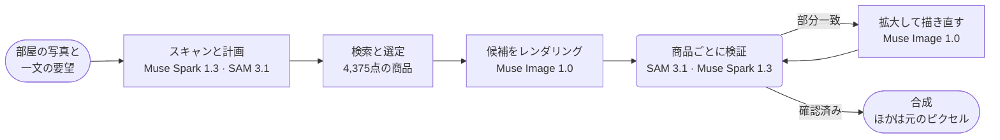

<p align="center">
  <a href="https://chanjoongx--realroom.us-east.modal.run">
    <picture>
      <source media="(prefers-color-scheme: dark)" srcset="../banner-dark.jpg">
      <source media="(prefers-color-scheme: light)" srcset="../banner-light.jpg">
      
    </picture>
  </a>
</p>

<h4 align="center">
  <a href="https://chanjoongx--realroom.us-east.modal.run">ライブデモ</a>
  &nbsp;·&nbsp;
  <a href="#how-a-run-works">仕組み</a>
  &nbsp;·&nbsp;
  <a href="#demo-rooms">デモの部屋</a>
  &nbsp;·&nbsp;
  <a href="#run-it">実行方法</a>
  &nbsp;·&nbsp;
  <a href="#use-your-own-catalog">独自のカタログ</a>
</h4>

<p align="center">
  <a href="https://cerebralvalley.ai/e/meta-ai-developer-hackathon"></a>
  <a href="#meta-models"></a>
  <a href="#meta-models"></a>
  <a href="#meta-models"></a>
  <a href="#meta-models"></a>
  <a href="#meta-models"></a>
  <a href="../../LICENSE"></a>
</p>

<p align="center">
  <a href="../../README.md">English</a>
  &nbsp;·&nbsp; <a href="README.ko.md">한국어</a>
  &nbsp;·&nbsp; <b>日本語</b>
  &nbsp;·&nbsp; <a href="README.es.md">Español</a>
  &nbsp;·&nbsp; <a href="README.pt-BR.md">Português</a>
  &nbsp;·&nbsp; <a href="README.fr.md">Français</a>
  &nbsp;·&nbsp; <a href="README.de.md">Deutsch</a>
  &nbsp;·&nbsp; <a href="README.hi.md">हिन्दी</a>
  &nbsp;·&nbsp; <a href="README.ar.md">العربية</a>
  &nbsp;·&nbsp; <a href="README.id.md">Indonesia</a>
</p>

<p align="center"><sub>これは<a href="../../README.md">英語版の README</a> を翻訳したものです。内容が異なる場合は英語版を正とします。</sub></p>

> [!NOTE]
> Realroom は [Meta Global AI Developer Hackathon](https://cerebralvalley.ai/e/meta-ai-developer-hackathon) の Indie Developer トラックに、課題「Build for Your World」で応募した作品です。エージェント、Web アプリ、カタログのインデックス、デモの部屋は、どれも開発期間（2026年10月27日から11月4日まで）に作りました。
>
> 公開版のアプリでは、記録済みの3件の実行を再生できるほか、アップロードした写真でエージェント全体をライブ実行できます（1日40回まで）。手元のマシンでも同じアプリで、キーなしに実行を再生することも、自分の Meta Model API キーでライブ実行することもできます。どちらの方法も[実行方法](#run-it)で説明しています。

<p align="center">
  <picture>
    <source media="(prefers-color-scheme: dark)" srcset="../built-on-dark.png">
    <source media="(prefers-color-scheme: light)" srcset="../built-on-light.png">
    
  </picture>
</p>

<p align="center">
  <a href="https://chanjoongx--realroom.us-east.modal.run"></a>
  <br>
  <sub>リビングのデモ実行をアプリで再生したところ：スキャン、配置ガイド、検証、そしてビフォーアフターのスライダー。</sub>
</p>

Realroom は Meta のモデルで作ったエージェントです。部屋の写真と、どうしたいかを書いた一文を渡します。エージェントは部屋を読み取り、何を加えて何を置き換えるかを計画し、4,375点の実在の商品からその空間に合うものを探して、写真の中にレンダリングします。それから、自分の仕事をチェックします。SAM 3.1 がレンダリング画像の中で各商品をもう一度見つけ、Muse Spark 1.3 がそれを商品のカタログ写真と比べ、うまく描けなかったものは描き直します。画像モデルの出力を使うのは、新しい商品とその影、物を取り除いた箇所だけです。それ以外はすべて元の写真からコピーして戻しており、そのピクセル数はページ上で、自分のブラウザを使って確かめられます。

[chanjoongx--realroom.us-east.modal.run](https://chanjoongx--realroom.us-east.modal.run) で試せます。デモの部屋では記録済みの実行を再生し、アップロード欄では自分の写真でエージェント全体を実行します。

## なぜ作ったか

部屋の模様替えを生成するツールは、感じのよい部屋を描いてくれます。でも、そこにあるソファは買えるものではなく、壁際に収まるかどうかも誰も確かめていません。しかもツールは、壁や床、窓の外の景色まで黙って描き替えてしまいます。賃貸に住んでいる人や、ソファを1台探しているだけの人にとって、その絵が答えているのは知りたいこととは別の問いです。Realroom は今ある部屋をそのまま残し、実際に買うものだけを変えます。家具店なら自社のカタログを組み込めます。デモでは、Amazon の実際の商品データを集めた公開データセット、Amazon Berkeley Objects を使っています。

## <a id="demo-rooms"></a>デモの部屋


デモの部屋は Muse Image 1.0 で生成したので、このリポジトリには個人の写真が入っていません。各行が記録済みの実行1件です。数値は [`demo-runs/`](../../demo-runs) にある、その実行自身の `run.json` と `ledger.jsonl` から取っています。

| 部屋 | 要望 | 商品 | 一致 | 元のままのピクセル | 所要時間 | 費用 |
|---|---|---|---|---|---|---|
| リビング、2005年築のマンション | "The old dark sofa makes the room feel gloomy. Make it brighter and cozier without painting or touching the floor." | ソファ、ラグ、フロアランプ | 3点中3点（ラグは描き直し1ラウンド後） | 70.3% | 216&nbsp;s | $0.24 |
| 何もない部屋、引っ越し当日 | "Move-in day. I work from home and want a calm living room where two friends can sit: something to sit on, a rug, a small table and warm evening light." | ソファ、ラグ、フロアランプ、コーヒーテーブル、プランター | 5点中5点（ラグは描き直し2ラウンド後、コーヒーテーブルは1ラウンド後） | 63.3% | 288&nbsp;s | $0.37 |
| ワンルーム、初めての一人暮らし | "...I still sleep on a mattress on the floor and the moving boxes are everywhere. Make it feel like a calm, grown-up bedroom without painting." | ベッドフレーム、寝具、ラグ | 3点中3点（ラグは描き直し2ラウンド後） | 70.7% | 244&nbsp;s | $0.30 |

「一致」は、レンダリングした各商品をアップで切り出してカタログ写真と並べ、それを見て Muse Spark 1.3 が下した判定です。費用は Meta の公表価格にもとづく見積もりで、呼び出しごとに記録しています。

## <a id="how-a-run-works"></a>実行の仕組み



| ステップ | モデル | 処理内容 |
|---|---|---|
| スキャンと計画 | Muse Spark 1.3、SAM 3.1 | Spark への1回のリクエストで、スキーマに沿った JSON が返ります。中身は、動かせる物それぞれのボックスと判断（残す、取り除く、置き換える）、動かせない構造、部屋の大きさと光、そしてスロットの計画（種類、追加か置き換えか、配置先のボックス、cm 単位のサイズ範囲、見た目、色の系統）です。SAM 3.1 はコンセプトプロンプトでボックスを正確なマスクに変え、コンセプトで拾えない物にはボックスプロンプトを使います。 |
| 検索 | カタログのインデックス、PE-Core B16 | スロットごとに、その種類の商品を集め、実寸がスロットのサイズ範囲に収まるものだけに絞ってから、Muse Spark Open が書いた説明文とのテキスト類似度（45%）と、Perception Encoder によるテキストと画像の類似度（55%）で順位を付けます。1スロットにつき24件です。Perception Encoder はアプリ自身のサーバーで動くので、このステップでは API を呼び出しません。 |
| 選定 | Muse Spark 1.3 | Spark は1回のリクエストで、部屋と、全スロットの候補を番号付きで並べたシートを見ます。そのため、互いに合う組み合わせを選べます。 |
| レンダリング | Muse Image 1.0 | 部屋、配置ガイド、実際の商品写真を渡して `/images/edits` を1回呼び出すと、候補が2～3枚返ります。モデルの Web 検索ツールと画像検索ツールはオフにしています。 |
| 検証 | SAM 3.1、Muse Spark 1.3 | 各候補を元の写真に位置合わせし（ECC ホモグラフィ）、色も合わせます。SAM 3.1 が新しい商品をすべてもう一度見つけ、Spark が商品ごとの切り出し画像をカタログ写真と見比べて判定し、シーン全体も判定します。最もよい候補を採用します。 |
| 修正 | Muse Image 1.0、SAM 3.1、Muse Spark 1.3 | 「partial」（部分一致）と判定された商品は、周囲ごと切り出し、カタログ写真と照らし合わせながら拡大して描き直します。1ラウンドにつき2回試し、最大2ラウンドです。試した結果が今の版と入れ替わるのは Spark のスコアが上がったときだけで、Spark の所見が次のラウンドの方向を決めます。レンダリング画像に残ってしまった散らかった物は専用の工程で片付け、SAM 3.1 で確認します。何かが変わった場合は、仕上がった部屋を Spark がもう一度判定します。 |
| 合成 | なし | 最終結果がレンダリング画像から取るのは、商品のマスク部分、その周りの細い縁、接地影、取り除いた物があった範囲だけです。それ以外のピクセルはすべて元の写真のままです。 |

Web アプリは、各実行をイベントログから再生します。輪郭をすべて表示したスキャン、検索の絞り込み、選定シート、すべてのレンダリング候補、修正ごとのビフォーアフター、最終的なレイヤーまで見られます。各ステップのヘッダーには、そのステップで呼び出したモデルの ID が表示されます。


上の画像は、リビングの実行の検証ステップです。Muse Image が候補を3枚描き、Spark がそれぞれに写る3つの商品をすべて採点して、候補2が採用されました。この候補のラグは10点中5点だったので修正ステップに回り、9点になって戻ってきました。

## <a id="meta-models"></a>Meta のモデル

| モデル | アクセス方法 | 用途 |
|---|---|---|
| `muse-spark-1.3` | Meta Model API | 部屋の読み取りと計画、商品の選定、すべての商品とシーンの判定 |
| `sam-3.1` | Meta Model API | 部屋にある物とレンダリングした全商品のマスク、片付け残しの確認 |
| `muse-image-1.0` | Meta Model API | レンダリング候補、描き直し、散らかった物の片付け、デモの部屋 |
| Muse Spark Open | Baseten、Fireworks | カタログ全体のタグと説明文 |
| `pe-core-b16-224` | オープンウェイト、アプリのサーバー内（Modal または手元のマシン） | Perception Encoder：各スロットの見た目をカタログ写真と照合 |

## 自分で確かめられること

- `before.png` と `after.png` は可逆圧縮の画像です。アプリの **Check it in your browser** ボタンは、両方をダウンロードしてピクセルごとに比較し、一致する割合を表示します。
- `layers.png` は、変更したピクセルを商品、除去、影のいずれかに色分けしたものです。`masks.npz` には、すべての物と商品のマスクが入っています。
- `ledger.jsonl` には、モデルの呼び出しがすべて、時間と推定費用とともに記録されています。Perception Encoder の検索もここに載っていますが、アプリ自身のサーバーで動くので費用はかかりません。
- `drift.jpg` は、加工前のレンダリング画像が、変更箇所以外のすべての場所で元の写真からどれだけずれたかを示します（デモの実行では平均色差 dE 1.7～3.7）。合成ステップがあるのは、こうしたピクセルのためです。

## <a id="run-it"></a>実行方法

Python 3.12 と、Web ビルド用に Node 20 以降が必要です。最初に一度だけインストールします。

```bash
python -m venv .venv
.venv/bin/pip install torch==2.6.0 torchvision==0.21.0 --index-url https://download.pytorch.org/whl/cpu
.venv/bin/pip install -r backend/requirements.txt
(cd web && npm ci && npm run build)
```

Windows では、これらのコマンドの `.venv/bin/` を `.venv\Scripts\` に読み替えてください。

### 記録済みの実行を再生する（キー不要）

```bash
.venv/bin/python backend/scripts/serve_local.py
```

http://127.0.0.1:8787 を開きます。デモの部屋では、公開版のアプリと同じように [`demo-runs/`](../../demo-runs) の実行をステップごとに再生します。モデルは呼び出しません。これらの実行に出てくる商品写真は `demo-runs/_photos` にあり、アップロード欄にはライブ実行がオフであることが表示されます。

### 自分の Meta Model API キーでライブ実行する

1. リポジトリのルートで `.env.example` を `.env` にコピーし、`MODEL_API_KEY` を記入します。git は `.env` を無視します。
2. 4,375点すべての商品写真を `data/photos` にダウンロードします。写真はこのリポジトリの GitHub リリースに、約730 MB の1ファイルとして置いてあります。
   ```bash
   .venv/bin/python catalog/get_photos.py
   ```
3. Perception Encoder の重みを一度だけダウンロードします（Hugging Face の `timm/PE-Core-B-16`、約1.8 GB）。この手順を飛ばすと、最初のライブ検索が同じダウンロードを待つことになります。
   ```bash
   .venv/bin/python -c "import open_clip; open_clip.create_model_and_transforms('PE-Core-B-16', pretrained='meta')"
   ```
4. `--live` を付けてサーバーを起動します。
   ```bash
   .venv/bin/python backend/scripts/serve_local.py --live
   ```

再生とライブを切り替えるのは `--live` だけです。これを付けると、アップロード欄から自分の写真でエージェント全体が動き、ページは実行中の様子を追って表示します。1回の実行の費用は Meta の公表価格で約$0.2～$0.4で、その実行の `ledger.jsonl` にすべての呼び出しが記録されます。ローカルサーバーが1日に始めるライブ実行は10回までで、`--per-day` で変えられます。

Web アプリを使わずに1枚の写真でエージェントを動かすには、次のようにします。

```bash
.venv/bin/python backend/scripts/run_demo.py --room room.jpg --id my-room --brief "Warmer and less cluttered" \
    --mode refresh --slots 3 --catalog catalog/index --photos data/photos --out demo-runs/my-room
```

何もない部屋には `--mode furnish` を使います。`serve_local.py` が動いていれば、終わった実行を http://127.0.0.1:8787/r/my-room で再生できます。

### カタログの再構築とアプリのホスティング

カタログを作り直すには、ABO の商品データと画像メタデータを `data/abo/` にダウンロードしてから、[カタログ](#the-catalog)の手順を実行します。Modal のステップには Modal のアカウントが必要です。タグ付けにはさらに、`realroom-keys` という名前の Modal シークレットに `BASETEN_API_KEY` と `FIREWORKS_API_KEY` を入れておく必要があります。

公開版は Modal で動いています（`backend/modal_app.py`）。構成は Web コンテナ1つで、カタログと実行データは2つのボリュームに置いています。ライブ実行は同時に3件まで、1日40回まで、訪問者1人につき3回まで、モデル呼び出しの総額は60ドルまでです。アップロードされた写真は24時間以内に削除します。

## <a id="the-catalog"></a>カタログ

[Amazon Berkeley Objects](https://amazon-berkeley-objects.s3.us-east-1.amazonaws.com/index.html)（ABO）は、Amazon の実際の商品データを写真と寸法付きで集めた公開データセットです。`catalog/` は、これをもとに Realroom のカタログを作ります。

1. `abo_catalog.py` は amazon.com の商品データを25の種類（ソファ、ラグ、フロアランプ、ウォールアートなど）に振り分けます。当てはまるのは5,931件です。サイズをセンチメートルに換算し、寸法がないものや不自然な寸法のものを除くと、候補は4,612件になります。
2. `modal_catalog.py --step score` と `abo_choose.py` で、商品ごとに参照写真を1枚選びます。白背景のきれいな切り抜き写真を優先します。
3. `modal_catalog.py --step fetch` は、その写真を Modal のクラウド上で一度だけダウンロードし、トリミングします。
4. `modal_catalog.py --step tag` は、すべての写真を商品データと一緒に **Muse Spark Open** に送ります。Muse Spark Open は Meta のオープンウェイトモデルで、Baseten 経由で使い、Fireworks を予備にしています。返ってくるのは、タイトル、色、素材、スタイル、見た目の説明、SAM 用のフレーズ、レンダリングリスクの見立て、そして写真に本当に掲載商品が写っているかどうかです。
5. `modal_catalog.py --step embed` は、Modal の CPU 上で Meta の Perception Encoder（PE-Core B16-224）を使い、すべての写真の埋め込みを計算します。
6. `abo_finalize.py` が `catalog.jsonl` を書き出します。商品数は4,375点です。写真に掲載商品が写っていなかった104点と、デモの実行を記録した時点でタグ付けが終わっていなかった133点を除外しました。

Muse Spark Open は、4,375点のうち3,781点を Baseten で、594点を Fireworks でタグ付けしました。タグは [`catalog/index/catalog.jsonl`](../../catalog/index/catalog.jsonl) にあります。リポジトリに入っている商品写真は、デモの実行に出てくるものだけです。全写真は GitHub リリースの1ファイルにまとめてあり（[実行方法](#run-it)を参照）、上の手順で ABO から作り直すこともできます。

## <a id="use-your-own-catalog"></a>独自のカタログを使う

エージェント自体は ABO に依存しません。読み込むのは、`catalog.jsonl` と Perception Encoder のファイル2つが入ったカタログフォルダー（`--catalog`）と、商品ごとの `img/<id>.jpg` と `thumb/<id>.webp` が入った写真フォルダー（`--photos`）です。次は [`catalog/index/catalog.jsonl`](../../catalog/index/catalog.jsonl) の1行目を短くしたものです。

```json
{
  "id": "B075QFCHM9",
  "kind": "bed",
  "name": "Rivet York Modern Extended Platform Queen Bed, 90.2\"L, Grey",
  "brand": "Rivet",
  "size_cm": {"w": 229.0, "d": 182.9, "h": 107.5},
  "url": "https://www.amazon.com/dp/B075QFCHM9",
  "cutout": true,
  "tag": {
    "title": "Light Grey Upholstered Platform Bed",
    "matches_listing": true,
    "colors": ["light grey", "white", "light brown"],
    "color_family": "grey",
    "materials": ["polyester", "fabric", "wood"],
    "style": ["modern", "minimal", "contemporary"],
    "render_risk": "low",
    "sam_phrase": "platform bed",
    "visual_description": "Low-profile light grey polyester platform bed with tall rectangular headboard, extended surround frame and tapered wood legs shown with white mattress."
  }
}
```

- `kind` は、`backend/realroom/catalog.py` の `KINDS` にある名前のどれかです。計画では、スロットごとに種類を指定して商品を求めます。
- `size_cm` は幅、奥行き、高さです。スロットのサイズ範囲に収まる商品だけが候補リストに入ります。
- `tag` は、ステップ4で Muse Spark Open が書いた内容です。テキスト検索はそのタイトル、色、素材、スタイル、説明文を読み、SAM 3.1 は `sam_phrase` を手がかりにレンダリング後の商品を見つけます。`"matches_listing": false` の商品が候補に出ることはありません。タグがない場合、エージェントは `name` と `kind` で代用します。
- `cutout` は、無地の背景に商品だけが写った写真であることを示します。検索ではこうした写真を上位にします。
- `emb_pe_core_b16.npy` には、商品写真1枚につき1つの Perception Encoder の埋め込みが、`emb_pe_core_b16_ids.json` の順に入っています。どちらもステップ5で書き出します。これらがなければ、検索はテキストだけで順位を付けます。

`catalog/` のスクリプトは、このフォルダーを ABO から作ります。別の商品フィードを使う場合、書き換えるのはステップ1～3です。ABO の商品データを行と写真に変換しているのがこの部分だからです。そのあと、`--catalog` と `--photos` で `serve_local.py` か `run_demo.py` に新しいフォルダーを指定します。

## リポジトリの構成

```text
backend/
  realroom/      the agent: scan.py, pick.py, render.py, verify.py, composite.py and pipeline.py,
                 catalog.py (search), meta.py (Meta Model API clients), server.py (API and site)
  scripts/       serve_local.py, run_demo.py, make_rooms.py (the demo rooms), pack_demo_photos.py
  modal_app.py   the hosted app on Modal
catalog/         the catalog build from ABO, steps 1 to 6, plus get_photos.py and pack_photos.py
  index/         catalog.jsonl (4,375 products) and the Perception Encoder embeddings
demo-runs/       the three recorded runs (run.json, ledger.jsonl, masks and images) and their product photos
web/             the React app (Vite): the home page, the run viewer and the pixel check
docs/            README images and translations
```

## 制限事項

- 画像モデルは繊細な質感が苦手です。かすかな格子状の織り目があるクリーム色のラグは、レンダリング画像によって織り目が強く出すぎたり、無地になったりしました。修正ループがこれを見つけ、どの描き直しもスコアが上がらないときは、隠さずに結果に「partial」と表示します。
- 同じ要望でも、実行するたびに計画が変わります。Spark が毎回、計画と選定をやり直すためです。
- 取り除いた物があった場所では、描き直した床と元の床の間に、かすかな継ぎ目が出ることがあります。
- 商品データは2021年に公開されたデータセットのものなので、価格はなく、一部の商品リンクはもう開けません。
- Spark が出す部屋の大きさは、ドアやベッドのサイズなどからの推定です。検索のサイズ範囲はこれで決まりますが、レンダリング画像は実測ではありません。

## クレジット

- 商品の写真とデータ：**Amazon.com** の Amazon Berkeley Objects、ライセンスは [CC BY 4.0](https://creativecommons.org/licenses/by/4.0/)。データセットの作成者は Matthieu Guillaumin、Thomas Dideriksen、Kenan Deng、Himanshu Arora（Amazon.com）と Jasmine Collins、Jitendra Malik（UC Berkeley）です。変更点：写真はトリミングとリサイズを行い、商品には Muse Spark Open でタグを付け、Muse Image 1.0 で部屋の写真の中に描き直しています。Realroom は Amazon と提携しておらず、Amazon の承認も受けていません。
- 計算資源：Meta から提供された Meta Model API のクレジットと、ハッカソンの推論パートナーである Baseten、Fireworks AI、Modal のクレジット。
- Built with Muse Spark Open. モデルの重みは [Muse Model License](https://huggingface.co/meta-models/Muse-Spark-Open-816B-A42B) のもとで公開されています。Realroom はカタログのタグ付けのために、Baseten と Fireworks AI 経由でこのモデルを呼び出しています。
- Meta FAIR の [Perception Encoder](https://github.com/facebookresearch/perception_models)（PE-Core B16-224）、Apache 2.0。`timm/PE-Core-B-16` の重みを [OpenCLIP](https://github.com/mlfoundations/open_clip) で読み込んでいます。
- Python ライブラリ：FastAPI（MIT）、Uvicorn（BSD-3-Clause）、NumPy と SciPy（BSD）、OpenCV（Apache 2.0）、Pillow（MIT-CMU）、scikit-image（BSD-3-Clause）、PyTorch と torchvision（BSD-3-Clause）、OpenCLIP（MIT）、timm（Apache 2.0）、Requests（Apache 2.0）、python-multipart（Apache 2.0）、Modal クライアント（Apache 2.0）、Meta の `meta-sam-parser`（SAM License）。OpenAI Python SDK（Apache 2.0）は、Meta の API ドキュメントが Meta Model API のクライアントとして示しているものです。ここでは api.meta.ai とだけ通信します。
- Web ライブラリ：React、Vite、Motion（MIT）、Lucide アイコン（ISC）、TypeScript（Apache 2.0）。
- フォント：Geist と Geist Mono（Vercel）、Instrument Serif。いずれも SIL Open Font License です。
- デモの部屋は Muse Image 1.0 で生成しました。

[Chanjoong Kim](https://github.com/chanjoongx) が作りました。コードは MIT ライセンスです（[LICENSE](../../LICENSE) を参照）。
