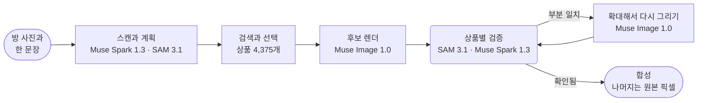

<p align="center">
  <a href="https://chanjoongx--realroom.us-east.modal.run">
    <picture>
      <source media="(prefers-color-scheme: dark)" srcset="../banner-dark.jpg">
      <source media="(prefers-color-scheme: light)" srcset="../banner-light.jpg">
      
    </picture>
  </a>
</p>

<h4 align="center">
  <a href="https://chanjoongx--realroom.us-east.modal.run">라이브 데모</a>
  &nbsp;·&nbsp;
  <a href="#how-a-run-works">동작 방식</a>
  &nbsp;·&nbsp;
  <a href="#demo-rooms">데모 방</a>
  &nbsp;·&nbsp;
  <a href="#run-it">실행하기</a>
  &nbsp;·&nbsp;
  <a href="#use-your-own-catalog">자체 카탈로그</a>
</h4>

<p align="center">
  <a href="https://cerebralvalley.ai/e/meta-ai-developer-hackathon"></a>
  <a href="#meta-models"></a>
  <a href="#meta-models"></a>
  <a href="#meta-models"></a>
  <a href="#meta-models"></a>
  <a href="#meta-models"></a>
  <a href="https://github.com/chanjoongx/realroom/actions/workflows/ci.yml"></a>
  <a href="../../LICENSE"></a>
</p>

<p align="center">
  <a href="../../README.md">English</a>
  &nbsp;·&nbsp; <b>한국어</b>
  &nbsp;·&nbsp; <a href="README.ja.md">日本語</a>
  &nbsp;·&nbsp; <a href="README.es.md">Español</a>
  &nbsp;·&nbsp; <a href="README.pt-BR.md">Português</a>
  &nbsp;·&nbsp; <a href="README.fr.md">Français</a>
  &nbsp;·&nbsp; <a href="README.de.md">Deutsch</a>
  &nbsp;·&nbsp; <a href="README.hi.md">हिन्दी</a>
  &nbsp;·&nbsp; <a href="README.ar.md">العربية</a>
</p>

<p align="center"><sub><a href="../../README.md">영어 README</a>를 옮긴 번역본입니다. 두 문서의 내용이 다르면 영어 README가 맞습니다.</sub></p>

> [!NOTE]
> Realroom은 [Meta Global AI Developer Hackathon](https://cerebralvalley.ai/e/meta-ai-developer-hackathon)의 Indie Developer 트랙에 "Build for Your World" 과제로 낸 출품작입니다. 에이전트, 웹 앱, 카탈로그 인덱스, 데모 방은 모두 개발 기간인 2026년 10월 27일부터 11월 4일 사이에 만들었습니다.
>
> 배포된 앱은 기록된 실행 세 개를 재생하고 업로드한 사진으로 에이전트 전체를 하루 40번까지 라이브로 돌립니다. 라이브 실행은 한 번에 4~8분쯤 걸리고 페이지는 실행이 진행되는 동안 그 과정을 따라 보여 줍니다. 로컬에서는 같은 앱이 키 없이 실행을 재생하거나 본인의 Meta Model API 키로 라이브 실행을 돌립니다. 두 방법 모두 [실행하기](#run-it)에 있습니다.

<p align="center">
  <picture>
    <source media="(prefers-color-scheme: dark)" srcset="../built-on-dark.png">
    <source media="(prefers-color-scheme: light)" srcset="../built-on-light.png">
    
  </picture>
</p>

<p align="center">
  <a href="https://chanjoongx--realroom.us-east.modal.run"></a>
  <br>
  <sub>앱에서 재생한 거실 데모 실행입니다. 스캔, 배치 가이드, 검증을 차례로 보여 주고 마지막에 전후 비교 슬라이더가 나옵니다.</sub>
</p>

Realroom은 Meta 모델로 만든 에이전트입니다. 방 사진과 원하는 것을 적은 문장 하나를 넣으면 Muse Spark 1.3이 방을 읽고 무엇을 더하거나 바꿀지 계획합니다. SAM 3.1은 방 안의 물건마다 윤곽을 땁니다. 에이전트는 실제 상품 4,375개 중에서 상품 정보에 적힌 치수가 공간에 맞는 것을 찾아 Muse Spark Open이 쓴 설명과 Meta의 Perception Encoder로 순위를 매깁니다. Spark가 서로 어울리는 조합을 고르면 Muse Image 1.0이 그 상품들을 사진 속에 그려 넣습니다. 그다음 에이전트가 자기 결과물을 스스로 검사합니다. SAM 3.1이 렌더 결과에서 상품을 하나씩 다시 찾으면 Muse Spark 1.3이 그 상품을 카탈로그 사진과 따로 세 번 비교합니다. 잘못 나온 상품은 다시 그립니다. 렌더에서 온 부분은 새 상품과 그 그림자, 치운 자리뿐입니다. 나머지 픽셀은 모두 원본 사진에서 그대로 다시 가져옵니다. 그 개수는 페이지에서 브라우저로 직접 확인할 수 있습니다.

[chanjoongx--realroom.us-east.modal.run](https://chanjoongx--realroom.us-east.modal.run)에서 써 볼 수 있습니다. 데모 방은 기록된 실행을 재생하고, 업로드 상자는 직접 올린 사진으로 에이전트 전체를 돌립니다.

## 만든 이유

방 꾸미기 생성기는 보기 좋은 방을 그려 주지만 그 안의 소파는 살 수 있는 물건이 아닙니다. 벽에 맞는지 확인한 사람도 없고, 생성기는 벽과 바닥과 창밖 풍경까지 슬쩍 바꿔 그립니다. 세입자이거나 소파 하나를 고르는 중이라면 그 그림은 엉뚱한 질문에 답합니다. Realroom은 지금 있는 방을 그대로 두고 실제로 살 물건만 바꿉니다. 가구 매장은 자체 카탈로그를 연결할 수 있습니다. 데모는 실제 Amazon 상품 정보를 모은 공개 데이터셋인 Amazon Berkeley Objects를 씁니다.

## <a id="demo-rooms"></a>데모 방


데모 방은 Muse Image 1.0으로 생성했기 때문에 이 저장소에는 개인 사진이 없습니다. 각 행은 기록된 실행 하나입니다. 숫자는 [`demo-runs/`](../../demo-runs)에 있는 그 실행의 `run.json`과 `ledger.jsonl`에서 가져왔습니다.

| 방 | 요청 | 상품 | 일치 | 손대지 않은 픽셀 | 시간 | 비용 |
|---|---|---|---|---|---|---|
| 거실, 2005년식 아파트 | "The old dark sofa makes the room feel gloomy. Make it brighter and cozier without painting or touching the floor." | 소파, 러그, 플로어 램프 | 3개 중 3개, 플로어 램프는 한 라운드 다시 그린 뒤 | 68.7% | 433&nbsp;s | $0.39 |
| 빈방, 이사 온 날 | "Move-in day. I work from home and want a calm living room where two friends can sit: something to sit on, a rug, a small table and warm evening light." | 소파, 러그, 플로어 램프, 커피 테이블, 화분 | 5개 중 5개, 러그와 플로어 램프는 각각 한 라운드 다시 그린 뒤 | 63.6% | 384&nbsp;s | $0.58 |
| 원룸, 첫 자취방 | "...I still sleep on a mattress on the floor and the moving boxes are everywhere. Make it feel like a calm, grown-up bedroom without painting." | 침구, 러그, 벽 장식 | 3개 중 3개, 침구는 한 라운드 다시 그린 뒤 | 67.5% | 477&nbsp;s | $0.40 |

"일치"는 Muse Spark 1.3이 상품의 최종 픽셀을 따로 세 번 확인해 두 번 이상 match로 판정한 경우에 셉니다. 확인할 때마다 상품을 가까이 잘라 카탈로그 사진 옆에 놓고 봅니다. 앱은 세 판정을 모두 보여 줍니다. 비용은 Meta가 공개한 가격으로 계산한 추정치이며 호출마다 기록했습니다. 기록된 실행은 후보를 세 개 그렸고 상품을 두 개까지 다시 그릴 수 있었습니다. 라이브 실행은 후보 두 개에 다시 그리는 상품도 하나까지라 비용이 약 $0.2~$0.5로 더 적습니다.

## <a id="how-a-run-works"></a>실행 과정



| 단계 | 모델 | 하는 일 |
|---|---|---|
| 스캔과 계획 | Muse Spark 1.3, SAM 3.1 | Spark 요청 한 번이 스키마에 맞춘 JSON을 돌려줍니다. 여기에는 옮길 수 있는 모든 물건의 박스와 처리 결정(유지, 제거, 교체), 고정 구조물, 방의 크기와 빛, 슬롯 계획(종류, 추가 또는 교체, 목표 박스, cm 단위 크기 범위, 생김새, 색 계열)이 들어 있습니다. SAM 3.1은 개념 프롬프트로 박스를 정확한 마스크로 바꾸고, 개념 프롬프트가 놓친 물건에는 박스 프롬프트를 씁니다. |
| 검색 | 카탈로그 인덱스, PE-Core B16 | 슬롯마다 그 종류의 상품을 모은 뒤 실제 치수가 슬롯의 크기 범위에 맞는 것만 남기고, Muse Spark Open이 쓴 설명과 견준 텍스트 유사도(45%)와 Perception Encoder의 텍스트-이미지 유사도(55%)로 순위를 매깁니다. 슬롯당 24개입니다. Perception Encoder는 앱 서버 안에서 돌기 때문에 이 단계는 API를 호출하지 않습니다. |
| 선택 | Muse Spark 1.3 | Spark는 요청 한 번에 방 사진과 슬롯마다 후보에 번호를 붙인 시트를 모두 봅니다. 그래서 서로 어울리는 조합을 고릅니다. |
| 렌더 | Muse Image 1.0 | 방 사진, 배치 가이드, 실제 상품 사진을 넣은 `/images/edits` 호출 한 번으로 후보를 두세 개 받습니다. 모델의 웹 검색 도구와 이미지 검색 도구는 꺼 둡니다. |
| 검증 | SAM 3.1, Muse Spark 1.3 | 후보마다 원본 기준으로 정렬하고(ECC 호모그래피) 색을 맞춥니다. SAM 3.1이 새 상품을 모두 다시 찾고, Spark는 잘라 낸 상품 이미지를 하나씩 카탈로그 사진과 견주며 장면 전체도 판정합니다. 가장 좋은 후보를 남깁니다. 그다음 Spark가 이 후보의 상품을 하나씩 세 번 더 확인합니다. 확인은 매번 따로 보내는 요청이고 가까이 잘라 낸 상품을 카탈로그 사진 옆에 놓고 봅니다. 같은 픽셀이어도 Spark의 판정은 요청마다 바뀔 수 있어서 세 번 중 두 번 이상 match여야 일치로 셉니다. |
| 수정 | Muse Image 1.0, SAM 3.1, Muse Spark 1.3 | 확인 결과 partial로 판정된 상품은 주변과 함께 잘라 확대한 뒤 카탈로그 사진을 기준으로 다시 그립니다. 라운드마다 두 번 시도하고 최대 두 라운드까지 갑니다. 렌더가 상품을 다른 곳에 그릴 때가 있어서 확인에서 계획한 자리에 없다고 나온 상품은 먼저 사진 전체에서 찾습니다. 사진 어디에도 없을 때만 같은 방식으로 계획한 자리에 그려 넣습니다. 새로 그린 결과는 Spark가 더 높은 점수를 줄 때만 현재 버전을 대체합니다. 다음 라운드의 방향은 Spark의 메모가 잡습니다. 다시 그린 상품과, 뒤 단계에서 자기 픽셀이 바뀐 상품은 완성된 사진에서 다시 세 번 확인합니다. 렌더가 남긴 잡동사니는 따로 한 번 더 지우고 SAM 3.1로 확인합니다. 바뀐 것이 있으면 Spark가 완성된 방을 다시 판정합니다. |
| 합성 | 없음 | 결과물은 렌더에서 상품 마스크와 그 둘레의 얇은 테두리, 접촉 그림자, 치운 물건이 있던 자리만 가져옵니다. 나머지 픽셀은 모두 원본입니다. |

웹 앱은 각 실행을 이벤트 로그에서 재생합니다. 모든 윤곽선을 표시한 스캔, 검색 퍼널, 선택 시트, 모든 렌더 후보, 수정별 전후 모습, 최종 레이어까지 나옵니다. 단계마다 헤더에는 그 단계가 호출한 모델의 ID가 표시됩니다.


위 그림은 거실 실행의 검증 단계입니다. Muse Image가 후보 세 개를 그렸고 Spark가 후보마다 상품 세 개에 모두 점수를 매겼습니다. 남은 후보는 1번입니다. 이 후보의 플로어 램프는 10점 만점에 5점이었고 따로 세 번 확인했을 때도 각각 6점이 나와 수정 단계로 넘어갔다가 9점이 되어 돌아왔습니다.

## <a id="meta-models"></a>Meta 모델

| 모델 | 사용 경로 | 용도 |
|---|---|---|
| `muse-spark-1.3` | Meta Model API | 방 읽기와 계획, 상품 선택, 모든 상품과 장면 판정 |
| `sam-3.1` | Meta Model API | 방 안 물건과 렌더된 모든 상품의 마스크, 남은 잡동사니 확인 |
| `muse-image-1.0` | Meta Model API | 렌더 후보, 다시 그리기, 잡동사니 치우기, 데모 방 |
| Muse Spark Open | Baseten, Fireworks | 카탈로그 전체의 태그와 설명 |
| `pe-core-b16-224` | 공개 가중치, 앱 서버 안(Modal 또는 로컬 컴퓨터) | Perception Encoder: 슬롯마다 생김새를 카탈로그 사진과 대조 |

실행 중에 Realroom이 호출하는 모델은 이 표의 앞 세 모델뿐이고 모두 api.meta.ai에 있습니다. Perception Encoder는 앱 서버 안에서 직접 돌립니다. Muse Spark Open은 카탈로그를 만들 때 미리 태그를 달았습니다. [`backend/tests/test_meta_only.py`](../../backend/tests/test_meta_only.py)는 `backend/realroom/`의 에이전트 코드를 검사합니다. 그 코드의 모델 ID가 이 표의 네 개와 다르거나 API 주소가 api.meta.ai가 아니면 테스트가 실패합니다. 코드 안의 문자열에 다른 URL이 있거나 GPT, Claude, Gemini, Flux, SigLIP처럼 널리 쓰이는 Meta 밖 모델의 이름이 있어도 실패합니다.

## 확인할 수 있는 것

- `before.png`와 `after.png`는 무손실입니다. 앱의 **Check it in your browser**는 두 파일을 내려받아 브라우저에서 픽셀 단위로 비교한 뒤 똑같은 픽셀의 비율을 보여 줍니다.
- `layers.png`는 바뀐 픽셀마다 상품, 치운 자리, 그림자 중 하나로 색을 칠합니다. `masks.npz`에는 모든 물건과 상품의 마스크가 들어 있습니다.
- `run.json`의 상품별 판정에는 근거가 된 최종 확인 세 번이 검증 단계나 수정 단계가 내린 판정과 나란히 들어 있습니다.
- `ledger.jsonl`에는 모든 모델 호출이 시간, 추정 비용과 함께 기록됩니다. Perception Encoder 검색도 들어 있지만 앱 서버 안에서 돌기 때문에 비용은 들지 않습니다.
- `drift.jpg`는 합성 전 렌더가 나머지 모든 곳에서 원본과 얼마나 어긋났는지 보여 줍니다(데모 실행의 평균 색차 dE 1.8~2.7). 이 픽셀들 때문에 합성 단계를 둡니다.

## <a id="run-it"></a>실행하기

Python 3.12가 필요합니다(PyTorch 2.6.0에는 Python 3.14용 휠이 없습니다). 웹 빌드에는 Node 22.12 이상이 필요하며 20.19에서도 됩니다. 처음에 한 번 설치합니다.

```bash
python3.12 -m venv .venv
.venv/bin/pip install torch==2.6.0 torchvision==0.21.0 --index-url https://download.pytorch.org/whl/cpu
.venv/bin/pip install -r backend/requirements.txt
(cd web && npm ci && npm run build)
```

Windows에서는 `py -3.12 -m venv .venv`로 환경을 만들고 명령에 나오는 `.venv/bin/`을 `.venv\Scripts\`로 바꿔 씁니다.

### 기록된 실행 재생하기 (키 없이)

```bash
.venv/bin/python backend/scripts/serve_local.py
```

http://127.0.0.1:8787 주소를 엽니다. 데모 방은 배포된 앱과 마찬가지로 [`demo-runs/`](../../demo-runs)의 실행을 단계별로 재생합니다. 모델은 호출하지 않습니다. 이 실행들에 나오는 상품 사진은 `demo-runs/_photos`에 있고, 업로드 상자에는 라이브 실행이 꺼져 있다는 안내가 나옵니다.

재생에는 PyTorch가 필요 없습니다. 재생만 하려면 위의 `pip` 두 줄 대신 `.venv/bin/pip install -r backend/requirements-test.txt`를 실행합니다. 재생 서버와 테스트가 쓰는 Python 패키지가 모두 설치됩니다. 웹 빌드는 그대로 필요합니다.

### 본인 Meta Model API 키로 라이브 실행하기

1. 저장소 루트에서 `.env.example`을 `.env`로 복사하고 `MODEL_API_KEY`를 채웁니다. `.env`는 git이 무시합니다.
2. 상품 4,375개의 사진을 모두 `data/photos`에 내려받습니다. 사진은 이 저장소의 GitHub 릴리스에 약 730 MB짜리 파일 하나로 올라가 있습니다.
   ```bash
   .venv/bin/python catalog/get_photos.py
   ```
3. Perception Encoder 가중치를 한 번 내려받습니다(Hugging Face의 `timm/PE-Core-B-16`, 약 1.8 GB). 이 단계를 건너뛰면 첫 라이브 검색이 같은 다운로드를 기다립니다.
   ```bash
   .venv/bin/python -c "import open_clip; open_clip.create_model_and_transforms('PE-Core-B-16', pretrained='meta')"
   ```
4. `--live`를 붙여 서버를 시작합니다.
   ```bash
   .venv/bin/python backend/scripts/serve_local.py --live
   ```

재생과 라이브는 `--live` 하나로 갈립니다. 이 옵션을 켜면 업로드 상자가 올린 사진으로 에이전트 전체를 돌리고, 페이지는 실행이 진행되는 동안 그 과정을 따라 보여 줍니다. 실행 한 번에 드는 비용은 Meta 공개 가격 기준 약 $0.2~$0.5이고 그 실행의 `ledger.jsonl`에 모든 호출이 남습니다. 로컬 서버는 라이브 실행을 하루 최대 10번까지 시작합니다. 이 횟수는 `--per-day`로 바꿉니다. 실행이 12분이나 $0.60를 넘기면 남은 다시 그리기를 건너뛰고 그때까지의 결과로 마칩니다.

웹 앱 없이 사진 한 장에 에이전트를 돌리려면 다음 명령을 씁니다.

```bash
.venv/bin/python backend/scripts/run_demo.py --room room.jpg --id my-room --brief "Warmer and less cluttered" \
    --mode refresh --slots 3 --catalog catalog/index --photos data/photos --out demo-runs/my-room
```

빈방이면 `--mode furnish`를 씁니다. `serve_local.py`가 실행 중이면 끝난 실행은 http://127.0.0.1:8787/r/my-room 주소에서 재생됩니다.

### 카탈로그 다시 만들기와 앱 호스팅

카탈로그를 다시 만들려면 ABO 상품 정보와 이미지 메타데이터를 `data/abo/`에 내려받은 뒤 [카탈로그](#the-catalog)에 나온 단계를 실행합니다. Modal 단계에는 Modal 계정이 필요합니다. 태깅에는 `realroom-keys`라는 Modal 시크릿에 넣은 `BASETEN_API_KEY`와 `FIREWORKS_API_KEY`도 있어야 합니다.

배포 버전은 Modal에서 돌아갑니다(`backend/modal_app.py`). 웹 컨테이너는 하나이고 카탈로그와 실행 기록은 볼륨 두 개에 둡니다. 라이브 실행은 동시에 최대 세 개, 하루 40번, 한 시간에 8번, 방문자당 세 번까지이고 모델 호출 비용은 모두 합쳐 60달러까지입니다. 업로드는 JPEG, PNG, WebP만 받고 12MB, 40메가픽셀까지입니다. 사진을 저장하기 전에 위치 정보와 카메라 정보를 지우고, 방문자는 IP 주소 대신 날마다 바뀌는 솔트를 섞은 해시로 셉니다. 사람이 보이거나 방이 아닌 사진은 거절하고 바로 흐리게 만듭니다. 라이브 결과는 추측할 수 없는 주소에 두고 캐시하지 않습니다. 그 `after.jpg`와 `after.png`에는 AI로 편집했다는 IPTC 메타데이터가 들어갑니다. 업로드된 사진은 24시간 안에 삭제됩니다.

## <a id="the-catalog"></a>카탈로그

[Amazon Berkeley Objects](https://amazon-berkeley-objects.s3.us-east-1.amazonaws.com/index.html)(ABO)는 사진과 치수가 포함된 실제 Amazon 상품 정보를 모은 공개 데이터셋입니다. `catalog/`는 이 데이터셋으로 Realroom 카탈로그를 만듭니다.

1. `abo_catalog.py`는 amazon.com 상품을 25가지 종류(소파, 러그, 플로어 램프, 벽 장식 등)로 나눕니다. 여기에 해당하는 상품은 5,931개입니다. 크기를 센티미터로 바꾸고 치수가 없거나 비현실적인 상품을 빼서 후보 4,612개를 남깁니다.
2. `modal_catalog.py --step score`와 `abo_choose.py`가 상품마다 기준 사진을 한 장씩 고릅니다. 흰 배경에 상품만 깔끔하게 오려 낸 사진을 우선합니다.
3. `modal_catalog.py --step fetch`는 그 사진을 Modal 클라우드에서 한 번 내려받아 여백을 잘라 냅니다.
4. `modal_catalog.py --step tag`는 모든 사진을 상품 정보와 함께 Meta의 공개 가중치 모델인 **Muse Spark Open**에 보냅니다. Baseten에서 서빙하고 Fireworks를 예비로 둡니다. 모델은 제목, 색상, 소재, 스타일, 생김새 설명, SAM 문구, 렌더 위험도 추정을 돌려주고, 사진에 실제로 그 상품이 나오는지도 알려 줍니다.
5. `modal_catalog.py --step embed`는 Modal CPU에서 Meta의 Perception Encoder(PE-Core B16-224)로 모든 사진을 임베딩합니다.
6. `abo_finalize.py`가 상품 4,375개로 된 `catalog.jsonl`을 씁니다. 사진에 해당 상품이 나오지 않은 104개와 데모 실행을 기록할 때 태그가 끝나지 않았던 133개는 뺐습니다.

Muse Spark Open은 4,375개 중 3,781개를 Baseten에서, 594개를 Fireworks에서 태깅했습니다. 태그는 [`catalog/index/catalog.jsonl`](../../catalog/index/catalog.jsonl)에 있습니다. 저장소에는 데모 실행에 나오는 상품 사진만 들어 있습니다. 전체 사진은 GitHub 릴리스에 파일 하나로 있고([실행하기](#run-it) 참고), 위 단계로 ABO에서 다시 만듭니다.

## <a id="use-your-own-catalog"></a>자체 카탈로그 쓰기

에이전트 자체는 ABO에 의존하지 않습니다. 에이전트는 `catalog.jsonl`과 Perception Encoder 파일 두 개가 든 카탈로그 폴더(`--catalog`)와, 상품마다 `img/<id>.jpg`와 `thumb/<id>.webp`가 있는 사진 폴더(`--photos`)를 읽습니다. 아래는 [`catalog/index/catalog.jsonl`](../../catalog/index/catalog.jsonl)의 첫 줄을 줄인 것입니다.

```json
{
  "id": "B075QFCHM9",
  "kind": "bed",
  "name": "Rivet York Modern Extended Platform Queen Bed, 90.2\"L, Grey",
  "brand": "Rivet",
  "size_cm": {"w": 229.0, "d": 182.9, "h": 107.5},
  "url": "https://www.amazon.com/dp/B075QFCHM9",
  "cutout": true,
  "tag": {
    "title": "Light Grey Upholstered Platform Bed",
    "matches_listing": true,
    "colors": ["light grey", "white", "light brown"],
    "color_family": "grey",
    "materials": ["polyester", "fabric", "wood"],
    "style": ["modern", "minimal", "contemporary"],
    "render_risk": "low",
    "sam_phrase": "platform bed",
    "visual_description": "Low-profile light grey polyester platform bed with tall rectangular headboard, extended surround frame and tapered wood legs shown with white mattress."
  }
}
```

- `kind`는 `backend/realroom/catalog.py`의 `KINDS`에 있는 이름 중 하나입니다. 계획은 슬롯마다 종류를 지정해 상품을 찾습니다.
- `size_cm`는 너비, 깊이, 높이입니다. 슬롯의 크기 범위에 맞는 상품만 후보 목록에 오릅니다.
- `tag`는 4단계에서 Muse Spark Open이 쓴 내용입니다. 텍스트 검색은 그중 제목, 색상, 소재, 스타일, 설명을 읽습니다. SAM 3.1은 `sam_phrase`로 렌더된 상품을 찾고, `"matches_listing": false`인 상품은 아예 후보에 오르지 않습니다. 태그가 없으면 에이전트는 `name`과 `kind`를 대신 씁니다.
- `cutout`은 단색 배경에 상품만 있는 사진이라는 표시입니다. 검색은 이런 사진을 더 높은 순위에 둡니다.
- `emb_pe_core_b16.npy`에는 상품 사진마다 Perception Encoder 임베딩이 하나씩 `emb_pe_core_b16_ids.json`의 순서대로 들어 있습니다. 두 파일 모두 5단계에서 만듭니다. 이 두 파일이 없으면 검색은 텍스트만으로 순위를 매깁니다.

`catalog/`의 스크립트가 ABO로 이 폴더를 만듭니다. 다른 상품 피드를 쓰려면 1~3단계를 새로 작성하면 됩니다. 이 단계들이 ABO 상품 정보를 행과 사진으로 바꾸기 때문입니다. 그다음 `--catalog`와 `--photos`로 `serve_local.py`나 `run_demo.py`가 새 폴더를 가리키게 합니다.

## 테스트

```bash
.venv/bin/pip install -r backend/requirements-test.txt
.venv/bin/python -m pytest backend/tests
```

테스트는 키가 필요 없고 모델을 부르지 않습니다. 녹화된 실행 세 개를 HTTP API로 다시 재생하고, 그 숫자를 각 ledger와 이 README에 대조합니다. 가짜 실행기를 써서 업로드를 실시간 실행의 관문에 통과시키며 메타데이터 제거, 크기와 형식 제한, 방문자별 · 하루 · 예산 한도를 확인합니다. 파이프라인에는 실패한 응답과 형식이 깨진 모델 출력을 넣어 보고, 앱이 부르는 모델이 모두 api.meta.ai로만 닿는 Meta 모델인지 확인합니다. GitHub Actions가 push마다 이 테스트를 웹 타입 검사, 빌드와 함께 돌립니다.

## 저장소 구조

```text
backend/
  realroom/      the agent: scan.py, pick.py, render.py, verify.py, composite.py and pipeline.py,
                 catalog.py (search), meta.py (Meta Model API clients), server.py (API and site)
  scripts/       serve_local.py, run_demo.py, make_rooms.py (the demo rooms), pack_demo_photos.py
  tests/         the test suite (no key, no network calls)
  modal_app.py   the hosted app on Modal
catalog/         the catalog build from ABO, steps 1 to 6, plus get_photos.py and pack_photos.py
  index/         catalog.jsonl (4,375 products) and the Perception Encoder embeddings
demo-runs/       the three recorded runs (run.json, ledger.jsonl, masks and images) and their product photos
web/             the React app (Vite): the home page, the run viewer and the pixel check
docs/            README images and translations
```

## 한계

- 이미지 모델은 미묘한 질감과 색을 어려워합니다. 짜임이 고운 러그는 너무 진하게 나올 때가 많고, 침구는 카탈로그 사진보다 어둡거나 회색빛이 돌게 나오는 일이 잦습니다. 수정 루프는 가장 덜 맞는 상품을 다시 그립니다(배포된 앱에서는 실행마다 하나, 기록된 실행에서는 둘). 같은 픽셀에도 Spark의 판정은 요청마다 달라져서, 따로 하는 확인 세 번 중 두 번 이상 match여야 일치로 셉니다.
- 렌더가 상품을 계획한 자리에서 벗어난 곳에 그리거나 아예 빠뜨릴 때가 있습니다. 확인에서 그 자리에 아무것도 찾지 못하면 Spark가 먼저 사진 전체에서 상품을 찾고, 사진 어디에도 없을 때만 수정 단계가 상품을 추가합니다.
- 같은 요청이라도 실행할 때마다 계획이 달라집니다. Spark가 매번 새로 계획하고 고르기 때문입니다.
- 치운 물건이 있던 자리에서는 다시 그린 바닥과 원래 바닥 사이에 희미한 이음매가 생길 수 있습니다.
- 상품 정보는 2021년에 공개된 데이터셋에서 가져와서 가격이 없고, 일부 상품 링크는 이제 열리지 않습니다.
- Spark가 내놓는 방 크기는 문이나 침대 크기 같은 단서로 짐작한 추정치입니다. 검색할 크기 범위는 이 값으로 정하지만 렌더 결과는 실측값이 아닙니다.

## 크레딧

- 상품 사진과 데이터: **Amazon.com**의 Amazon Berkeley Objects, [CC BY 4.0](https://creativecommons.org/licenses/by/4.0/) 라이선스. 데이터셋 제작: Matthieu Guillaumin, Thomas Dideriksen, Kenan Deng, Himanshu Arora(Amazon.com), Jasmine Collins, Jitendra Malik(UC Berkeley). 변경 사항: 사진은 여백을 자르고 크기를 바꿨습니다. 상품은 Muse Spark Open으로 태그를 달았고 Muse Image 1.0으로 방 사진 속에 다시 그립니다. Realroom은 Amazon과 제휴 관계가 없으며 Amazon의 보증을 받지도 않았습니다.
- 컴퓨팅: Meta가 제공한 Meta Model API 크레딧, 해커톤 추론 파트너인 Baseten, Fireworks AI, Modal이 제공한 크레딧.
- Built with Muse Spark Open. 이 모델의 가중치는 [Muse Model License](https://huggingface.co/meta-models/Muse-Spark-Open-816B-A42B)에 따라 공개되었습니다. Realroom은 카탈로그에 태그를 달 때 Baseten과 Fireworks AI를 거쳐 이 모델을 호출합니다.
- Meta FAIR의 [Perception Encoder](https://github.com/facebookresearch/perception_models)(PE-Core B16-224), Apache 2.0. [OpenCLIP](https://github.com/mlfoundations/open_clip)으로 `timm/PE-Core-B-16` 가중치를 불러옵니다.
- Python 라이브러리: FastAPI(MIT), Uvicorn(BSD-3-Clause), NumPy와 SciPy(BSD), OpenCV(Apache 2.0), Pillow(MIT-CMU), scikit-image(BSD-3-Clause), PyTorch와 torchvision(BSD-3-Clause), OpenCLIP(MIT), timm(Apache 2.0), Requests(Apache 2.0), python-multipart(Apache 2.0), Modal 클라이언트(Apache 2.0), Meta의 `meta-sam-parser`(SAM License). OpenAI Python SDK(Apache 2.0)는 Meta의 API 문서가 Meta Model API용으로 안내하는 클라이언트입니다. 여기서는 api.meta.ai와만 통신합니다.
- 웹 라이브러리: React, Vite, Motion(모두 MIT), Lucide 아이콘(ISC), TypeScript(Apache 2.0).
- 글꼴: Geist와 Geist Mono(Vercel), Instrument Serif. 모두 SIL Open Font License를 따릅니다.
- 데모 방은 Muse Image 1.0으로 생성했습니다.

서울 국민대학교 인공지능학부 학생인 [Chanjoong Kim](https://github.com/chanjoongx)이 만들었습니다. 코드 라이선스는 MIT입니다([LICENSE](../../LICENSE) 참고).
