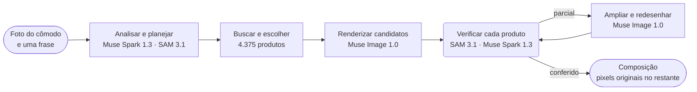

<p align="center">
  <a href="https://chanjoongx--realroom.us-east.modal.run">
    <picture>
      <source media="(prefers-color-scheme: dark)" srcset="../banner-dark.jpg">
      <source media="(prefers-color-scheme: light)" srcset="../banner-light.jpg">
      
    </picture>
  </a>
</p>

<h4 align="center">
  <a href="https://chanjoongx--realroom.us-east.modal.run">Demo ao vivo</a>
  &nbsp;·&nbsp;
  <a href="#how-a-run-works">Como funciona</a>
  &nbsp;·&nbsp;
  <a href="#demo-rooms">Cômodos de demonstração</a>
  &nbsp;·&nbsp;
  <a href="#run-it">Como executar</a>
  &nbsp;·&nbsp;
  <a href="#use-your-own-catalog">Seu próprio catálogo</a>
</h4>

<p align="center">
  <a href="https://cerebralvalley.ai/e/meta-ai-developer-hackathon"></a>
  <a href="#meta-models"></a>
  <a href="#meta-models"></a>
  <a href="#meta-models"></a>
  <a href="#meta-models"></a>
  <a href="#meta-models"></a>
  <a href="https://github.com/chanjoongx/realroom/actions/workflows/ci.yml"></a>
  <a href="../../LICENSE"></a>
</p>

<p align="center">
  <a href="../../README.md">English</a>
  &nbsp;·&nbsp; <a href="README.ko.md">한국어</a>
  &nbsp;·&nbsp; <a href="README.ja.md">日本語</a>
  &nbsp;·&nbsp; <a href="README.es.md">Español</a>
  &nbsp;·&nbsp; <b>Português</b>
  &nbsp;·&nbsp; <a href="README.fr.md">Français</a>
  &nbsp;·&nbsp; <a href="README.de.md">Deutsch</a>
  &nbsp;·&nbsp; <a href="README.hi.md">हिन्दी</a>
  &nbsp;·&nbsp; <a href="README.ar.md">العربية</a>
</p>

<p align="center"><sub>Esta é uma tradução do <a href="../../README.md">README em inglês</a>. Se houver diferença entre os dois, a versão em inglês é a correta.</sub></p>

> [!NOTE]
> O Realroom é um projeto inscrito no [Meta Global AI Developer Hackathon](https://cerebralvalley.ai/e/meta-ai-developer-hackathon), na trilha Indie Developer, dentro do desafio "Build for Your World". O agente, o app web, o índice do catálogo e os cômodos de demonstração foram todos feitos durante o período de desenvolvimento, de 27 de outubro a 4 de novembro de 2026.
>
> O app hospedado reproduz as três execuções gravadas e roda o agente inteiro ao vivo em uma foto enviada, até 40 vezes por dia. Uma execução ao vivo leva cerca de quatro a oito minutos, e a página acompanha a execução enquanto ela acontece. Na sua máquina, o mesmo app reproduz as execuções sem chave ou roda ao vivo com a sua própria chave da Meta Model API. As duas formas estão em [Como executar](#run-it).

<p align="center">
  <picture>
    <source media="(prefers-color-scheme: dark)" srcset="../built-on-dark.png">
    <source media="(prefers-color-scheme: light)" srcset="../built-on-light.png">
    
  </picture>
</p>

<p align="center">
  <a href="https://chanjoongx--realroom.us-east.modal.run"></a>
  <br>
  <sub>A execução de demonstração da sala de estar, reproduzida no app: análise, guia de posicionamento, verificação e, por fim, o slider de antes e depois.</sub>
</p>

O Realroom é um agente feito com os modelos da Meta. Você envia uma foto de um cômodo e uma frase sobre o que quer. O Muse Spark 1.3 lê o cômodo e planeja o que adicionar ou substituir, e o SAM 3.1 contorna cada objeto. O agente procura entre 4.375 produtos reais as peças cujas medidas informadas no anúncio cabem no espaço e as ordena pelas descrições do Muse Spark Open e pelo Perception Encoder da Meta. O Spark escolhe um conjunto que combina, e o Muse Image 1.0 o desenha na foto. Depois, o agente confere o próprio trabalho: o SAM 3.1 encontra de novo cada produto na imagem renderizada, o Muse Spark 1.3 compara cada um com a foto dele no catálogo em três checagens independentes, e um produto que saiu errado é redesenhado. Só os produtos novos, as sombras deles e as áreas que foram limpas vêm da renderização. Todos os outros pixels são copiados de volta da sua foto original, e a página permite verificar essa contagem no seu próprio navegador.

Experimente em [chanjoongx--realroom.us-east.modal.run](https://chanjoongx--realroom.us-east.modal.run). Os cômodos de demonstração reproduzem execuções gravadas, e a caixa de upload roda o agente inteiro na sua própria foto.

## Por quê

Os geradores de redecoração desenham um cômodo agradável, mas não dá para comprar o sofá que aparece nele, ninguém conferiu se ele cabe na parede, e o gerador repinta, sem avisar, as paredes, o piso e a vista da janela. Se você mora de aluguel ou quer comprar só um sofá, essa imagem responde à pergunta errada. O Realroom mantém o cômodo que você tem e muda só o que você de fato compraria. Uma loja de móveis pode conectar o próprio catálogo; a demonstração usa o Amazon Berkeley Objects, um conjunto público de anúncios reais da Amazon.

## <a id="demo-rooms"></a>Cômodos de demonstração


Os cômodos de demonstração foram gerados com o Muse Image 1.0, então este repositório não guarda nenhuma foto particular. Cada linha é uma execução gravada. Os números vêm do `run.json` e do `ledger.jsonl` da própria execução, em [`demo-runs/`](../../demo-runs).

| Cômodo | Pedido | Produtos | Correspondem | Pixels intactos | Tempo | Custo |
|---|---|---|---|---|---|---|
| Sala de estar, apartamento de 2005 | "The old dark sofa makes the room feel gloomy. Make it brighter and cozier without painting or touching the floor." | sofá, tapete, luminária de chão | 3 de 3, a luminária de chão depois de uma rodada de redesenho | 68,7% | 433&nbsp;s | US$&nbsp;0,39 |
| Cômodo vazio, dia da mudança | "Move-in day. I work from home and want a calm living room where two friends can sit: something to sit on, a rug, a small table and warm evening light." | sofá, tapete, luminária de chão, mesa de centro, vaso de planta | 5 de 5, o tapete e a luminária de chão depois de uma rodada de redesenho cada um | 63,6% | 384&nbsp;s | US$&nbsp;0,58 |
| Studio, primeiro apartamento | "...I still sleep on a mattress on the floor and the moving boxes are everywhere. Make it feel like a calm, grown-up bedroom without painting." | roupa de cama, tapete, quadro | 3 de 3, a roupa de cama depois de uma rodada de redesenho | 67,5% | 477&nbsp;s | US$&nbsp;0,40 |

"Correspondem" conta um produto quando pelo menos duas de três checagens independentes do Muse Spark 1.3 sobre os pixels finais dele dizem "match". Cada checagem põe um recorte fechado do produto ao lado da foto dele no catálogo, e o app lista os três vereditos. Os custos são estimativas com base nos preços publicados pela Meta, registradas a cada chamada. As execuções gravadas desenharam três candidatos e podiam redesenhar até dois produtos. As execuções ao vivo desenham dois e redesenham no máximo um, então custam menos, cerca de US$ 0,2 a US$ 0,5.

## <a id="how-a-run-works"></a>Como funciona uma execução



| Etapa | Modelos | O que acontece |
|---|---|---|
| Análise e planejamento | Muse Spark 1.3, SAM 3.1 | Uma requisição ao Spark retorna um JSON restrito a um schema: cada objeto móvel com uma caixa e uma decisão (manter, remover ou substituir), a estrutura fixa, o tamanho e a luz do cômodo, e um plano de slots (tipo, adicionar ou substituir, caixa-alvo, faixa de tamanho em cm, visual, família de cor). O SAM 3.1 transforma as caixas em máscaras exatas com prompts de conceito, e com prompts de caixa para os objetos que os conceitos não captam. |
| Busca | índice do catálogo, PE-Core B16 | Para cada slot: os produtos daquele tipo, depois só os que têm dimensões reais dentro da faixa de tamanho do slot, ordenados pela similaridade de texto com a descrição do Muse Spark Open (45%) e pela similaridade texto-imagem do Perception Encoder (55%). 24 por slot. O Perception Encoder roda no próprio servidor do app, então esta etapa não faz nenhuma chamada de API. |
| Escolha | Muse Spark 1.3 | O Spark vê o cômodo e uma folha numerada de candidatos para cada slot em uma única requisição, e por isso escolhe um conjunto que combina entre si. |
| Renderização | Muse Image 1.0 | Uma chamada a `/images/edits` com o cômodo, um guia de posicionamento e as fotos reais dos produtos retorna dois ou três candidatos. As ferramentas de busca na web e de busca de imagens do modelo ficam desligadas. |
| Verificação | SAM 3.1, Muse Spark 1.3 | Cada candidato é alinhado ao original (homografia ECC) e tem as cores ajustadas. O SAM 3.1 volta a localizar cada produto novo, e o Spark compara cada recorte de produto com a foto do catálogo e avalia a cena como um todo. O melhor candidato é mantido. Depois, o Spark confere cada um dos produtos dele mais três vezes, cada checagem em uma requisição separada, com um recorte fechado ao lado da foto do catálogo. O veredito do Spark sobre os mesmos pixels pode mudar de uma requisição para outra, então um produto só conta como correspondente quando pelo menos duas das três checagens dizem "match". |
| Correção | Muse Image 1.0, SAM 3.1, Muse Spark 1.3 | Um produto que as checagens classificam como "partial" é recortado junto com o entorno, ampliado e redesenhado com a foto do catálogo como referência, com duas tentativas por rodada e até duas rodadas. Um produto que as checagens não encontram no lugar planejado é procurado primeiro na foto inteira, porque às vezes a renderização o desenha em outro lugar; só se não estiver lá ele é adicionado no lugar planejado, do mesmo jeito. Uma tentativa só substitui a versão atual se o Spark der a ela uma nota maior, e as observações do Spark orientam a rodada seguinte. Um produto redesenhado, e qualquer produto cujos próprios pixels uma etapa posterior tenha alterado, é conferido de novo três vezes na foto pronta. A bagunça que a renderização deixou para trás ganha uma passada própria, conferida com o SAM 3.1. Se algo mudou, o Spark avalia de novo o cômodo pronto. |
| Composição | nenhum | O resultado tira da renderização apenas as máscaras dos produtos, uma borda fina em volta delas, as sombras de contato e o espaço que os objetos removidos ocupavam. Todos os outros pixels são os originais. |

O app web reproduz cada execução a partir do log de eventos: a análise com todos os contornos, o funil de busca, as folhas de escolha, todos os candidatos de renderização, cada correção com o seu antes e depois, e as camadas finais. O cabeçalho de cada etapa mostra o ID do modelo que ela chamou.


Acima está a etapa de verificação da execução da sala de estar. O Muse Image desenhou três candidatos, o Spark deu nota aos três produtos de cada um, e o candidato 1 foi mantido. A luminária de chão dele recebeu nota 5 de 10, e três checagens independentes deram nota 6 cada uma, então ela seguiu para a etapa de correção e voltou com 9.

## <a id="meta-models"></a>Modelos da Meta

| Modelo | Acesso | Usado para |
|---|---|---|
| `muse-spark-1.3` | Meta Model API | ler o cômodo e planejar, escolher produtos, avaliar cada produto e a cena |
| `sam-3.1` | Meta Model API | máscaras dos objetos do cômodo e de cada produto renderizado, conferir a bagunça que sobrou |
| `muse-image-1.0` | Meta Model API | candidatos de renderização, redesenhos, limpeza da bagunça, os cômodos de demonstração |
| Muse Spark Open | Baseten, Fireworks | tags e descrições de todo o catálogo |
| `pe-core-b16-224` | pesos abertos, no servidor do app (Modal ou a sua máquina) | Perception Encoder: compara o visual de cada slot com as fotos do catálogo |

Durante uma execução, o Realroom só chama os três primeiros modelos, todos em api.meta.ai, e roda o Perception Encoder no próprio servidor. O Muse Spark Open gerou as tags do catálogo antes de qualquer execução. [`backend/tests/test_meta_only.py`](../../backend/tests/test_meta_only.py) confere o código do agente em `backend/realroom/`: ele falha se os IDs de modelo ali não forem os quatro desta tabela, se o endereço da API não for api.meta.ai, ou se alguma string desse código tiver outra URL ou citar um modelo conhecido que não seja da Meta, como GPT, Claude, Gemini, Flux ou SigLIP.

## Como as partes se conectam

1. A página envia a foto, a frase e o modo para `POST /api/runs` no servidor FastAPI ([`backend/realroom/server.py`](../../backend/realroom/server.py)). O servidor confere os limites, salva a foto sem os metadados em uma pasta de execução nova e inicia o agente ([`pipeline.py`](../../backend/realroom/pipeline.py)) em uma thread em segundo plano.
2. O agente chama o Muse Spark 1.3, o SAM 3.1 e o Muse Image 1.0 em api.meta.ai por meio do [`meta.py`](../../backend/realroom/meta.py). A busca no catálogo, em [`catalog.py`](../../backend/realroom/catalog.py), roda o Perception Encoder no mesmo processo.
3. Sempre que uma etapa começa ou termina, o agente acrescenta um evento ao `run.json` e salva as imagens da etapa na pasta da execução. Toda chamada de modelo entra no `ledger.jsonl` com o horário e o custo estimado.
4. Enquanto a execução está em andamento, a página lê `GET /api/runs/<id>` a cada 1,5 segundo e desenha cada etapa assim que o evento dela chega, com as imagens de `/runs/<id>/`. Um cômodo de demonstração é uma pasta de execução já concluída, e a página reproduz os eventos dela.

A chave da Meta Model API fica no servidor. Na sua máquina, ela está no `.env`, que o git ignora. No Modal, está no secret `realroom-model`, que guarda apenas a `MODEL_API_KEY`. O navegador nunca recebe a chave, e o repositório não guarda nenhuma.

## O que você pode conferir

- `before.png` e `after.png` estão em formato sem perdas. No app, o **Check it in your browser** baixa os dois, compara os arquivos pixel a pixel no seu navegador e depois mostra a fração de pixels idênticos.
- `layers.png` pinta cada pixel alterado como produto, área limpa ou sombra. `masks.npz` guarda todas as máscaras de objetos e de produtos.
- No `run.json`, o veredito de cada produto lista as três checagens finais a partir das quais ele foi contado, ao lado do veredito que a etapa de verificação ou a de correção deu a ele.
- `ledger.jsonl` lista cada chamada de modelo com o tempo e o custo estimado. A busca do Perception Encoder também está lá, com custo zero, porque roda no próprio servidor do app.
- `drift.jpg` mostra o quanto a renderização bruta se afastou do original em todo o resto (diferença média de cor dE de 1,8 a 2,7 nas execuções de demonstração). Esses pixels são o motivo da etapa de composição.

## <a id="run-it"></a>Como executar

Você precisa do Python 3.12 (o PyTorch 2.6.0 não tem wheels para o Python 3.14) e, para o build da web, do Node 22.12 ou mais novo (o 20.19 também funciona). Instale uma única vez:

```bash
python3.12 -m venv .venv
.venv/bin/pip install torch==2.6.0 torchvision==0.21.0 --index-url https://download.pytorch.org/whl/cpu
.venv/bin/pip install -r backend/requirements.txt
(cd web && npm ci && npm run build)
```

No Windows, crie o ambiente com `py -3.12 -m venv .venv` e troque `.venv/bin/` por `.venv\Scripts\` nesses comandos.

### Reproduzir as execuções gravadas (sem chave)

```bash
.venv/bin/python backend/scripts/serve_local.py
```

Abra http://127.0.0.1:8787. Os cômodos de demonstração reproduzem passo a passo as execuções em [`demo-runs/`](../../demo-runs), como no app hospedado. Nenhum modelo é chamado. As fotos de produtos que essas execuções mostram ficam em `demo-runs/_photos`, e a caixa de upload avisa que as execuções ao vivo estão desligadas.

A reprodução não precisa de PyTorch. Se você só quer reproduzir, rode `.venv/bin/pip install -r backend/requirements-test.txt` no lugar das duas linhas de `pip` acima: ele instala todos os pacotes Python que o servidor de reprodução e os testes usam. O build da web continua necessário.

### Execuções ao vivo com a sua própria chave da Meta Model API

1. Copie `.env.example` para `.env` na raiz do repositório e preencha `MODEL_API_KEY`. O git ignora o `.env`.
2. Baixe as fotos de todos os 4.375 produtos para `data/photos`. Elas estão em um único arquivo de cerca de 730 MB na release do GitHub deste repositório.
   ```bash
   .venv/bin/python catalog/get_photos.py
   ```
3. Baixe uma vez os pesos do Perception Encoder (`timm/PE-Core-B-16` no Hugging Face, cerca de 1,8 GB). Se você pular este passo, a primeira busca ao vivo espera esse mesmo download.
   ```bash
   .venv/bin/python -c "import open_clip; open_clip.create_model_and_transforms('PE-Core-B-16', pretrained='meta')"
   ```
4. Inicie o servidor com `--live`:
   ```bash
   .venv/bin/python backend/scripts/serve_local.py --live
   ```

`--live` é a única opção que separa a reprodução da execução ao vivo. Com ela, a caixa de upload roda o agente inteiro na sua foto, e a página acompanha a execução enquanto ela acontece. Uma execução custa cerca de US$ 0,2 a US$ 0,5 pelos preços publicados pela Meta, e o `ledger.jsonl` dela lista cada chamada. O servidor local inicia no máximo 10 execuções ao vivo por dia; `--per-day` muda esse limite. Uma execução que passa de 12 minutos ou de US$ 0,60 pula os redesenhos que faltam e termina com o que tem.

Para rodar o agente em uma foto, sem o app web:

```bash
.venv/bin/python backend/scripts/run_demo.py --room room.jpg --id my-room --brief "Warmer and less cluttered" \
    --mode refresh --slots 3 --catalog catalog/index --photos data/photos --out demo-runs/my-room
```

Use `--mode furnish` para um cômodo vazio. Com o `serve_local.py` rodando, a execução concluída pode ser reproduzida em http://127.0.0.1:8787/r/my-room.

### Reconstruir o catálogo ou hospedar o app

Para reconstruir o catálogo, baixe os anúncios e os metadados de imagens do ABO para `data/abo/` e depois rode as etapas descritas em [O catálogo](#the-catalog). As etapas no Modal exigem uma conta no Modal e, para gerar as tags, `BASETEN_API_KEY` e `FIREWORKS_API_KEY` em um secret do Modal chamado `realroom-keys`.

A versão hospedada roda no Modal (`backend/modal_app.py`): um contêiner web, o catálogo e as execuções em dois volumes, no máximo três execuções ao vivo ao mesmo tempo, 40 execuções ao vivo por dia e 8 por hora, três por visitante e 60 dólares em chamadas de modelo no total. Os uploads precisam ser JPEG, PNG ou WebP, com no máximo 12 MB e 40 megapixels. Os dados de localização e da câmera são removidos antes de a foto ser guardada, e os visitantes são contados por um hash com sal que muda todo dia, nunca pelo endereço. Uma foto que mostra uma pessoa ou que não é de um cômodo é recusada e desfocada na hora. Os resultados ao vivo ficam num endereço impossível de adivinhar e nunca vão para cache. Os `after.jpg` e `after.png` deles levam metadados IPTC que os marcam como editados por IA. As fotos enviadas são apagadas em até 24 horas.

## <a id="the-catalog"></a>O catálogo

O [Amazon Berkeley Objects](https://amazon-berkeley-objects.s3.us-east-1.amazonaws.com/index.html) (ABO) é um conjunto de dados público de anúncios reais de produtos da Amazon, com fotos e dimensões. A pasta `catalog/` monta o catálogo do Realroom a partir dele:

1. `abo_catalog.py` classifica os anúncios da amazon.com em 25 tipos (sofá, tapete, luminária de chão, quadro e assim por diante), o que abrange 5.931 deles. Ele converte as medidas para centímetros e descarta os anúncios sem dimensões ou com dimensões implausíveis, e restam 4.612 candidatos.
2. `modal_catalog.py --step score` e `abo_choose.py` escolhem uma foto de referência por produto, de preferência um recorte limpo em fundo branco.
3. `modal_catalog.py --step fetch` baixa essa foto uma vez, na nuvem do Modal, e apara as bordas.
4. `modal_catalog.py --step tag` envia cada foto com o seu anúncio para o **Muse Spark Open**, o modelo de pesos abertos da Meta, servido pelo Baseten (com o Fireworks como reserva). Ele retorna um título, cores, materiais, estilo, uma descrição visual, uma frase para o SAM, um palpite sobre o risco de renderização e se a foto mostra mesmo o produto anunciado.
5. `modal_catalog.py --step embed` gera o embedding de cada foto com o Perception Encoder da Meta (PE-Core B16-224) em CPUs do Modal.
6. `abo_finalize.py` grava o `catalog.jsonl`: 4.375 produtos. Ele descartou 104 cuja foto não mostrava o produto anunciado e 133 que não tinham tag pronta quando as execuções de demonstração foram gravadas.

O Muse Spark Open gerou as tags de 3.781 dos 4.375 produtos no Baseten e de 594 no Fireworks. As tags estão em [`catalog/index/catalog.jsonl`](../../catalog/index/catalog.jsonl). O repositório guarda só as fotos de produtos que aparecem nas execuções de demonstração. O conjunto completo é um único arquivo na release do GitHub (veja [Como executar](#run-it)), e as etapas acima o reconstroem a partir do ABO.

## <a id="use-your-own-catalog"></a>Use o seu próprio catálogo

O agente em si não depende do ABO. Ele lê uma pasta de catálogo (`--catalog`) com o `catalog.jsonl` e dois arquivos do Perception Encoder, e uma pasta de fotos (`--photos`) com `img/<id>.jpg` e `thumb/<id>.webp` para cada produto. Esta é a primeira linha de [`catalog/index/catalog.jsonl`](../../catalog/index/catalog.jsonl), encurtada:

```json
{
  "id": "B075QFCHM9",
  "kind": "bed",
  "name": "Rivet York Modern Extended Platform Queen Bed, 90.2\"L, Grey",
  "brand": "Rivet",
  "size_cm": {"w": 229.0, "d": 182.9, "h": 107.5},
  "url": "https://www.amazon.com/dp/B075QFCHM9",
  "cutout": true,
  "tag": {
    "title": "Light Grey Upholstered Platform Bed",
    "matches_listing": true,
    "colors": ["light grey", "white", "light brown"],
    "color_family": "grey",
    "materials": ["polyester", "fabric", "wood"],
    "style": ["modern", "minimal", "contemporary"],
    "render_risk": "low",
    "sam_phrase": "platform bed",
    "visual_description": "Low-profile light grey polyester platform bed with tall rectangular headboard, extended surround frame and tapered wood legs shown with white mattress."
  }
}
```

- `kind` é um dos nomes de `KINDS` em `backend/realroom/catalog.py`. O plano pede cada slot pelo tipo.
- `size_cm` é largura, profundidade e altura. Um produto só entra na pré-seleção se couber na faixa de tamanho do slot.
- `tag` é o que o Muse Spark Open escreveu na etapa 4. A busca por texto lê o título, as cores, os materiais, o estilo e a descrição dela, o SAM 3.1 encontra o produto renderizado pelo `sam_phrase`, e um produto com `"matches_listing": false` nunca é oferecido. Sem tag, o agente recorre a `name` e `kind`.
- `cutout` marca uma foto só do produto, sobre um fundo liso. A busca dá preferência a essas fotos.
- `emb_pe_core_b16.npy` guarda um embedding do Perception Encoder por foto de produto, na ordem de `emb_pe_core_b16_ids.json`. A etapa 5 grava os dois. Sem eles, a busca ordena só pelo texto.

Os scripts em `catalog/` montam essa pasta a partir do ABO. Para outro feed de produtos, a parte a reescrever são as etapas 1 a 3, porque são elas que transformam os anúncios do ABO em linhas e fotos. Depois, aponte o `serve_local.py` ou o `run_demo.py` para as novas pastas com `--catalog` e `--photos`.

## Testes

```bash
.venv/bin/pip install -r backend/requirements-test.txt
.venv/bin/python -m pytest backend/tests
```

Os testes não precisam de chave e não chamam nenhum modelo. Eles reproduzem as três execuções gravadas pela API HTTP e conferem os números com cada ledger e com este README. Passam uploads pelo controle de entrada das execuções ao vivo com um lançador falso: remoção de metadados, limites de tamanho e formato, e os tetos por visitante, por dia e de orçamento. Dão ao pipeline respostas com falha e saídas de modelo malformadas, e verificam que todo modelo que o app chama é um modelo da Meta acessado só em api.meta.ai. O GitHub Actions roda os testes a cada push, junto com a checagem de tipos e o build da web.

## Estrutura do repositório

```text
backend/
  realroom/      the agent: scan.py, pick.py, render.py, verify.py, composite.py and pipeline.py,
                 catalog.py (search), meta.py (Meta Model API clients), server.py (API and site)
  scripts/       serve_local.py, run_demo.py, make_rooms.py (the demo rooms), pack_demo_photos.py
  tests/         the test suite (no key, no network calls)
  modal_app.py   the hosted app on Modal
catalog/         the catalog build from ABO, steps 1 to 6, plus get_photos.py and pack_photos.py
  index/         catalog.jsonl (4,375 products) and the Perception Encoder embeddings
demo-runs/       the three recorded runs (run.json, ledger.jsonl, masks and images) and their product photos
web/             the React app (Vite): the home page, the run viewer and the pixel check
docs/            README images and translations
```

## Limitações

- Texturas e cores sutis são difíceis para o modelo de imagem. Tapetes com trama fina costumam sair marcados demais, e a roupa de cama costuma sair mais escura ou mais acinzentada do que na foto do catálogo. O loop de correção redesenha os produtos mais fracos (um por execução no app hospedado, dois por execução gravada), e os vereditos do Spark sobre os mesmos pixels variam de uma requisição para outra, então um produto só conta como correspondente quando pelo menos duas de três checagens independentes dizem "match".
- Às vezes a renderização põe um produto fora do lugar planejado, ou nem chega a desenhá-lo. Quando as checagens não encontram nada nesse lugar, o Spark procura primeiro o produto na foto inteira, e a etapa de correção só o adiciona se ele não estiver lá.
- O plano muda entre execuções do mesmo pedido, porque o Spark planeja e escolhe de novo a cada vez.
- Onde havia um objeto removido, o piso redesenhado pode deixar uma emenda discreta no encontro com o piso original.
- Os anúncios vêm de um conjunto de dados publicado em 2021, então não há preços e alguns links de produtos já não abrem.
- O tamanho do cômodo que o Spark informa é uma estimativa feita a partir de coisas como o tamanho de portas e camas. Ele define a faixa de tamanho da busca, mas a renderização não é uma medição.

## Créditos

- Fotos e dados de produtos: Amazon Berkeley Objects, da **Amazon.com**, sob a licença [CC BY 4.0](https://creativecommons.org/licenses/by/4.0/). Conjunto de dados criado por Matthieu Guillaumin, Thomas Dideriksen, Kenan Deng e Himanshu Arora (Amazon.com), Jasmine Collins e Jitendra Malik (UC Berkeley). Alterações: as fotos foram aparadas e redimensionadas, os produtos receberam tags do Muse Spark Open e são redesenhados em fotos de cômodos pelo Muse Image 1.0. O Realroom não é afiliado à Amazon nem endossado por ela.
- Computação: créditos da Meta Model API concedidos pela Meta e créditos de Baseten, Fireworks AI e Modal, os parceiros de inferência do hackathon.
- Built with Muse Spark Open. Os pesos do modelo são publicados sob a [Muse Model License](https://huggingface.co/meta-models/Muse-Spark-Open-816B-A42B), e o Realroom chama o modelo pelo Baseten e pelo Fireworks AI para gerar as tags do catálogo.
- [Perception Encoder](https://github.com/facebookresearch/perception_models) (PE-Core B16-224), da Meta FAIR, sob Apache 2.0, carregado com o [OpenCLIP](https://github.com/mlfoundations/open_clip) a partir dos pesos `timm/PE-Core-B-16`.
- Bibliotecas Python: FastAPI (MIT), Uvicorn (BSD-3-Clause), NumPy e SciPy (BSD), OpenCV (Apache 2.0), Pillow (MIT-CMU), scikit-image (BSD-3-Clause), PyTorch e torchvision (BSD-3-Clause), OpenCLIP (MIT), timm (Apache 2.0), Requests (Apache 2.0), python-multipart (Apache 2.0), o cliente do Modal (Apache 2.0) e o `meta-sam-parser` da Meta (SAM License). O OpenAI Python SDK (Apache 2.0) é o cliente que a documentação da API da Meta mostra para a Meta Model API; aqui ele só se comunica com api.meta.ai.
- Bibliotecas web: React, Vite e Motion (MIT), ícones Lucide (ISC) e TypeScript (Apache 2.0).
- Fontes: Geist e Geist Mono (Vercel) e Instrument Serif, todas sob a SIL Open Font License.
- Os cômodos de demonstração foram gerados com o Muse Image 1.0.

Feito por [Chanjoong Kim](https://github.com/chanjoongx), estudante de IA na Universidade Kookmin, em Seul. Código: MIT, veja [LICENSE](../../LICENSE).
