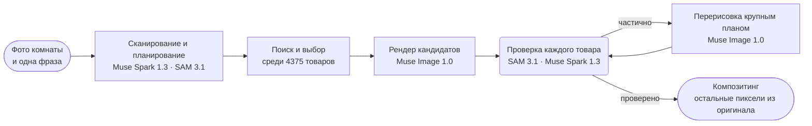

<p align="center">
  <a href="https://chanjoongx--realroom.us-east.modal.run">
    <picture>
      <source media="(prefers-color-scheme: dark)" srcset="../banner-dark.jpg">
      <source media="(prefers-color-scheme: light)" srcset="../banner-light.jpg">
      
    </picture>
  </a>
</p>

<h4 align="center">
  <a href="https://chanjoongx--realroom.us-east.modal.run">Онлайн-демо</a>
  &nbsp;·&nbsp;
  <a href="#how-a-run-works">Как это работает</a>
  &nbsp;·&nbsp;
  <a href="#demo-rooms">Демо-комнаты</a>
  &nbsp;·&nbsp;
  <a href="#run-it">Запуск</a>
  &nbsp;·&nbsp;
  <a href="#use-your-own-catalog">Свой каталог</a>
</h4>

<p align="center">
  <a href="https://cerebralvalley.ai/e/meta-ai-developer-hackathon"></a>
  <a href="#meta-models"></a>
  <a href="#meta-models"></a>
  <a href="#meta-models"></a>
  <a href="#meta-models"></a>
  <a href="#meta-models"></a>
  <a href="../../LICENSE"></a>
</p>

<p align="center">
  <a href="../../README.md">English</a>
  &nbsp;·&nbsp; <a href="README.ko.md">한국어</a>
  &nbsp;·&nbsp; <a href="README.zh-CN.md">简体中文</a>
  &nbsp;·&nbsp; <a href="README.ja.md">日本語</a>
  &nbsp;·&nbsp; <a href="README.es.md">Español</a>
  &nbsp;·&nbsp; <a href="README.pt-BR.md">Português</a>
  &nbsp;·&nbsp; <a href="README.fr.md">Français</a>
  &nbsp;·&nbsp; <a href="README.de.md">Deutsch</a>
  &nbsp;·&nbsp; <b>Русский</b>
  &nbsp;·&nbsp; <a href="README.hi.md">हिन्दी</a>
  &nbsp;·&nbsp; <a href="README.ar.md">العربية</a>
  &nbsp;·&nbsp; <a href="README.id.md">Bahasa Indonesia</a>
</p>

<p align="center"><sub>Это перевод <a href="../../README.md">английского README</a>. Если версии расходятся, правильной считается английская.</sub></p>

> [!NOTE]
> Realroom участвует в [Meta Global AI Developer Hackathon](https://cerebralvalley.ai/e/meta-ai-developer-hackathon) в треке Indie Developer по теме «Build for Your World». Агент, веб-приложение, индекс каталога и демо-комнаты целиком сделаны за период разработки, с 27 октября по 4 ноября 2026 года.
>
> Онлайн-версия воспроизводит три записанных прогона, а на загруженном фото запускает полный прогон агента вживую, до 40 раз в день. На вашем компьютере то же приложение воспроизводит прогоны без ключа или работает вживую с вашим ключом Meta Model API. Оба способа описаны в разделе [Запуск](#run-it).

<p align="center">
  <picture>
    <source media="(prefers-color-scheme: dark)" srcset="../built-on-dark.png">
    <source media="(prefers-color-scheme: light)" srcset="../built-on-light.png">
    
  </picture>
</p>

<p align="center">
  <a href="https://chanjoongx--realroom.us-east.modal.run"></a>
  <br>
  <sub>Демо-прогон для гостиной, воспроизведённый в приложении: сканирование, схема расстановки, проверка, затем слайдер «до и после».</sub>
</p>

Агент Realroom построен на моделях Meta. На вход ему нужны фото комнаты и одна фраза о том, чего вы хотите. Агент анализирует комнату, решает, что добавить или заменить, ищет среди 4375 реальных товаров вещи, которые впишутся в пространство, и отрисовывает их прямо на фото. Затем он проверяет собственную работу. SAM 3.1 заново находит каждый товар на рендере, Muse Spark 1.3 сравнивает его с фото товара из каталога, а всё, что вышло неправильно, перерисовывается. От модели изображений берутся только новые товары, их тени и расчищенные участки. Всё остальное копируется обратно из вашего исходного фото, а страница позволяет перепроверить этот подсчёт прямо в вашем браузере.

Попробовать можно на [chanjoongx--realroom.us-east.modal.run](https://chanjoongx--realroom.us-east.modal.run). Демо-комнаты воспроизводят записанные прогоны, а поле загрузки запускает полный прогон агента на вашем собственном фото.

## Зачем

Генераторы дизайна интерьера рисуют приятную комнату, но диван на картинке не купить, никто не проверял, встанет ли он у стены, а генератор ещё и незаметно перерисовывает стены, пол и вид из окна. Если вы снимаете жильё или выбираете всего один диван, такая картинка отвечает не на тот вопрос. Realroom оставляет вашу комнату как есть и меняет только то, что вы действительно купили бы. Мебельный магазин может подключить собственный каталог; в демо используется Amazon Berkeley Objects, открытый набор реальных карточек товаров Amazon.

## <a id="demo-rooms"></a>Демо-комнаты


Демо-комнаты сгенерированы в Muse Image 1.0, поэтому в репозитории нет личных фотографий. Каждая строка соответствует одному записанному прогону. Цифры взяты из собственных `run.json` и `ledger.jsonl` этого прогона в [`demo-runs/`](../../demo-runs).

| Комната | Запрос | Товары | Совпало | Нетронутые пиксели | Время | Стоимость |
|---|---|---|---|---|---|---|
| Гостиная, квартира 2005 года | "The old dark sofa makes the room feel gloomy. Make it brighter and cozier without painting or touching the floor." | диван, ковёр, торшер | 3 из 3, ковёр после одного раунда перерисовки | 70,3% | 216&nbsp;s | $0,24 |
| Пустая комната, день переезда | "Move-in day. I work from home and want a calm living room where two friends can sit: something to sit on, a rug, a small table and warm evening light." | диван, ковёр, торшер, журнальный столик, кашпо | 5 из 5, ковёр после двух раундов перерисовки, а журнальный столик после одного | 63,3% | 288&nbsp;s | $0,37 |
| Студия, первая квартира | "...I still sleep on a mattress on the floor and the moving boxes are everywhere. Make it feel like a calm, grown-up bedroom without painting." | каркас кровати, постельное бельё, ковёр | 3 из 3, ковёр после двух раундов перерисовки | 70,7% | 244&nbsp;s | $0,30 |

«Совпало» показывает вердикт Muse Spark 1.3: модель видит крупный кроп каждого отрисованного товара рядом с его фото из каталога. Стоимость оценена по опубликованным ценам Meta и записана по каждому вызову.

## <a id="how-a-run-works"></a>Как устроен прогон



| Шаг | Модели | Что происходит |
|---|---|---|
| Сканирование и планирование | Muse Spark 1.3, SAM 3.1 | Один запрос к Spark возвращает JSON строго по схеме: каждый подвижный предмет с рамкой и решением (оставить, убрать или заменить), неподвижные элементы, размер и освещение комнаты, а также план слотов (тип, добавить или заменить, целевая рамка, диапазон размеров в cm, внешний вид, цветовая гамма). SAM 3.1 превращает рамки в точные маски с помощью концептных промптов, а для предметов, которые концепты упускают, с помощью промптов-рамок. |
| Поиск | индекс каталога, PE-Core B16 | Для каждого слота берутся товары нужного типа, из них только те, чьи реальные размеры укладываются в диапазон слота, и ранжируются по текстовому сходству с описанием от Muse Spark Open (45%) и по сходству текста и изображения в Perception Encoder (55%). По 24 на слот. Perception Encoder работает на собственном сервере приложения, поэтому этот шаг не делает вызовов API. |
| Выбор | Muse Spark 1.3 | Spark в одном запросе видит комнату и пронумерованный лист кандидатов для каждого слота, поэтому выбирает набор, в котором вещи сочетаются друг с другом. |
| Рендер | Muse Image 1.0 | Один вызов `/images/edits` с комнатой, схемой расстановки и настоящими фото товаров возвращает два или три кандидата. Инструменты веб-поиска и поиска изображений у модели отключены. |
| Проверка | SAM 3.1, Muse Spark 1.3 | Каждый кандидат выравнивается по оригиналу (гомография ECC) и подгоняется по цвету. SAM 3.1 заново находит каждый новый товар, а Spark сравнивает кроп каждого товара с его фото из каталога и оценивает сцену в целом. Остаётся лучший кандидат. |
| Исправление | Muse Image 1.0, SAM 3.1, Muse Spark 1.3 | Товар с вердиктом partial вырезается вместе с окружением и перерисовывается крупным планом по своему фото из каталога: по две попытки за раунд, не больше двух раундов. Попытка заменяет текущую версию, только если Spark оценит её выше, а замечания Spark направляют следующий раунд. Лишние вещи, которые остались после рендера, убираются отдельным проходом с проверкой через SAM 3.1. Если что-то изменилось, Spark заново оценивает готовую комнату. |
| Композитинг | нет | Из рендера в результат попадают только области масок товаров, тонкая кайма вокруг них, контактные тени и места, где стояли убранные предметы. Все остальные пиксели взяты из оригинала. |

Веб-приложение воспроизводит каждый прогон по его журналу событий: сканирование со всеми контурами, воронку поиска, листы выбора, всех кандидатов рендера, каждое исправление с видом до и после и итоговые слои. В заголовке каждого шага указан ID модели, которую он вызывал.


Выше показан шаг проверки в прогоне для гостиной. Muse Image нарисовала три кандидата, Spark оценила все три товара в каждом из них, и остался кандидат 2. Ковёр в нём получил 5 из 10, поэтому ушёл на шаг исправления и вернулся с оценкой 9.

## <a id="meta-models"></a>Модели Meta

| Модель | Доступ | Для чего |
|---|---|---|
| `muse-spark-1.3` | Meta Model API | анализ комнаты и планирование, выбор товаров, оценка каждого товара и сцены |
| `sam-3.1` | Meta Model API | маски предметов в комнате и каждого отрисованного товара, проверка оставшихся лишних вещей |
| `muse-image-1.0` | Meta Model API | кандидаты рендера, перерисовки, уборка лишних вещей, демо-комнаты |
| Muse Spark Open | Baseten, Fireworks | теги и описания для всего каталога |
| `pe-core-b16-224` | открытые веса, на сервере приложения (Modal или ваш компьютер) | Perception Encoder: сопоставляет нужный внешний вид каждого слота с фото из каталога |

## Что можно проверить

- `before.png` и `after.png` сохранены без потерь. Кнопка **Check it in your browser** в приложении скачивает оба файла, попиксельно сравнивает их прямо в вашем браузере и показывает долю совпадающих пикселей.
- `layers.png` размечает цветом каждый изменённый пиксель: товар, расчищенное место или тень. В `masks.npz` хранятся все маски предметов и товаров.
- В `ledger.jsonl` записан каждый вызов модели со временем и оценкой стоимости. Поиск через Perception Encoder там тоже есть, с нулевой стоимостью, потому что он работает на собственном сервере приложения.
- `drift.jpg` показывает, насколько сырой рендер ушёл от оригинала во всех остальных местах (средняя цветовая разница dE от 1,7 до 3,7 на демо-прогонах). Именно из-за этих пикселей и нужен шаг композитинга.

## <a id="run-it"></a>Запуск

Нужны Python 3.12 и, для сборки веб-части, Node 20 или новее. Установите один раз:

```bash
python -m venv .venv
.venv/bin/pip install torch==2.6.0 torchvision==0.21.0 --index-url https://download.pytorch.org/whl/cpu
.venv/bin/pip install -r backend/requirements.txt
(cd web && npm ci && npm run build)
```

В Windows пишите `.venv\Scripts\` там, где в этих командах стоит `.venv/bin/`.

### Воспроизведение записанных прогонов (без ключа)

```bash
.venv/bin/python backend/scripts/serve_local.py
```

Откройте http://127.0.0.1:8787. Демо-комнаты шаг за шагом воспроизводят прогоны из [`demo-runs/`](../../demo-runs), как в онлайн-версии. Ни одна модель не вызывается. Фото товаров, которые показывают эти прогоны, лежат в `demo-runs/_photos`, а поле загрузки сообщает, что живые прогоны отключены.

### Живые прогоны с вашим ключом Meta Model API

1. Скопируйте `.env.example` в `.env` в корне репозитория и впишите `MODEL_API_KEY`. git игнорирует `.env`.
2. Скачайте фото всех 4375 товаров в `data/photos`. Это один файл размером около 730 MB в GitHub-релизе этого репозитория.
   ```bash
   .venv/bin/python catalog/get_photos.py
   ```
3. Один раз скачайте веса Perception Encoder (`timm/PE-Core-B-16` на Hugging Face, около 1,8 GB). Если пропустить этот шаг, первый живой поиск будет ждать ту же загрузку.
   ```bash
   .venv/bin/python -c "import open_clip; open_clip.create_model_and_transforms('PE-Core-B-16', pretrained='meta')"
   ```
4. Запустите сервер с `--live`:
   ```bash
   .venv/bin/python backend/scripts/serve_local.py --live
   ```

Между воспроизведением и живым режимом переключает только `--live`. С ним поле загрузки запускает полный прогон агента на вашем фото, а страница показывает ход прогона, пока он идёт. Один прогон стоит примерно от $0,2 до $0,4 по опубликованным ценам Meta, и каждый вызов записан в его `ledger.jsonl`. Локальный сервер запускает не больше 10 живых прогонов в день; это число меняется через `--per-day`.

Чтобы запустить агента на одном фото без веб-приложения:

```bash
.venv/bin/python backend/scripts/run_demo.py --room room.jpg --id my-room --brief "Warmer and less cluttered" \
    --mode refresh --slots 3 --catalog catalog/index --photos data/photos --out demo-runs/my-room
```

Для пустой комнаты используйте `--mode furnish`. Пока работает `serve_local.py`, готовый прогон воспроизводится по адресу http://127.0.0.1:8787/r/my-room.

### Пересборка каталога и хостинг приложения

Чтобы пересобрать каталог, скачайте карточки ABO и метаданные изображений в `data/abo/`, затем выполните шаги из раздела [Каталог](#the-catalog). Для шагов на Modal нужен аккаунт Modal, а для разметки ещё `BASETEN_API_KEY` и `FIREWORKS_API_KEY` в секрете Modal с именем `realroom-keys`.

Онлайн-версия работает на Modal (`backend/modal_app.py`): один веб-контейнер, каталог и прогоны на двух томах, не больше трёх живых прогонов одновременно, 40 живых прогонов в день, трёх на посетителя и 60 долларов на вызовы моделей в сумме. Загруженные фото удаляются в течение 24 часов.

## <a id="the-catalog"></a>Каталог

Открытый датасет [Amazon Berkeley Objects](https://amazon-berkeley-objects.s3.us-east-1.amazonaws.com/index.html) (ABO) содержит реальные карточки товаров Amazon с фото и размерами. Скрипты в `catalog/` собирают из него каталог Realroom:

1. `abo_catalog.py` раскладывает карточки с amazon.com по 25 типам (диван, ковёр, торшер, настенный декор и так далее), и под эти типы подходит 5931 из них. Скрипт переводит размеры в сантиметры и отбрасывает карточки без размеров или с неправдоподобными размерами, после чего остаётся 4612 кандидатов.
2. `modal_catalog.py --step score` и `abo_choose.py` выбирают для каждого товара одно опорное фото, предпочитая чистое изображение товара на белом фоне.
3. `modal_catalog.py --step fetch` один раз скачивает это фото в облаке Modal и обрезает поля.
4. `modal_catalog.py --step tag` отправляет каждое фото вместе с его карточкой в **Muse Spark Open**, модель Meta с открытыми весами, развёрнутую на Baseten (Fireworks в качестве запасного варианта). Модель возвращает название, цвета, материалы, стиль, визуальное описание, фразу для SAM, прогноз риска при рендере и отметку о том, действительно ли на фото тот товар, что указан в карточке.
5. `modal_catalog.py --step embed` считает эмбеддинг каждого фото через Perception Encoder от Meta (PE-Core B16-224) на CPU в Modal.
6. `abo_finalize.py` записывает `catalog.jsonl`: 4375 товаров. Скрипт отбросил 104 товара, на фото которых не оказалось товара из карточки, и 133 товара, у которых на момент записи демо-прогонов ещё не было готового тега.

Muse Spark Open разметила 3781 из 4375 товаров на Baseten и 594 на Fireworks. Теги лежат в [`catalog/index/catalog.jsonl`](../../catalog/index/catalog.jsonl). В репозитории есть только те фото товаров, которые показаны в демо-прогонах. Полный набор лежит одним файлом в GitHub-релизе (см. [Запуск](#run-it)), а шаги выше собирают его заново из ABO.

## <a id="use-your-own-catalog"></a>Как использовать свой каталог

Сам агент от ABO не зависит. Он читает папку каталога (`--catalog`) с `catalog.jsonl` и двумя файлами Perception Encoder, а также папку с фото (`--photos`), где для каждого товара лежат `img/<id>.jpg` и `thumb/<id>.webp`. Вот первая строка [`catalog/index/catalog.jsonl`](../../catalog/index/catalog.jsonl) в сокращённом виде:

```json
{
  "id": "B075QFCHM9",
  "kind": "bed",
  "name": "Rivet York Modern Extended Platform Queen Bed, 90.2\"L, Grey",
  "brand": "Rivet",
  "size_cm": {"w": 229.0, "d": 182.9, "h": 107.5},
  "url": "https://www.amazon.com/dp/B075QFCHM9",
  "cutout": true,
  "tag": {
    "title": "Light Grey Upholstered Platform Bed",
    "matches_listing": true,
    "colors": ["light grey", "white", "light brown"],
    "color_family": "grey",
    "materials": ["polyester", "fabric", "wood"],
    "style": ["modern", "minimal", "contemporary"],
    "render_risk": "low",
    "sam_phrase": "platform bed",
    "visual_description": "Low-profile light grey polyester platform bed with tall rectangular headboard, extended surround frame and tapered wood legs shown with white mattress."
  }
}
```

- `kind`: одно из названий в `KINDS` из `backend/realroom/catalog.py`. В плане каждый слот запрашивается по типу.
- `size_cm`: ширина, глубина и высота. Товар попадает в шорт-лист, только если укладывается в диапазон размеров слота.
- `tag`: то, что Muse Spark Open написала на шаге 4. Текстовый поиск читает из него название, цвета, материалы, стиль и описание, SAM 3.1 находит отрисованный товар по `sam_phrase`, а товар с `"matches_listing": false` никогда не предлагается. Если тега нет, агент опирается на `name` и `kind`.
- `cutout` отмечает фото, на котором товар снят отдельно на однотонном фоне. Поиск ставит такие фото выше.
- `emb_pe_core_b16.npy` хранит по одному эмбеддингу Perception Encoder на каждое фото товара, в порядке `emb_pe_core_b16_ids.json`. Оба файла записывает шаг 5. Без них поиск ранжирует только по тексту.

Скрипты в `catalog/` собирают эту папку из ABO. Для другого товарного фида переписать нужно шаги с 1 по 3, потому что именно они превращают карточки ABO в строки и фото. Затем передайте `serve_local.py` или `run_demo.py` новые папки через `--catalog` и `--photos`.

## Структура репозитория

```text
backend/
  realroom/      the agent: scan.py, pick.py, render.py, verify.py, composite.py and pipeline.py,
                 catalog.py (search), meta.py (Meta Model API clients), server.py (API and site)
  scripts/       serve_local.py, run_demo.py, make_rooms.py (the demo rooms), pack_demo_photos.py
  modal_app.py   the hosted app on Modal
catalog/         the catalog build from ABO, steps 1 to 6, plus get_photos.py and pack_photos.py
  index/         catalog.jsonl (4,375 products) and the Perception Encoder embeddings
demo-runs/       the three recorded runs (run.json, ledger.jsonl, masks and images) and their product photos
web/             the React app (Vite): the home page, the run viewer and the pixel check
docs/            README images and translations
```

## Ограничения

- Тонкие текстуры даются модели изображений с трудом. Кремовый ковёр с едва заметным перекрёстным плетением на одних рендерах выходил слишком броским, на других совсем гладким. Цикл исправлений это ловит, и если ни одна перерисовка не получает оценку выше, результат так и показывает «partial», а не прячет проблему.
- План меняется от прогона к прогону при одном и том же запросе, потому что Spark каждый раз заново планирует и выбирает.
- Там, где стоял убранный предмет, перерисованный пол может сходиться с исходным по едва заметному шву.
- Карточки товаров взяты из датасета, опубликованного в 2021 году, поэтому цен нет, а часть ссылок на товары уже не открывается.
- Размер комнаты Spark оценивает по таким ориентирам, как размеры дверей и кроватей. Эта оценка задаёт диапазон размеров для поиска, но рендер не стоит воспринимать как измерение.

## Благодарности

- Фото и данные товаров: Amazon Berkeley Objects от **Amazon.com**, лицензия [CC BY 4.0](https://creativecommons.org/licenses/by/4.0/). Авторы датасета: Matthieu Guillaumin, Thomas Dideriksen, Kenan Deng и Himanshu Arora (Amazon.com), Jasmine Collins и Jitendra Malik (UC Berkeley). Изменения: фото обрезаны и масштабированы, товары размечены моделью Muse Spark Open и перерисовываются в фото комнат моделью Muse Image 1.0. Realroom не связан с Amazon и не одобрен этой компанией.
- Вычисления: кредиты Meta Model API от Meta и кредиты от партнёров хакатона по инференсу Baseten, Fireworks AI и Modal.
- Built with Muse Spark Open. Её веса опубликованы под лицензией [Muse Model License](https://huggingface.co/meta-models/Muse-Spark-Open-816B-A42B), а Realroom вызывает модель через Baseten и Fireworks AI, чтобы разметить каталог.
- [Perception Encoder](https://github.com/facebookresearch/perception_models) (PE-Core B16-224) от Meta FAIR, Apache 2.0, загружается через [OpenCLIP](https://github.com/mlfoundations/open_clip) из весов `timm/PE-Core-B-16`.
- Библиотеки Python: FastAPI (MIT), Uvicorn (BSD-3-Clause), NumPy и SciPy (BSD), OpenCV (Apache 2.0), Pillow (MIT-CMU), scikit-image (BSD-3-Clause), PyTorch и torchvision (BSD-3-Clause), OpenCLIP (MIT), timm (Apache 2.0), Requests (Apache 2.0), python-multipart (Apache 2.0), клиент Modal (Apache 2.0) и `meta-sam-parser` от Meta (SAM License). В документации Meta API клиентом для Meta Model API указан OpenAI Python SDK (Apache 2.0); здесь он обращается только к api.meta.ai.
- Веб-библиотеки: React, Vite и Motion (MIT), иконки Lucide (ISC) и TypeScript (Apache 2.0).
- Шрифты: Geist и Geist Mono (Vercel) и Instrument Serif, все под лицензией SIL Open Font License.
- Демо-комнаты сгенерированы в Muse Image 1.0.

Автор: [Chanjoong Kim](https://github.com/chanjoongx). Код: MIT, см. [LICENSE](../../LICENSE).
