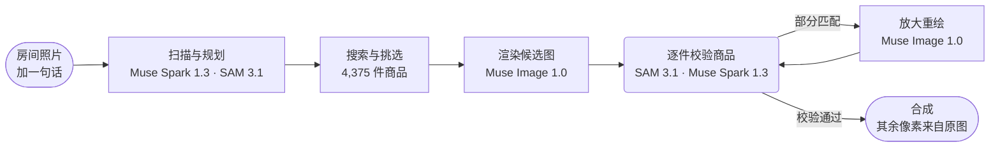

<p align="center">
  <a href="https://chanjoongx--realroom.us-east.modal.run">
    <picture>
      <source media="(prefers-color-scheme: dark)" srcset="../banner-dark.jpg">
      <source media="(prefers-color-scheme: light)" srcset="../banner-light.jpg">
      
    </picture>
  </a>
</p>

<h4 align="center">
  <a href="https://chanjoongx--realroom.us-east.modal.run">在线演示</a>
  &nbsp;·&nbsp;
  <a href="#how-a-run-works">工作原理</a>
  &nbsp;·&nbsp;
  <a href="#demo-rooms">演示房间</a>
  &nbsp;·&nbsp;
  <a href="#run-it">运行方法</a>
  &nbsp;·&nbsp;
  <a href="#use-your-own-catalog">自有商品目录</a>
</h4>

<p align="center">
  <a href="https://cerebralvalley.ai/e/meta-ai-developer-hackathon"></a>
  <a href="#meta-models"></a>
  <a href="#meta-models"></a>
  <a href="#meta-models"></a>
  <a href="#meta-models"></a>
  <a href="#meta-models"></a>
  <a href="../../LICENSE"></a>
</p>

<p align="center">
  <a href="../../README.md">English</a>
  &nbsp;·&nbsp; <a href="README.ko.md">한국어</a>
  &nbsp;·&nbsp; <b>简体中文</b>
  &nbsp;·&nbsp; <a href="README.ja.md">日本語</a>
  &nbsp;·&nbsp; <a href="README.es.md">Español</a>
  &nbsp;·&nbsp; <a href="README.pt-BR.md">Português</a>
  &nbsp;·&nbsp; <a href="README.fr.md">Français</a>
  &nbsp;·&nbsp; <a href="README.de.md">Deutsch</a>
  &nbsp;·&nbsp; <a href="README.ru.md">Русский</a>
  &nbsp;·&nbsp; <a href="README.hi.md">हिन्दी</a>
  &nbsp;·&nbsp; <a href="README.ar.md">العربية</a>
  &nbsp;·&nbsp; <a href="README.id.md">Bahasa Indonesia</a>
</p>

<p align="center"><sub>本文译自<a href="../../README.md">英文版 README</a>。两者如有出入，以英文版为准。</sub></p>

> [!NOTE]
> Realroom 是 [Meta Global AI Developer Hackathon](https://cerebralvalley.ai/e/meta-ai-developer-hackathon) Indie Developer 赛道的参赛作品，所选赛题为“Build for Your World”。智能体、Web 应用、商品目录索引和演示房间，全部是在 2026 年 10 月 27 日至 11 月 4 日的开发期内完成的。
>
> 在线版应用会回放三次录制好的运行，也会对上传的照片实时运行整个智能体，每天最多 40 次。在你自己的机器上，同一个应用不需要密钥就能回放这些运行，也可以用你自己的 Meta Model API 密钥实时运行。两种方式都写在[运行方法](#run-it)一节。

<p align="center">
  <picture>
    <source media="(prefers-color-scheme: dark)" srcset="../built-on-dark.png">
    <source media="(prefers-color-scheme: light)" srcset="../built-on-light.png">
    
  </picture>
</p>

<p align="center">
  <a href="https://chanjoongx--realroom.us-east.modal.run"></a>
  <br>
  <sub>客厅演示运行在应用中的回放：扫描、摆放引导图、校验，最后是前后对比滑块。</sub>
</p>

Realroom 是一个基于 Meta 模型构建的智能体。你给它一张房间照片，再用一句话说明你想要什么。它会读懂这个房间，规划要添加或替换哪些东西，从 4,375 件真实商品中搜索适合这个空间的单品，再把它们渲染进照片。然后它会检查自己的成果。SAM 3.1 在渲染图里重新找出每件商品，Muse Spark 1.3 把它和该商品的目录图做比较，哪里画得不对就重绘哪里。只有新加入的商品、它们的阴影和被清除的区域来自图像模型。其余部分全都从你的原始照片复制回来，页面还能让你在自己的浏览器里核对这部分像素的数量。

在线试用：[chanjoongx--realroom.us-east.modal.run](https://chanjoongx--realroom.us-east.modal.run)。演示房间回放的是录制好的运行，上传框则会对你自己的照片运行整个智能体。

## 为什么做这个

房间改造生成器能画出一间好看的房间，但里面的沙发你买不到，也没人确认过它靠墙放不放得下，生成器还会悄悄重画墙面、地板和窗外的景色。如果你是租房住，或者只是在挑一张沙发，这样的图就是答非所问。Realroom 保留你现有的房间，只改动你真正会买的东西。家具店可以接入自己的商品目录；演示用的是 Amazon Berkeley Objects，一个由真实 Amazon 商品条目组成的公开数据集。

## <a id="demo-rooms"></a>演示房间


演示房间是用 Muse Image 1.0 生成的，所以本仓库里没有任何私人照片。每一行对应一次录制的运行。表中的数字来自 [`demo-runs/`](../../demo-runs) 里该次运行自己的 `run.json` 和 `ledger.jsonl`。

| 房间 | 需求 | 商品 | 匹配 | 未改动像素 | 用时 | 费用 |
|---|---|---|---|---|---|---|
| 客厅，2005 年的公寓 | "The old dark sofa makes the room feel gloomy. Make it brighter and cozier without painting or touching the floor." | 沙发、地毯、落地灯 | 3/3，地毯经过一轮重绘 | 70.3% | 216&nbsp;s | $0.24 |
| 空房间，搬入当天 | "Move-in day. I work from home and want a calm living room where two friends can sit: something to sit on, a rug, a small table and warm evening light." | 沙发、地毯、落地灯、茶几、花盆 | 5/5，地毯经过两轮重绘，茶几经过一轮 | 63.3% | 288&nbsp;s | $0.37 |
| 开间，第一间公寓 | "...I still sleep on a mattress on the floor and the moving boxes are everywhere. Make it feel like a calm, grown-up bedroom without painting." | 床架、床品、地毯 | 3/3，地毯经过两轮重绘 | 70.7% | 244&nbsp;s | $0.30 |

“匹配”是 Muse Spark 1.3 把每件渲染商品的近景裁剪图与其目录图并排比较后给出的判定。费用是按 Meta 公布的价格估算的，每次调用单独记录。

## <a id="how-a-run-works"></a>一次运行的流程



| 步骤 | 模型 | 具体过程 |
|---|---|---|
| 扫描与规划 | Muse Spark 1.3、SAM 3.1 | 一次 Spark 请求返回受 schema 约束的 JSON：每个可移动物体及其边界框和处理决定（保留、移除或替换），固定结构，房间的尺寸和光线，以及一份槽位方案（类别、新增还是替换、目标框、以 cm 为单位的尺寸范围、外观、色系）。SAM 3.1 用概念提示把这些框变成精确的掩码，概念提示漏掉的物体则改用框提示。 |
| 搜索 | 商品目录索引、PE-Core B16 | 对每个槽位：先取该类别的商品，再只保留实际尺寸符合槽位尺寸范围的商品，然后按与 Muse Spark Open 所写描述的文本相似度（45%）和 Perception Encoder 的文本到图像相似度（55%）排序。每个槽位取 24 件。Perception Encoder 运行在应用自己的服务器上，所以这一步不发起任何 API 调用。 |
| 挑选 | Muse Spark 1.3 | Spark 在一次请求中同时看到房间和每个槽位各一张带编号的候选拼接图，因此选出的是一套彼此搭配的组合。 |
| 渲染 | Muse Image 1.0 | 一次 `/images/edits` 调用传入房间照片、摆放引导图和真实商品图片，返回两到三张候选图。模型的网页搜索和图片搜索工具都已关闭。 |
| 校验 | SAM 3.1、Muse Spark 1.3 | 每张候选图先与原图对齐（ECC 单应性配准），再做颜色匹配。SAM 3.1 重新找出每件新商品，Spark 对照目录图评判每件商品的裁剪图，并评判整个场景。保留最好的那张候选图。 |
| 修正 | Muse Image 1.0、SAM 3.1、Muse Spark 1.3 | 被判为 partial 的商品会连同周围区域一起裁出，对照目录图放大重绘，每轮尝试两次，最多两轮。只有 Spark 给出的分数更高时，新的尝试才会替换当前版本，Spark 的评语会指导下一轮。渲染后残留的杂物单独处理一遍，并用 SAM 3.1 检查。只要有改动，Spark 就会重新评判完成后的房间。 |
| 合成 | 无 | 结果只从渲染图中取商品掩码区域、掩码周围的一圈细边、接触阴影，以及被移除物体原先占据的区域。其余每个像素都来自原图。 |

Web 应用会根据事件日志回放每一次运行：带全部轮廓的扫描结果、搜索漏斗、挑选用的拼接图、所有候选渲染图、每次修正的前后对比，以及最终图层。每一步的标题栏都会显示这一步调用的模型 ID。


上图是客厅那次运行的校验步骤。Muse Image 画了三张候选图，Spark 给每张图里的三件商品都打了分，最后保留了 2 号候选图。这张图里的地毯得了 5 分（满分 10 分），于是进入修正步骤，修正后升到 9 分。

## <a id="meta-models"></a>Meta 模型

| 模型 | 接入方式 | 用途 |
|---|---|---|
| `muse-spark-1.3` | Meta Model API | 解读房间并做规划、挑选商品、评判每件商品和每个场景 |
| `sam-3.1` | Meta Model API | 房间物体和每件渲染商品的掩码、检查还剩下哪些杂物 |
| `muse-image-1.0` | Meta Model API | 候选渲染图、重绘、清除杂物、演示房间 |
| Muse Spark Open | Baseten、Fireworks | 整个商品目录的标签和描述 |
| `pe-core-b16-224` | 开放权重，运行在应用自己的服务器上（Modal 或你自己的机器） | Perception Encoder：把每个槽位的外观与目录图进行匹配 |

## 你可以核对什么

- `before.png` 和 `after.png` 都是无损的。在应用里，**Check it in your browser** 会下载这两张图，在你的浏览器中逐像素比较，然后显示完全相同的像素所占的比例。
- `layers.png` 把每个改动过的像素按商品、清除区域或阴影分别着色。`masks.npz` 保存了所有物体和商品的掩码。
- `ledger.jsonl` 列出每一次模型调用，以及它的时间和估算费用。Perception Encoder 搜索也记录在里面，费用为零，因为它运行在应用自己的服务器上。
- `drift.jpg` 显示原始渲染图在其余所有区域偏离原图的程度（演示运行中的平均色差 dE 为 1.7 到 3.7）。合成步骤就是为这些像素准备的。

## <a id="run-it"></a>运行方法

需要 Python 3.12，另外构建网页需要 Node 20 或更高版本。只需安装一次：

```bash
python -m venv .venv
.venv/bin/pip install torch==2.6.0 torchvision==0.21.0 --index-url https://download.pytorch.org/whl/cpu
.venv/bin/pip install -r backend/requirements.txt
(cd web && npm ci && npm run build)
```

在 Windows 上，把这些命令中的 `.venv/bin/` 换成 `.venv\Scripts\`。

### 回放录制的运行（无需密钥）

```bash
.venv/bin/python backend/scripts/serve_local.py
```

打开 http://127.0.0.1:8787 后，演示房间会像在线版一样，一步步回放 [`demo-runs/`](../../demo-runs) 中的运行。整个过程不调用任何模型。这些运行展示的商品图片放在 `demo-runs/_photos`，上传框会提示实时运行已关闭。

### 用你自己的 Meta Model API 密钥实时运行

1. 在仓库根目录下把 `.env.example` 复制为 `.env`，填入 `MODEL_API_KEY`。git 会忽略 `.env`。
2. 把全部 4,375 件商品的图片下载到 `data/photos`。它们是本仓库 GitHub Release 中一个约 730 MB 的文件。
   ```bash
   .venv/bin/python catalog/get_photos.py
   ```
3. 下载一次 Perception Encoder 权重（Hugging Face 上的 `timm/PE-Core-B-16`，约 1.8 GB）。如果跳过这一步，第一次实时搜索就要等待同样的下载。
   ```bash
   .venv/bin/python -c "import open_clip; open_clip.create_model_and_transforms('PE-Core-B-16', pretrained='meta')"
   ```
4. 加上 `--live` 启动服务器：
   ```bash
   .venv/bin/python backend/scripts/serve_local.py --live
   ```

`--live` 是回放和实时运行之间唯一的开关。加上它之后，上传框会对你的照片运行整个智能体，页面会随运行进度实时更新。按 Meta 公布的价格，一次运行大约 $0.2 到 $0.4，它的 `ledger.jsonl` 会列出每一次调用。本地服务器每天最多启动 10 次实时运行；用 `--per-day` 可以修改这个上限。

不用 Web 应用、直接对一张照片运行智能体：

```bash
.venv/bin/python backend/scripts/run_demo.py --room room.jpg --id my-room --brief "Warmer and less cluttered" \
    --mode refresh --slots 3 --catalog catalog/index --photos data/photos --out demo-runs/my-room
```

空房间请用 `--mode furnish`。`serve_local.py` 运行期间，完成的运行可以在 http://127.0.0.1:8787/r/my-room 回放。

### 重建商品目录或自行托管应用

要重建商品目录，先把 ABO 的商品条目和图片元数据下载到 `data/abo/`，再执行[商品目录](#the-catalog)一节中的步骤。Modal 上的步骤需要 Modal 账号；打标签还需要把 `BASETEN_API_KEY` 和 `FIREWORKS_API_KEY` 放进名为 `realroom-keys` 的 Modal Secret。

在线版部署在 Modal 上（`backend/modal_app.py`）：一个 Web 容器，商品目录和运行记录放在两个卷上，最多同时进行三次实时运行，每天 40 次，每位访客三次，模型调用总额不超过 60 美元。上传的照片会在 24 小时内删除。

## <a id="the-catalog"></a>商品目录

[Amazon Berkeley Objects](https://amazon-berkeley-objects.s3.us-east-1.amazonaws.com/index.html)（ABO）是一个公开数据集，收录了带图片和尺寸的真实 Amazon 商品条目。`catalog/` 用它构建 Realroom 的商品目录：

1. `abo_catalog.py` 把 amazon.com 的商品条目分到 25 个类别（沙发、地毯、落地灯、挂画等），共匹配到 5,931 条。它把尺寸换算成厘米，去掉没有尺寸或尺寸不合理的条目，剩下 4,612 个候选。
2. `modal_catalog.py --step score` 和 `abo_choose.py` 为每件商品选一张参考图，优先选白底的干净抠图。
3. `modal_catalog.py --step fetch` 在 Modal 云端把这张图下载一次，并裁掉多余的边。
4. `modal_catalog.py --step tag` 把每张图片连同它的商品条目发给 Meta 的开放权重模型 **Muse Spark Open**，由 Baseten 提供服务（Fireworks 作为备用）。模型返回标题、颜色、材质、风格、外观描述、SAM 短语、渲染风险估计，以及这张图是否真的是所列商品。
5. `modal_catalog.py --step embed` 在 Modal 的 CPU 上用 Meta 的 Perception Encoder（PE-Core B16-224）为每张图片生成嵌入。
6. `abo_finalize.py` 写出 `catalog.jsonl`，共 4,375 件商品。它去掉了 104 件图片与所列商品不符的商品，以及 133 件在录制演示运行时还没有完成标签的商品。

在这 4,375 件商品中，Muse Spark Open 在 Baseten 上为 3,781 件打了标签，在 Fireworks 上为 594 件打了标签。标签保存在 [`catalog/index/catalog.jsonl`](../../catalog/index/catalog.jsonl) 中。仓库里只放了演示运行中展示的商品图片。完整图片集是 GitHub Release 中的一个文件（见[运行方法](#run-it)），上面的步骤也能从 ABO 重新构建它。

## <a id="use-your-own-catalog"></a>使用自己的商品目录

智能体本身并不依赖 ABO。它读取一个商品目录文件夹（`--catalog`），里面有 `catalog.jsonl` 和两个 Perception Encoder 文件；还读取一个图片文件夹（`--photos`），里面有每件商品的 `img/<id>.jpg` 和 `thumb/<id>.webp`。下面是 [`catalog/index/catalog.jsonl`](../../catalog/index/catalog.jsonl) 的第一行（有删减）：

```json
{
  "id": "B075QFCHM9",
  "kind": "bed",
  "name": "Rivet York Modern Extended Platform Queen Bed, 90.2\"L, Grey",
  "brand": "Rivet",
  "size_cm": {"w": 229.0, "d": 182.9, "h": 107.5},
  "url": "https://www.amazon.com/dp/B075QFCHM9",
  "cutout": true,
  "tag": {
    "title": "Light Grey Upholstered Platform Bed",
    "matches_listing": true,
    "colors": ["light grey", "white", "light brown"],
    "color_family": "grey",
    "materials": ["polyester", "fabric", "wood"],
    "style": ["modern", "minimal", "contemporary"],
    "render_risk": "low",
    "sam_phrase": "platform bed",
    "visual_description": "Low-profile light grey polyester platform bed with tall rectangular headboard, extended surround frame and tapered wood legs shown with white mattress."
  }
}
```

- `kind` 是 `backend/realroom/catalog.py` 里 `KINDS` 中的某个名称。方案用类别来描述每个槽位需要的商品。
- `size_cm` 是宽、深、高。商品只有符合槽位的尺寸范围，才会进入候选名单。
- `tag` 是 Muse Spark Open 在第 4 步写出的内容。文本搜索读取其中的标题、颜色、材质、风格和描述，SAM 3.1 根据 `sam_phrase` 在渲染图中找到对应商品，带有 `"matches_listing": false` 的商品永远不会被选作候选。没有标签时，智能体改用 `name` 和 `kind`。
- `cutout` 表示这张图里只有商品本身，背景是纯色。搜索时这类图片排名更高。
- `emb_pe_core_b16.npy` 按 `emb_pe_core_b16_ids.json` 的顺序，为每张商品图片保存一个 Perception Encoder 嵌入。两个文件都由第 5 步写出。没有它们时，搜索只按文本排序。

`catalog/` 中的脚本会从 ABO 构建这个文件夹。如果换成别的商品数据源，需要重写的是第 1 到 3 步，因为正是这几步把 ABO 商品条目转换成数据行和图片。然后用 `--catalog` 和 `--photos` 让 `serve_local.py` 或 `run_demo.py` 指向新的文件夹。

## 仓库结构

```text
backend/
  realroom/      the agent: scan.py, pick.py, render.py, verify.py, composite.py and pipeline.py,
                 catalog.py (search), meta.py (Meta Model API clients), server.py (API and site)
  scripts/       serve_local.py, run_demo.py, make_rooms.py (the demo rooms), pack_demo_photos.py
  modal_app.py   the hosted app on Modal
catalog/         the catalog build from ABO, steps 1 to 6, plus get_photos.py and pack_photos.py
  index/         catalog.jsonl (4,375 products) and the Perception Encoder embeddings
demo-runs/       the three recorded runs (run.json, ledger.jsonl, masks and images) and their product photos
web/             the React app (Vite): the home page, the run viewer and the pixel check
docs/            README images and translations
```

## 局限

- 细微的纹理对图像模型来说很难。一块带有淡淡交叉编织纹理的奶油色地毯，在有些渲染图里纹理太重，在另一些里又成了素面。修正循环能发现这个问题；如果没有哪次重绘得分更高，结果会标为“partial”，而不是把问题藏起来。
- 同一条需求每次运行得到的方案都不一样，因为 Spark 每次都会重新规划、重新挑选。
- 在被移除物体原来所在的位置，重绘的地板和原有地板之间可能会出现一条淡淡的接缝。
- 商品条目来自 2021 年发布的数据集，所以没有价格，部分商品链接也已经打不开了。
- Spark 给出的房间尺寸是根据门、床这类物体的尺寸估算的。它决定了搜索用的尺寸范围，但渲染图并不是测量结果。

## 致谢

- 商品图片和数据：**Amazon.com** 的 Amazon Berkeley Objects，采用 [CC BY 4.0](https://creativecommons.org/licenses/by/4.0/) 许可。数据集作者为 Matthieu Guillaumin、Thomas Dideriksen、Kenan Deng 和 Himanshu Arora（Amazon.com），以及 Jasmine Collins 和 Jitendra Malik（UC Berkeley）。改动：图片经过裁边和缩放，商品由 Muse Spark Open 打了标签，并由 Muse Image 1.0 重绘到房间照片中。Realroom 与 Amazon 没有隶属关系，也未获得 Amazon 的认可。
- 算力：Meta 提供的 Meta Model API 额度，以及黑客松推理合作伙伴 Baseten、Fireworks AI 和 Modal 提供的额度。
- Built with Muse Spark Open. 模型权重以 [Muse Model License](https://huggingface.co/meta-models/Muse-Spark-Open-816B-A42B) 发布，Realroom 通过 Baseten 和 Fireworks AI 调用该模型，为商品目录打标签。
- Meta FAIR 的 [Perception Encoder](https://github.com/facebookresearch/perception_models)（PE-Core B16-224），采用 Apache 2.0 许可，通过 [OpenCLIP](https://github.com/mlfoundations/open_clip) 从 `timm/PE-Core-B-16` 权重加载。
- Python 库：FastAPI（MIT）、Uvicorn（BSD-3-Clause）、NumPy 和 SciPy（BSD）、OpenCV（Apache 2.0）、Pillow（MIT-CMU）、scikit-image（BSD-3-Clause）、PyTorch 和 torchvision（BSD-3-Clause）、OpenCLIP（MIT）、timm（Apache 2.0）、Requests（Apache 2.0）、python-multipart（Apache 2.0）、Modal 客户端（Apache 2.0），以及 Meta 的 `meta-sam-parser`（SAM License）。OpenAI Python SDK（Apache 2.0）是 Meta 的 API 文档为 Meta Model API 示范使用的客户端；在这里它只与 api.meta.ai 通信。
- Web 库：React、Vite 和 Motion（MIT），Lucide 图标（ISC），以及 TypeScript（Apache 2.0）。
- 字体：Geist 和 Geist Mono（Vercel），以及 Instrument Serif，均采用 SIL Open Font License。
- 演示房间由 Muse Image 1.0 生成。

由 [Chanjoong Kim](https://github.com/chanjoongx) 开发。代码采用 MIT 许可，见 [LICENSE](../../LICENSE)。
